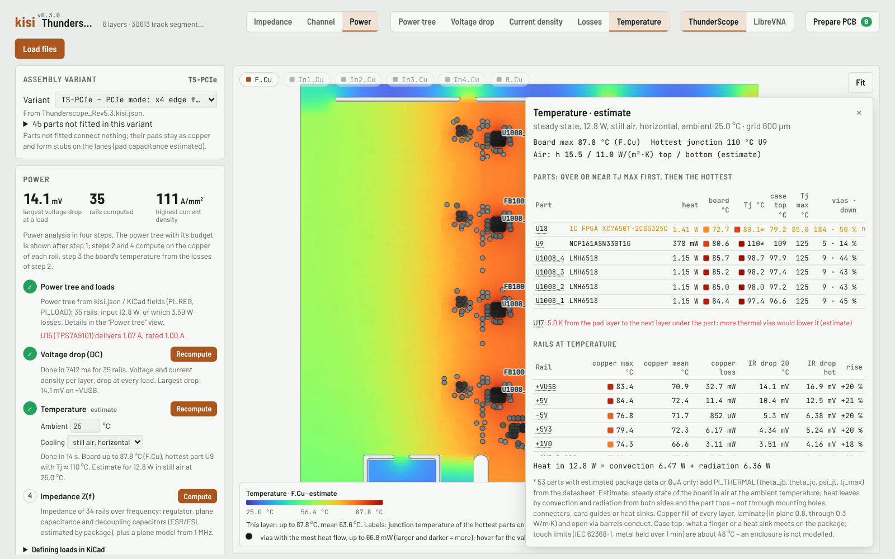
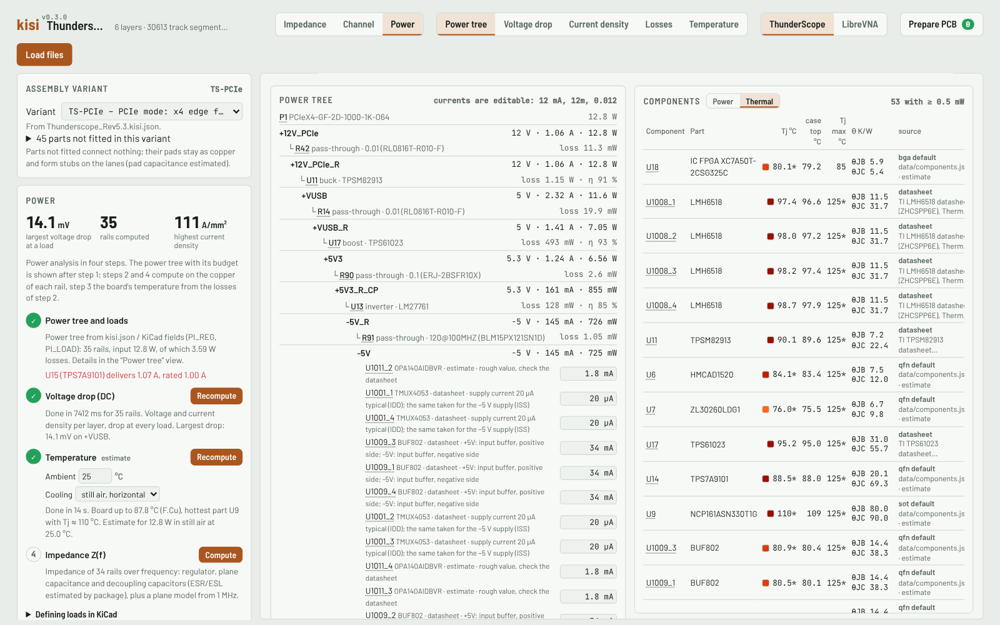

# kisi – quick signal and power integrity checks for KiCad

kisi reads a KiCad layout (`.kicad_pcb` + `.kicad_pro`) and checks trace impedance, high-speed channels
(loss, return loss, TDR, vias, crosstalk, skew, eye) and power delivery (regulator chain, DC IR drop,
PDN impedance, temperature estimate) – in the browser, with no installation and no setup beyond the board file.

**[Try it in your browser](https://riehlies.github.io/kisi/)** with two example boards, or open your own board
(it is processed locally and never uploaded).


> **Status.** kisi is a quick project, meant to be helpful: a fast check of a board without long setup times.
> Results are estimates for design checks, without any warranty of correctness – not a replacement for
> sign-off simulation or measurement. The individual tools – impedance map with a 2D field solver, TDR and loss
> per net, via model, crosstalk scan, power tree, IR drop, PDN per IC, temperature estimate – are useful on their
> own. kisi stays a fast linear checker – IBIS, AMI and equalisers are out of scope; for sign-off, export the
> channel to PyBERT or a circuit simulator ([why kisi is fast, and its scope](docs/models.md#why-kisi-is-small-and-fast)).

## What you get
- **Impedance:** every track against its target (from net class names such as `50Z`, `90Z_Diff`), with formulas
  in a second and the 2D field solver on demand; impedance along the path, loss, TDR, vias and crosstalk per net;
  every impedance and via result with its accuracy level (field solver, formula, estimate) and typical deviation.
- **Channel:** buses and device-to-device lanes through series resistors and AC-coupling capacitors, checked
  against interface profiles (PCIe, USB, DDR, LVDS, Ethernet, …) on loss, return loss, skew and a linear eye;
  differential pairs as 4-ports, multi-drop lines at every receiver, connectors with the channel behind them; a
  lane or a whole bus exported as SPICE subcircuits, Touchstone and a KiCad project for circuit simulators.
- **Preparation:** "Prepare PCB" is a checklist of what the board file lacks per category (impedance, channel,
  power): forms for the simple values, Apply per step, and `<board>.kisi.json` saved at the end; the kisi-prepare
  skill does the datasheet research.
- **Power:** the regulator chain and power flow from fields on the parts (`PI_REG`, `PI_LOAD`), DC voltage drop
  per rail and in the ground return, a losses map, a temperature estimate of the board and its parts, and the PDN
  impedance seen from every IC with recommendations.

<table>
<tr><td width="50%" valign="top"><br><b>Net detail:</b> impedance along the path, loss, TDR with the vias as physics-based models, skew of pairs and crosstalk from the neighbouring tracks – for every net with a target</td><td width="50%" valign="top"><br><b>Channel check:</b> buses and lanes from IC to IC or to a connector through series resistors and AC-coupling capacitors, judged against interface profiles on loss, return loss, skew and a linear eye – pairs as 4-ports with mode conversion, multi-drop lines per receiver (at a connector with the end and the channel behind it that you set)</td></tr>
<tr><td width="50%" valign="top"><br><b>Power flow:</b> from the supply inputs through every regulator to the loads, with regulator, shunt and copper losses</td><td width="50%" valign="top"><br><b>Voltage drop and PDN:</b> DC drop and current density on every layer of a rail, and its impedance seen from an IC with the decoupling capacitors ranked by loop inductance</td></tr>
<tr><td width="50%" valign="top"><br><b>Temperature (estimate):</b> the board's temperature per layer from the losses, the hottest parts with their junction temperature and the heat through the vias</td><td width="50%" valign="top"><br><b>Parts at temperature:</b> junction and case temperature against Tj max, with the thermal resistances used and where they come from (datasheet or package estimate)</td></tr>
</table>

## Quick start
- **Browser:** the [live version](https://riehlies.github.io/kisi/), or `kisi.html` from the
  [latest release](https://github.com/riehlies/kisi/releases/latest), offline. Drop the `.kicad_pcb` with the
  `.kicad_pro` (and `<board>.kisi.json` if there is one). KiCad 8, 9 and 10.
- **Command line** for scripts, CI and agents (Node.js ≥ 18; every command prints JSON):
  ```sh
  curl -fsSLO https://github.com/riehlies/kisi/releases/latest/download/kisi.mjs
  node kisi.mjs gaps   board.kicad_pcb     # what the analyses miss
  node kisi.mjs check  board.kicad_pcb     # channel check of all interfaces
  ```
- **Agents:** Claude Code `/plugin marketplace add riehlies/kisi` – the skills *kisi-prepare* (research missing
  data into `<board>.kisi.json`) and *kisi-si-pi-review*; other agents can follow the same `SKILL.md` files.

## Documentation
- [Getting started](docs/getting-started.md) – release files, the viewer's views, first commands
- [Preparing a board](docs/preparing-a-board.md) – the gap list, `<board>.kisi.json`, a worked example
- [Field and kisi.json reference](docs/reference.md) – net class names, `PI_*` fields, every kisi.json key
- [Models and limits](docs/models.md) – how kisi computes, accuracy, validation, estimates
- [CLI reference](docs/cli.md) – every command and option
- [Using kisi with agents](docs/agents.md) – skills and setup

All of it as one PDF: `kisi-docs.pdf` on every [release](https://github.com/riehlies/kisi/releases/latest).

## Limits
- The channel check is a first look: linear transmitter and receiver from the interface profile, no IBIS models,
  equalisation, jitter or noise.
- 2D cross-sections and reduced via and plane models instead of a full-board 3D solution.
- Validated against HFSS cases and kisi's own 3D FDTD references; validation against other solvers and
  measurements is still open. Data the board file lacks defaults to estimates until `<board>.kisi.json` fills
  it in. Details: [Models and limits](docs/models.md).

## Development
Build, checks and rules: [AGENTS.md](AGENTS.md) · structure: [ARCHITECTURE.md](ARCHITECTURE.md) · contributing:
[CONTRIBUTING.md](CONTRIBUTING.md) · planned work: [ROADMAP.md](ROADMAP.md) · field solver upstream:
[UPSTREAM.md](UPSTREAM.md).

## Related tools
- [js_2d_fields](https://github.com/Ttl/js_2d_fields) – Henrik Forstén's 2D field solver in the browser, used by kisi.
- [KiPI](https://github.com/drewsum/KiPI) – power integrity for KiCad (DC drop, PDN impedance, coupled noise).
- [padne](https://github.com/atx/padne) – DC voltage drop of KiCad boards with the finite element method.
- [openEMS](https://www.openems.de) – open 3D FDTD solver, for the cases where a reduced model is not enough.

## Credits
Field solver: [js_2d_fields](https://github.com/Ttl/js_2d_fields) by Henrik Forstén (GPL-3.0).
Example boards in `kisi-examples.html`: [ThunderScope](https://github.com/EEVengers/ThunderScope) Rev5.3 (EEVengers,
hardware under CERN-OHL-P-2.0) and [LibreVNA](https://github.com/jankae/LibreVNA) (Jan Käberich, GPL-3.0), shrunk to
what kisi reads; the licence texts are embedded with them.
Fonts: Barlow, Barlow Semi Condensed and JetBrains Mono (SIL Open Font License 1.1, `web/fonts/`), embedded in the viewer.

## About
kisi is a side project by David Riehl. It started as a visualisation tool for the course *Advanced PCB Design* at
TU Darmstadt and grew into a general check for KiCad boards. It was also an experiment in what current AI models
make possible: kisi was written with an AI coding assistant (Claude, Anthropic) – without it, a tool of this scope
would not have been possible as a side project. Commits made with AI help say so in their `Co-Authored-By` line.

Copyright © 2026 David Riehl and kisi contributors. Licence: GPL-3.0-only (`LICENSE`).
