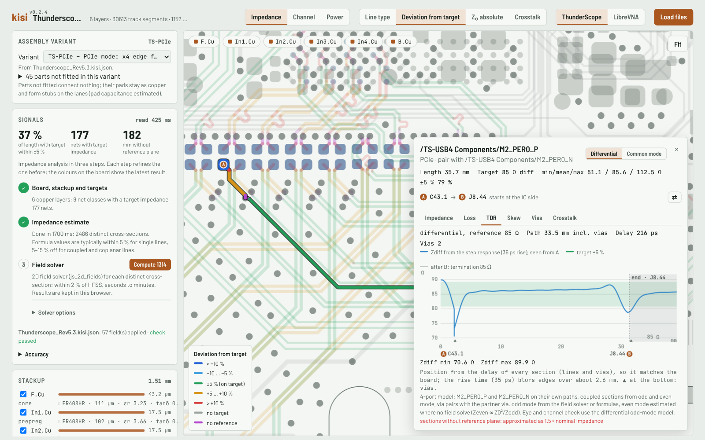
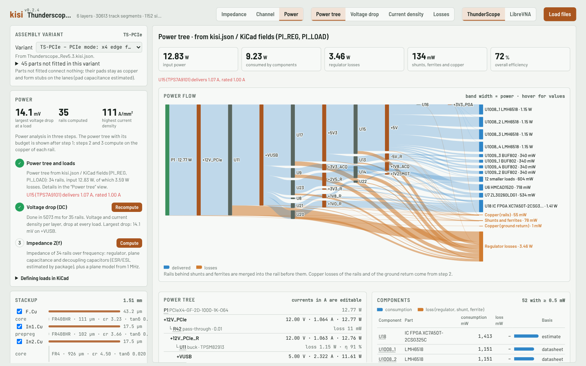

# kisi – quick signal and power integrity checks for KiCad

kisi reads a KiCad layout (`.kicad_pcb` + `.kicad_pro`) and checks trace impedance, high-speed channels
(loss, return loss, TDR, vias, crosstalk, skew, eye) and power delivery (regulator chain, DC IR drop,
PDN impedance) – in the browser, with no installation and no setup beyond the board file.

**[Try it in your browser](https://riehlies.github.io/kisi/)** with two example boards, or open your own board
(it is processed locally and never uploaded).


> **Status.** kisi is a quick project, meant to be helpful: a fast check of a board without long setup times.
> Results are estimates for design checks, without any warranty of correctness – not a replacement for
> sign-off simulation or measurement. For a real validation of a board, the channel simulation still needs IBIS
> models and more complex tests (see [Limits](#limits)). The individual tools – impedance map with a 2D field
> solver, TDR and loss per net, via model, crosstalk scan, power tree, IR drop, PDN per IC – are useful on their own.

## What you get
- **Impedance:** every track against its target (from net class names such as `50Z`, `90Z_Diff`), with formulas
  in a second and the 2D field solver on demand; impedance along the path, loss, TDR, vias and crosstalk per net.
- **Channel:** buses and device-to-device lanes through series resistors and AC-coupling capacitors, checked
  against interface profiles (PCIe, USB, DDR, LVDS, Ethernet, …).
- **Power:**
  - the regulator chain and power budget from fields on the parts (`PI_REG`, `PI_LOAD`), with the power flow from
    the inputs through the regulators to the loads and where the losses go;
  - DC voltage drop and current density on the copper of every rail and of the ground return, layer by layer, with
    the drop at each load and the vias that carry the most current;
  - a losses map (heat per part, copper loss per layer);
  - a temperature estimate from those losses: the board's temperature per copper layer in still air or an air
    flow, the junction temperature of every part with heat (datasheet θJB/θJC from `PI_THERMAL`, else package
    estimates) against its limit, and the IR drop with the copper at that temperature;
  - PDN impedance Z(f) per rail, and seen from every IC: the rail copper on all layers with ferrites and series
    parts up to the regulator, the loop inductance of each decoupling capacitor to that IC, anti-resonances, a target
    from the IC's current step and recommendations.

| | |
|---|---|
|  |  |
| **Net detail:** impedance along the path, loss, TDR with the vias as physics-based models, skew of pairs and crosstalk from the neighbouring tracks – for every net with a target | **Channel check:** buses and lanes from IC to IC or to a connector through series resistors and AC-coupling capacitors, judged against interface profiles on loss, return loss, skew and a linear eye (at a connector with the end and the channel behind it that you set) |
|  |  |
| **Power flow:** from the supply inputs through every regulator to the loads, with regulator, shunt and copper losses | **Voltage drop and PDN:** DC drop and current density on every layer of a rail, and its impedance seen from an IC with the decoupling capacitors ranked by loop inductance |

## Quick start
- **In the browser:** the [live version](https://riehlies.github.io/kisi/), or download `kisi.html` from the
  [latest release](https://github.com/riehlies/kisi/releases/latest) and open it offline. Drop the `.kicad_pcb`
  (with the `.kicad_pro` for net classes, optionally `<board>.kisi.json`). Nothing is installed, the page loads
  nothing else from the web and the board never leaves your computer. In Chromium-based browsers “Reload” reads the same
  files again after saving in KiCad. KiCad 8, 9 and 10 boards are supported.
- **`kisi-examples.html`** – the same viewer with two example boards built in (ThunderScope Rev5.3, LibreVNA), each
  with its power tree as a `kisi.json` (`web/samples/`).
- **`kisi-references.html`** – 3D reference cases for vias, stubs, pairs, lines and plane cavities with field plots,
  and kisi's fast models against them. Useful for teaching as well: it shows why vias and planes behave as they do.
- **`kisi.mjs` – the command line** for scripts, CI and agents (Node.js ≥ 18):
  ```sh
  curl -fsSLO https://github.com/riehlies/kisi/releases/latest/download/kisi.mjs
  node kisi.mjs help
  node kisi.mjs gaps   board.kicad_pcb     # what the analyses miss
  node kisi.mjs check  board.kicad_pcb     # channel check of all interfaces
  ```
  Every command prints JSON and states the models and assumptions it used.
- **Agent skills** (`claude-plugin/`, Claude Code: `/plugin marketplace add riehlies/kisi`): *kisi-prepare*
  finds missing data and researches it from datasheets into `<board>.kisi.json`; *kisi-si-pi-review* runs the checks.
  Other agents can follow the same `SKILL.md` files.

## Viewer
Three views, each starting with what the board file gives and computing more on demand:
1. **Impedance** – stackup and target impedances first; “Estimate impedances” (formulas), then the 2D field solver
   (selected net, a class, all nets with a target, or everything; results cached in the browser). Per net:
   impedance along the path, loss, TDR, vias, crosstalk. The estimate also gives NEXT/FEXT for every net with a target
   (Couplings card with the critical nets from 1 %, map mode “Crosstalk” marks the critical stretches); the field
   solver refines only the critical couplings (on by default); per net a chart shows where along the path the
   crosstalk comes from. The path runs from A to B (marked on the board and under
   the charts; A is the transmitter side of the lane or the IC, ⇄ swaps it); branches are marked where they leave
   the path and included in loss and TDR as open stubs; hovering a chart shows the position on the board.
2. **Channel** – interfaces overview: buses and device-to-device lanes through series resistors and AC-coupling
   capacitors, with terminations, branches and side stubs; per net class an interface profile (PCIe, USB, DDR,
   LVDS, … from `data/interfaces.json`) with transmitter, receiver and limits. Lanes ending at a connector (also connector to
   connector: coupons, pass-through boards) are judged on the board share (loss, return loss, skew); their eye uses the end set per connector in the interface's
   card – termination when the connector receives, driver when it sends (the profile's, matched, high impedance or
   custom R/C) – and, if
   given, the channel behind the connector as a lossy line (loss at Nyquist) or a Touchstone file (.s2p, .s4p);
   without it the eye covers the board share only and is information, with it the eye is judged. Parts from a lane's net to ground (a shunt capacitor) are in its channel at their pads. Boards with assembly variants (KiCad 10
   variants or `variants` in `kisi.json`) – or with forks where all alternative parts are fitted – ask “Which
   assembly variant?” before lanes are computed; the card “Assembly variant” switches later (stored in the
   browser, over the `kisi.json` choice) and the lane results name the variant. A lane is named after and made of
   its own path; where a line forks with all alternatives fitted, each lane leaves the IC on its own branch and
   carries the other path as an open branch (dashed on the board). The board map shows the channels of the chosen
   variant (before the check in one colour, after it by result); nets that only connect parts not fitted are drawn
   faint and not checked. A click on a channel in the map opens it.
3. **Power** – power tree, budget and power flow (Sankey) first, from `PI_REG` / `PI_LOAD` fields or the board's
   `kisi.json`; part references jump to the board. Then, per rail and for the ground return, voltage drop and
   current density on every layer (drop at each load, vias with the highest currents), a losses map (heat per part
   and copper loss per layer, mW/mm²), the temperature (step 3, an estimate for an ambient temperature and still air
   or an air flow: map per layer, the hottest parts with their junction temperature, the rails' IR drop at
   temperature) and Z(f): a lumped model of regulator, plane and capacitors with a plane
   model above 1 MHz, and the impedance seen from each IC – the rail domain with ferrites and series parts up to
   the regulator, the capacitors ranked by their loop inductance to the IC (outlined on the board),
   anti-resonances, a target from the IC's current step and recommendations (value, package, count, distance).

Stackup (εr, tanδ, thickness) and profiles can be edited in the viewer; edits are stored in the browser, the
files are not changed. Results of the last three boards stay in memory while switching.

## Command line
`node kisi.mjs <command> <board.kicad_pcb> [options]`

| Command | Result |
|---|---|
| `overview` | stackup, impedance per net class (share within ±5 %, worst nets) |
| `interfaces` | buses and device-to-device lanes with their profiles |
| `net <NET>` | path (start, end, branches), impedance along it, loss, TDR, vias, crosstalk; `--s2p FILE` writes Touchstone |
| `check` | channel check against the profiles (`--class CLASS=PROFILE`, `--nets A,B`, `--all`) |
| `crosstalk` | coupling scan of all nets with a target, critical from 1 % (`--nets A,B`, `--all` for every row); the field solver refines the critical couplings |
| `power` | regulator chain, budget, DC IR drop per rail and in the ground return, losses per part / rail / layer, power flow (`--pdn RAIL` adds Z(f)) |
| `thermal` | temperature estimate from the losses: board temperature per layer, hot spots, junction and case-top temperature per part against Tj max, heat through the vias and under each hot part (with a hint when thermal vias look short), copper temperature and IR drop at temperature per rail (`--ambient °C`, `--airflow m/s`, `--vertical`, `--h W/m²K`) |
| `report` | everything into `analysis/kisi.json` next to the board |
| `gaps` | missing or default data, where to find it, how to write it into `<board>.kisi.json` |
| `config-check`, `config-template` | check / start a `<board>.kisi.json` (the template suggests variants from forks) |
| `profiles [ID]` | the interface profiles |

`--variant NAME` chooses the assembly variant (a KiCad 10 variant of the board or one of the `kisi.json` variants;
`default` = the board file as it is), over `"variant"` in `<board>.kisi.json`. When a board has variants – or forks
where all alternative series parts are fitted – and none is chosen, `interfaces`, `check` and `report` stop with
the list of variants (exit code 1) and `gaps` reports it; the other commands do not depend on the fitted parts.

`overview`, `net`, `check`, `crosstalk` and `report` run the field solver for the cross-sections of nets with a target, the most
routed length first, within `--field-time` seconds (default 120). Results are cached
(`~/.cache/kisi`, Windows `%LOCALAPPDATA%\kisi`), so later runs are fast; `field_solver` in the output shows the
coverage, `--formula` skips the solver. A native build (`cargo install --path crates/kisi-cli`) accepts the same
commands with formula impedances only.

## Information kisi takes from KiCad
- **Target impedance** from net class names: `50Z`, `90Z_Diff`, `100Z_Diff`, … (or `<board>.kisi.json`).
- **Interface profile** automatically from net and class names (rules in `data/interfaces.json`), or per class.
- **Population:** DNP and “exclude from BOM” attributes, the sheet of every part, KiCad 10 assembly variants
  (variant list and per-part overrides: DNP, BOM, field values).
- **Part numbers:** an MPN field (`MPN`, `Manufacturer Part Number`, …) where the Value field does not show the
  part number – in `kisi gaps`, `kisi interfaces` and the power tree.
- **Supply rails:** a voltage in the net name, the rails named in the power fields, and – for `kisi gaps` –
  supply-like net and pin names (VBUS, VSYS, VBAT, VCC, VDD, …), which then need a voltage (`NAME@<V>V`).
- **Power** – fields on the symbol, copied to the footprint on “Update PCB from schematic”:

| Field | Example | Meaning |
|---|---|---|
| `PI_REG` | `+12V input` | supply input (connector) |
| | `+12V > +5V buck 90% 3A out=L3` | switching regulator: efficiency (without one kisi assumes 85 %, marked as an estimate), rated current, part carrying the output |
| | `+5V > +3V3 ldo iq=2mA 1A` | linear regulator with quiescent current |
| | `+3V3 > +3V3A pass r=0.05` | ferrite or shunt with series resistance (Ω) |
| | `+5V > VCORE@0.9V buck 85% id=U4A` | rail without a voltage in its name; several channels of one IC with `;` |
| | `+3V3 > "/Sensors/IMU VDD" pass r=0.5` | net name with spaces (hierarchical name) in double quotes, also `"/Power/VDD CORE"@0.9V` |
| `PI_LOAD` | `+1V0=2.5A, +1V8=300mA` or `+1V0=2W` | load current per rail |
| | `+5V=60mA@L32/L33` | current entering at other parts' pads (e.g. the inductors of an output stage) |
| | `"/Sensors/IMU VDD"=0.9mA` | net name with spaces in double quotes |
| `PI_SOURCE` | `+3V3` | source pads for the IR drop when there is no regulator chain |
| `PI_CAP` | `esr=5m esl=0.45n rated=6.3V X5R c@3.3V=2.1u` | decoupling capacitor data for the PDN (datasheet values; replaces the package estimates and the DC-bias curve) |
| `PI_SERIES` | `z100=600 rdc=0.15` · `l=2.2u dcr=50m` · `r=10m` | ferrite bead, inductor or resistor in a supply path: the PDN per IC models the rail with the nets behind them, up to the regulators (replaces the typical values) |
| `PI_TARGET` | `VCCINT=10m fmax=50M` or `15mOhm` | target impedance of an IC for a rail (default: from its own current step), band it applies to |
| `PI_THERMAL` | `theta_jb=17.4 theta_jc=53.6 psi_jt=1.1 tj_max=125` | thermal data of a part from its datasheet's Thermal Information table (K/W, °C) for the temperature estimate; `psi_jb=…` when there is no θJB, `psi_jt` for the case top, `theta_ja=…` only as a fallback (JEDEC test board), `p=0.2W` for the heat that stays in the part (replaces the power tree's value, e.g. a connector passing power on) |

  The nominal voltage comes from the net name (`+3V3`, `1V8`, `-5V`), else from `NAME@<V>V` in a `PI_REG` entry.
  Net names are written as in KiCad, or as the last part of a hierarchical name (`IMU_VDD` for
  `/Sensors/IMU_VDD`) when that is unique on the board. A name with spaces or one of `; , = @ >` goes in double
  quotes (`PI_REG`, `PI_LOAD`, `PI_SOURCE`, `PI_TARGET`); in `<board>.kisi.json` they are escaped as `\"`.

## Board configuration `<board>.kisi.json`
Values the board file lacks or holds only as KiCad defaults, each with its source. kisi never writes into the
KiCad files; CLI and viewer lay this file over the board.
```json
{
  "kisi_config": 1,
  "board": "board.kicad_pcb",
  "stackup": {"dielectrics": [{"index": 0, "epsilon_r": 3.65, "loss_tangent": 0.0095,
                               "source": {"kind": "datasheet", "document": "Isola FR408HR", "page": "2", "note": "10 GHz, typical"}}]},
  "net_classes": {"PCIe": {"target_ohm": 85, "diff": true, "profile": "pcie3", "source": {"kind": "standard", "document": "PCIe CEM 3.0"}}},
  "fields": [{"ref": "U5", "name": "PI_LOAD", "value": "+1V0=2.5A", "source": {"kind": "datasheet", "url": "…", "note": "maximum"}}],
  "variant": "TS-PCIe",
  "variants": {
    "TS-PCIe": {"description": "PCIe card", "not_fitted_sheets": ["/TS-USB4 Components/"], "fitted": ["C101", "C102", "C128"],
                "source": {"kind": "design", "document": "TS-PCIe_MP_BOM.csv"}},
    "TS-USB4": {"bom": "TS-USB4_MP_BOM.csv", "bom_exceptions": ["TP*"], "source": {"kind": "design", "document": "TS-USB4_MP_BOM.csv"}}
  }
}
```
- `stackup`: εr, tanδ, thickness, material per dielectric (index 0 = below F.Cu), solder mask εr.
- `net_classes`: target impedance and profile of existing net classes. `connector_ends`: per connector where lanes
  leave the board (`"P1": {"model": "profile" | "matched" | "high_impedance" | "custom", "r_ohm", "c_pf",
  "rest_loss_db", "rest_delay_ps", "source"}`) – the termination (connector receives) or driver (connector sends)
  there, and the channel behind it as a lossy line (loss in dB at the profile's Nyquist frequency) or a Touchstone
  file (`"touchstone": {"file": "cable.s4p", "port_order": "1-3,2-4" | "1-2,3-4", "flip": false}`; `.s2p` for
  single-ended lanes or on each line of a pair, `.s4p` of a pair reduced to the differential mode; path relative to
  the kisi.json) – with a channel behind the connector the eye is judged. In the viewer: the interface's card in the
  channel overview (Touchstone files are loaded there or dropped with the board and stay in memory). `fields`: footprint fields (`PI_LOAD`, `PI_REG`, `PI_SOURCE`, `PI_CAP`, `PI_TARGET`, `PI_SERIES`, `PI_THERMAL`).
- `variant`: the assembly variant to analyse – a KiCad 10 variant of the board, one of `variants`, or `default`
  (the board file as it is). `variants`: which parts are fitted, for boards without KiCad 10 variants (or on top of
  one of the same name). Rules in this order, later ones win: the board file (DNP, KiCad 10 overrides), `bom` (a CSV
  next to the kisi.json with a “Reference”/“Designator” column: parts not in it are not fitted, except parts marked
  “exclude from BOM” in KiCad and `bom_exceptions`), `fitted_sheets` / `not_fitted_sheets` (a sheet covers its
  sub-sheets, the most specific one wins), `fitted` / `not_fitted` (references, `*` and `?` allowed). A part that is
  not fitted connects nothing; its pads stay as copper and become stubs on the lanes, and nets that only connect
  parts not fitted are not checked (`check` names how many). In the viewer, drop the BOMs
  together with the board and the kisi.json.
- Source kinds: datasheet, standard, application_note, measurement, simulation, design (the project's own BOM,
  position or schematic files), estimate, assumption.
- Precedence: board file < kisi.json < edits in the viewer / `--class` and `--variant` on the command line.

## Models and accuracy
- **Impedance:** formulas (Hammerstad-Jensen, Wheeler, Wadell CPWG, IPC-2141) and the quasi-static 2D field solver
  js_2d_fields by Henrik Forstén (unmodified, see `UPSTREAM.md`; linear solver in Rust, `crates/kisi-sparse`).
  Cross-sections along every line with reference planes (also across gaps), coplanar ground and diff partner.
  Field solver against HFSS/Ansys: ≤ 1.7 %.
- **Lines:** RLGC per cross-section; skin effect (Wheeler), roughness (Huray, presets estimated), dielectric loss
  (Djordjevic-Sarkar); RLGC against HFSS ≤ 2 %. Channel as ABCD cascade (odd mode for pairs), TDR from S11.
- **Vias:** a physics-based ladder per via: capacitances from an axisymmetric Laplace solve, the plane pairs as
  radial lines with the nearby return vias, pads and annular rings, antipads from the zone fills (non-round ones as
  an equivalent circle), stubs and back-drill, the junction to the traces; pairs with their partner. Vias that do
  not cross a plane are coaxial sections. An estimate, not a 3D result.
- **Lanes:** series parts and terminations with package parasitics from `data/components.json` (estimates); the
  transmit direction is a guess (termination next to the receiver) and can be swapped. Copper of a lane net that
  leaves the path is an open side stub: to unused pads and test points, to the pads of parts that are not fitted
  (with their pad capacitance, an estimate), and – when all alternatives of a fork are fitted – through the other
  part to the other device. A stub hangs on the side of a via that matches its layer.
- **Eye:** PRBS7 NRZ with the profile's linear transmitter/receiver; no equalisation, jitter or noise.
- **Power:** copper rasterised per layer, vias as barrels (25 µm); DC IR drop per rail. PDN per IC: the rail's
  copper on all layers as an AC grid with plane capacitance, capacitors with ESR/ESL and DC-bias derating
  (estimated per package unless given), series parts up to the regulators.
- **Ground return and losses:** every part returns what it draws from the supply rails minus what it feeds into
  them (a buck converter takes current from ground); ground is solved like a rail with the supply input as 0 V.
  The power a load draws is counted as heat in the part (estimate), regulator losses on the regulator; copper
  loss is I²R from the DC solutions.
- **Temperature (estimate):** steady state of the board in air. One sheet per copper layer on a grid over the board
  outline (copper fill of every net, laminate in plane 0.8 and through the thickness 0.3 W/m·K, open via barrels),
  natural or forced convection (flat-plate correlations) and radiation from both sides; heat from the copper loss of
  every cell and the parts. A part is a junction node with θJB to the board under its pads and θJC to its top (JEDEC
  two-resistor model), with values from `PI_THERMAL` or package defaults by family and size (`data/components.json`,
  estimates); the case top from ψJT or that model. Per via the heat through its barrel; per hot part the split of its
  heat into vias, laminate and the pad layer. Not included: heat sinks, conduction into mounting holes, connectors or
  card guides, the enclosure (a device in a closed case runs hotter inside: emulate it with the case temperature as
  `--ambient` and the inner coupling as `--h`), the split of a regulator's loss between IC and inductor, transients. The IR drop at temperature solves the rails again
  with ρ(T) = ρ₂₀(1 + 0.393 %/K·(T − 20 °C)). Concept, physics and validation: `docs/research/thermal.md`.

### Validation
- The 2D field solver and the line models were compared with the HFSS/Ansys cases of Forstén's test suite
  (impedance within 1.7 %, RLGC within 2 %; `tools/validate_field.sh`).
- The via and plane models were compared with 3D results of kisi's own FDTD solver (`crates/kisi-fdtd`, checked
  against openEMS and analytic cavities); see `kisi-references.html` and `validation/fdtd/TESTS.md`.
- The temperature solver against analytic cases (1D slab exact, fin within 0.2 %, radial spreading in a plane with
  convection within 0.13 %, energy balance) and, with the datasheets' θJB/θJC on a model of the JEDEC JESD51-7 board,
  against their θJA (QFN-16 +4 %, SOIC-8 −15 %, SOT-23-5 −20 %); `docs/research/thermal.md`.
- **Still open:** validation against other solvers and against measurements (a test board is planned,
  `validation/test_board.md`). Until then, treat the numbers as plausible estimates, not as verified results.

### Limits
- The channel check is a first look: linear transmitter and receiver from the interface profile, no IBIS models,
  no equalisation, jitter or noise, no simulation of several aggressors at once. A real channel validation needs
  IBIS (or AMI) models and more complex tests.
- 2D cross-sections and reduced via/plane models instead of a full-board 3D solution; board edges, via-to-via
  coupling and resonances of the whole board are not included.
- Data the board file does not hold (laminate εr/tanδ, load currents, capacitor data) defaults to estimates;
  `kisi gaps` lists what is missing and `<board>.kisi.json` fills it in with sources.

## Development
```sh
cargo build --release                                                    # native CLI, kisi-validate
cargo build --release -p kisi-wasm -p kisi-sparse --target wasm32-unknown-unknown
W=target/wasm32-unknown-unknown/release
python3 tools/bundle.py web/index.html $W/kisi_wasm.wasm $W/kisi_sparse.wasm dist/kisi.html
sh tools/fetch_examples.sh examples                                     # example boards (optional)
python3 tools/bundle.py web/index.html $W/kisi_wasm.wasm $W/kisi_sparse.wasm dist/kisi-examples.html \
        ts "ThunderScope Rev5.3" examples/Thunderscope_Rev5.3.kicad_pcb examples/Thunderscope_Rev5.3.kicad_pro \
        vna LibreVNA examples/VNA.kicad_pcb examples/VNA.kicad_pro
python3 tools/bundle_cli.py $W/kisi_wasm.wasm $W/kisi_sparse.wasm dist/kisi.mjs
```
- Checks (all of them run in CI on every push and pull request, `.github/workflows/ci.yml`; locally the quick ones
  for what you changed, see `AGENTS.md`): `cargo test --release`,
  `sh tools/validate_field.sh` (field solver against HFSS and the stored baseline),
  `python3 tools/check_viewer.py dist/kisi-examples.html` (all views, light/dark/phone, no console errors),
  `python3 tools/compare_cli.py target/release/kisi dist/kisi.mjs examples` (Node CLI against the native CLI).
- Example boards (not in the repository): `sh tools/fetch_examples.sh examples` fetches them at fixed commits, shrinks
  them with `tools/strip_pcb.py` and writes their licence notices; their power trees are `web/samples/{ts,vna}.kisi.json`.
- Releases: a tag `v*` runs `.github/workflows/release.yml`; it attaches `kisi.html`, `kisi-examples.html`, `kisi.mjs`
  and `kisi-references.html` and publishes the live version on GitHub Pages.
- Contributing: `CONTRIBUTING.md`; notes for coding agents: `AGENTS.md`.
- Solver update: `tools/upstream_update.sh` (see `UPSTREAM.md`). Structure and rules: `ARCHITECTURE.md`.
  Planned work: `ROADMAP.md`.
- Validation data: `validation/*.json` (cross-sections) and `*.ref.json` (references from Forstén's solver, run in
  Node with `tools/forsten_sparse_shim.js`); `kisi-validate validation/forsten_suite.json` compares against the
  HFSS/Ansys cases of Forstén's test suite.

## Related tools
- [js_2d_fields](https://github.com/Ttl/js_2d_fields) – Henrik Forstén's 2D field solver in the browser, used by kisi.
- [KiPI](https://github.com/drewsum/KiPI) – power integrity for KiCad (DC drop, PDN impedance, coupled noise).
- [padne](https://github.com/atx/padne) – DC voltage drop of KiCad boards with the finite element method.
- [openEMS](https://www.openems.de) – open 3D FDTD solver, for the cases where a reduced model is not enough.

## Credits
Field solver: [js_2d_fields](https://github.com/Ttl/js_2d_fields) by Henrik Forstén (GPL-3.0).
Example boards in `kisi-examples.html`: [ThunderScope](https://github.com/EEVengers/ThunderScope) Rev5.3 (EEVengers,
hardware under CERN-OHL-P-2.0) and [LibreVNA](https://github.com/jankae/LibreVNA) (Jan Käberich, GPL-3.0), shrunk to
what kisi reads; the licence texts are embedded with them.
Fonts: Barlow, Barlow Semi Condensed and JetBrains Mono (SIL Open Font License 1.1, `web/fonts/`), embedded in the viewer.

## About
kisi is a side project by David Riehl. It started as a visualisation tool for the course *Advanced PCB Design* at
TU Darmstadt and grew into a general check for KiCad boards. It was also an experiment in what current AI models
make possible: kisi was written with an AI coding assistant (Claude, Anthropic) – without it, a tool of this scope
would not have been possible as a side project. Commits made with AI help say so in their `Co-Authored-By` line.

Copyright © 2026 David Riehl and kisi contributors. Licence: GPL-3.0-only (`LICENSE`).
