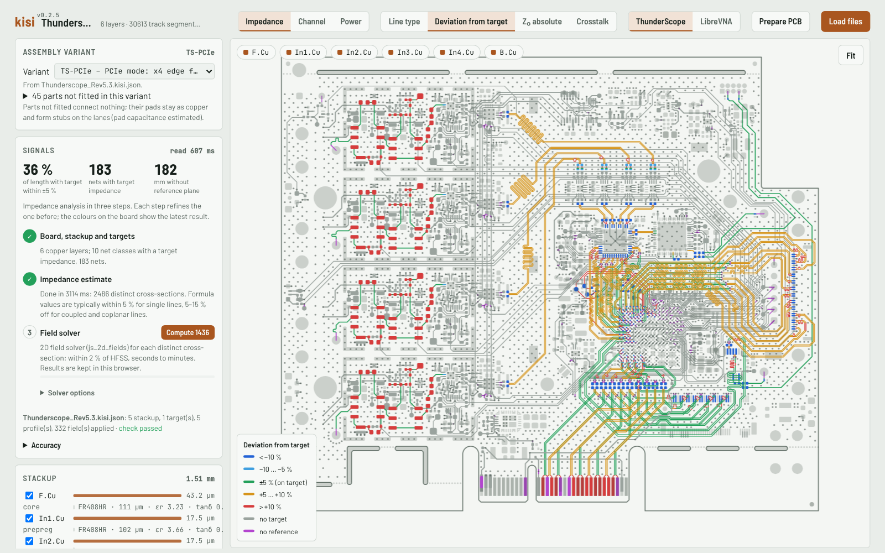
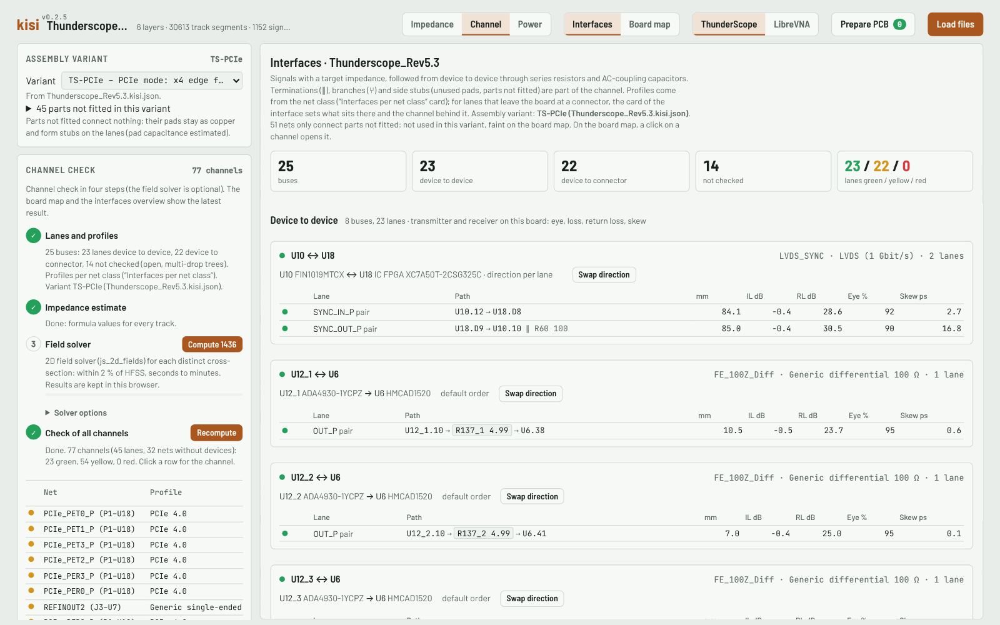
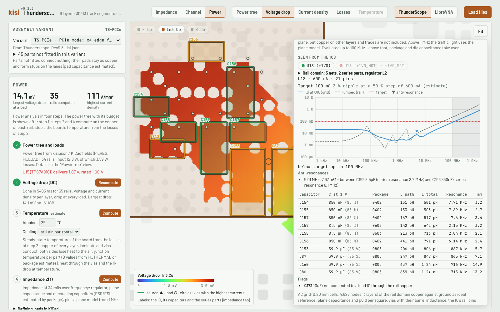

# Getting started

kisi reads a KiCad layout and checks trace impedance, high-speed channels and power delivery. It runs in the
browser (the viewer) or on the command line; both use the same engine and give the same results.

## What you need
- The board file `.kicad_pcb` (KiCad 8, 9 or 10), saved.
- The project file `.kicad_pro` next to it, for the net classes (target impedances and interface profiles come
  from them).
- Optionally `<board>.kisi.json`: the values the board file lacks (laminate data, load currents, …) with their
  sources – see [Preparing a board](preparing-a-board.md). Assembly variants may name BOM files, connector ends
  Touchstone files; drop or keep them next to it.

## The files of a release
Every [release](https://github.com/riehlies/kisi/releases/latest) carries:

| File | What it is |
|---|---|
| `kisi.html` | the viewer: one HTML file that runs offline in any current browser |
| `kisi-examples.html` | the same viewer with two example boards built in – ThunderScope Rev5.3 and LibreVNA – each with its power tree as a kisi.json |
| `kisi.mjs` | the command line for scripts, CI and agents (Node.js ≥ 18), with the 2D field solver |
| `kisi-docs.pdf` | this documentation as one PDF |
| `kisi-references.html` | 3D reference cases for vias, stubs, pairs, lines and plane cavities with field plots, and kisi's fast models against them (attached to the releases in which the cases changed, currently [v0.2.4](https://github.com/riehlies/kisi/releases/tag/v0.2.4)) |

The [live version](https://riehlies.github.io/kisi/) serves the viewer and the example viewer from GitHub Pages.

## The viewer
Open `kisi.html` (or the live version) and drop the `.kicad_pcb` with the `.kicad_pro` – and the board's
`kisi.json`, BOMs and Touchstone files if there are any – onto the page, or pick them with the file dialog.
Nothing is installed, the page loads nothing from the web, and the board never leaves your computer. In
Chromium-based browsers "Reload" reads the same files again after saving in KiCad.

The header switches between three views. Each starts with what the board file gives and computes more on demand,
in numbered steps.

### 1. Impedance


Stackup and target impedances first. "Estimate impedances" computes formula values for every track in a second,
then the 2D field solver refines them – for the selected net, a class, all nets with a target, or everything;
results are cached in the browser. The map colours every track by its deviation from the target.

Per net: impedance along the path, loss, TDR, vias and crosstalk. The path runs from A to B (marked on the board
and under the charts; A is the transmitter side of the lane or the IC, ⇄ swaps it). Branches are marked where
they leave the path and included in loss and TDR as open stubs; hovering a chart shows the position on the board.

The estimate also gives NEXT/FEXT for every net with a target: the Couplings card lists the critical nets (from
1 %), the map mode "Crosstalk" marks the critical stretches, and per net a chart shows where along the path the
crosstalk comes from. The field solver refines only the critical couplings (on by default).

### 2. Channel


The interfaces overview: buses and device-to-device lanes through series resistors and AC-coupling capacitors,
with terminations, branches and side stubs. Each net class gets an interface profile (PCIe, USB, DDR, LVDS,
Ethernet, HDMI, MIPI, … from `data/interfaces.json`) with transmitter, receiver and limits; the "Profile" card
shows and edits it. The check judges every lane on loss, return loss, skew, via stubs and a linear eye.

- A **differential pair** is a 4-port: both lines on their own paths with their own parts, stubs and vias, coupled
  where they run together. Loss and return loss are Sdd21/Sdd11, the eye drives P and N in opposite phase, and the
  mode conversion (Scd21) is shown.
- A **multi-drop line** along one path (one transmitter, more devices on side stubs) is checked at every receiver,
  all loading the line; the worst eye counts.
- **Lanes from a device to a connector** are judged on the board share (loss, return loss, skew). Their eye uses
  the end set in the interface's card – the termination when the connector receives, the driver when it sends –
  and, if given, the channel behind the connector as a lossy line or a Touchstone file (`.s2p`, `.s4p`). Without
  it the eye covers the board share only and is information; with it the eye is judged. Lanes from connector to
  connector (coupons, pass-through boards) get the board share only, without an eye.
- Parts from a lane's net to ground (a shunt capacitor) are in its channel at their pads.
- **Export…** in the lane detail and in the bus card (once the check has computed the lane) downloads the lane or
  the whole bus as SPICE subcircuits with test benches, Touchstone files and a KiCad project for circuit and RF
  simulators; the card "Export for simulators" sets what is written and the frequency range
  ([Channel export](models.md#channel-export)).

The board map shows the channels of the chosen variant – before the check in one colour, after it by result.
Nets that only connect parts not fitted are drawn faint and not checked. A click on a channel opens it.

### 3. Power


Power tree, budget and power flow (Sankey) first, from `PI_REG`/`PI_LOAD` fields or the board's kisi.json; part
references jump to the board. Then, in steps:
1. per rail and for the ground return, voltage drop and current density on every layer, the drop at each load
   and the vias with the highest currents;
2. a losses map: heat per part and copper loss per layer (mW/mm²);
3. the temperature (an estimate for an ambient temperature and still air or an air flow): a map per layer, the
   hottest parts with their junction temperature, the rails' IR drop at temperature;
4. Z(f): a lumped model of regulator, plane and capacitors with a plane model above 1 MHz, and the impedance seen
   from each IC – the rail domain with ferrites and series parts up to the regulator, the capacitors ranked by
   their loop inductance to the IC (outlined on the board), anti-resonances, a target from the IC's current step
   and recommendations (value, package, count, distance).

### Assembly variants
Boards with assembly variants (KiCad 10 variants or `variants` in kisi.json) – or with forks where all alternative
parts are fitted – ask "Which assembly variant?" before lanes are computed; the card "Assembly variant" switches
later, and the lane results name the variant. A lane is named after and made of its own path; where a line forks
with all alternatives fitted, each lane leaves the IC on its own branch and carries the other path as an open
branch (dashed on the board).

### What the viewer stores
Stackup (εr, tanδ, thickness), profiles, the net class → profile assignment, power settings, lane directions and
the chosen variant can be edited; edits are stored in this browser per board and lie over the kisi.json. The
KiCad files are never changed. Field-solver results are cached in the browser (IndexedDB); the results of the
last three boards stay in memory while switching. The "Accuracy" section of the impedance view summarises the
model accuracy ([Models and limits](models.md)).

## The command line
```sh
curl -fsSLO https://github.com/riehlies/kisi/releases/latest/download/kisi.mjs
node kisi.mjs help
node kisi.mjs gaps     board.kicad_pcb   # what the analyses miss
node kisi.mjs overview board.kicad_pcb   # stackup and impedance per net class
node kisi.mjs check    board.kicad_pcb   # channel check of all interfaces
node kisi.mjs power    board.kicad_pcb   # regulator chain, IR drop, losses
node kisi.mjs export   board.kicad_pcb --lane NET   # a lane for SPICE, Touchstone and KiCad
```
Every command prints JSON and states the models and assumptions it used. The first run of a field-solver command
on a board can take a few minutes; results are cached. All commands and options: [CLI reference](cli.md).

## Next steps
- A board straight from KiCad gives a first picture; for meaningful numbers, fill the gaps:
  [Preparing a board](preparing-a-board.md).
- What the numbers mean and how far to trust them: [Models and limits](models.md).
- Let an agent do the research and the review: [Using kisi with agents](agents.md).
