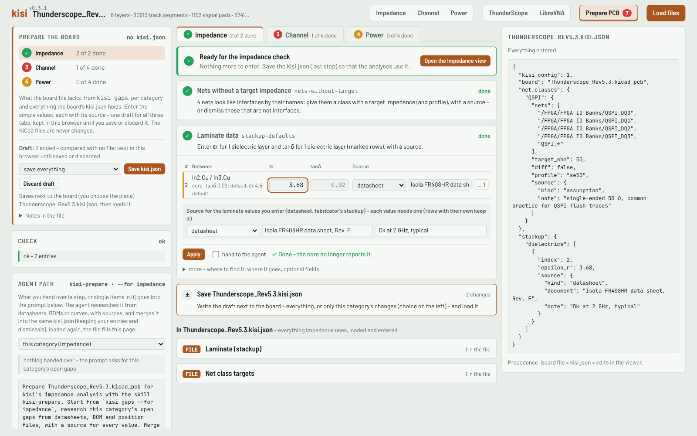

# Preparing a board

A board straight from KiCad gives a first picture: copper, stackup, net classes, parts. Many values a meaningful
analysis needs are not in the board file, or only as KiCad defaults – the laminate's εr and tanδ, the interface
standard of a bus, load currents, the regulator chain, capacitor and thermal data. Preparing a board means finding
these values, with a source for each, and writing them to `<board>.kisi.json` next to the board. kisi never
writes into the KiCad files; CLI and viewer lay the kisi.json over the board.

The work has two halves:
- **deterministic:** `kisi gaps` lists what is missing, where to find it and where it goes in kisi.json, and
  `kisi config-check` checks what was written;
- **research:** reading datasheets and choosing values – by hand, or by an agent with the
  [kisi-prepare skill](agents.md).

## The workflow
1. **Gap list:** `node kisi.mjs gaps board.kicad_pcb`. Work through `high` first, then `medium`; `low` gaps refine
   the PDN and the temperature estimate.
2. **Context:** `kisi overview` (stackup with materials, net classes, targets), `kisi interfaces` (the devices at
   the ends of each bus, with their MPNs), `kisi profiles` (the interface profiles a class can get).
3. **Skeleton:** `kisi config-template board.kicad_pcb > board.kisi.json` gives this board's dielectric indices,
   net classes and suggested variants; keep only what you fill in.
4. **Fill in** values with sources ([format](reference.md#board-configuration-boardkisijson)): typical values
   for loss and eye, maximum currents for IR drop and regulator loading, unless you have a reason otherwise – and
   say which in the source's `note`. If a value cannot be found, leave it out or mark it `estimate` /
   `assumption` with the reasoning.
5. **Check:** `kisi config-check board.kicad_pcb` – fix every error (references, ranges, missing sources, field
   syntax kisi cannot read) and read the warnings. Then `kisi gaps` again: the filled gaps are gone.
6. **Use it:** every command reads the kisi.json next to the board; in the viewer, drop it together with the
   board files.

Each gap names the analysis categories it matters for (`views`: impedance, channel, power; where a gap mixes
them, each item names its own – a dielectric with only KiCad's default tanδ is a channel item), and `kisi gaps` says per
category whether there is anything to check and whether it is ready (no open high or medium gap). To prepare a
board for one analysis only, use `kisi gaps --for impedance` (or `channel`, `power`): a board without nets with a
target impedance has nothing to check for impedance, and its laminate gap blocks nothing yet.

Gaps that are guesses from names (`nets-without-target`, rails found only by their name) can be dismissed with a
reason when the name misleads – `gaps.dismissed` in kisi.json ([reference](reference.md#gapsdismissed)).

Gaps whose `write.to` says "not kisi.json" are fixes in KiCad (a Value field kisi cannot read, for example).
Nets without a suitable class (in "Default") get one in kisi.json with `net_classes.<class>.nets` (names or
patterns, [reference](reference.md#target-impedance-from-net-class-names)), or in KiCad.

## The gap list
`kisi gaps` prints a list of gaps; each has an `id`, a `priority`, the `issue`, what it `affects`,
`where_to_find` the value, where to `write` it (with an example) and the `items` – layers, classes, rails or parts
(with their MPN where the Value field is not the part number).

| Gap | Priority | Category | What is missing | Where it goes |
|---|---|---|---|---|
| `stackup-missing` | high | I, C | no stackup in the board file | `stackup.dielectrics` (or the stackup in KiCad) |
| `stackup-defaults` | medium | I, C | dielectrics with KiCad's default εr 4.5 / tanδ 0.02 or no material | `stackup.dielectrics` |
| `nets-without-target` | high | I, C | nets that look like high-speed interfaces by their name, without a target impedance (confirm first) | `net_classes.<class>` (a class without a target), or a net class in KiCad |
| `classes-without-standard` | medium | C | classes with a target but only a generic profile (1 Gbit/s, generic limits) | `net_classes.<class>.profile` |
| `assembly-variant` | high | C, P | the board has assembly variants (or forks where all alternatives are fitted) and none is chosen | `variant`, `variants` |
| `assembly-variant-forks` | medium | C | the chosen variant still has forks where all alternative series parts are fitted | `variants.<name>.not_fitted` (or sheets, `bom`) |
| `channel-part-values` | medium | C | parts in signal channels whose value kisi cannot read ("DNP", a part number): modelled as open | the Value field in KiCad (not kisi.json) |
| `power-tree` | medium | P | no regulator chain (`PI_REG`): no budget, no regulator load check | `fields`: `PI_REG` |
| `rails-without-voltage` | medium | P | supply rails (found by name, pin name or a field) without a known voltage | `NAME@<V>V` in a `PI_REG` entry |
| `rails-without-source` | medium | P | supply rails without a source: no IR drop | `PI_REG` (input or regulator output), else `PI_SOURCE` |
| `regulator-efficiency` | low | P | switching regulators without an efficiency: 85 % assumed | `PI_REG` (`buck 90%`) |
| `ic-loads` | medium | P | ICs on supply rails without a load current | `fields`: `PI_LOAD` |
| `cap-ratings` | low | P | decoupling capacitors of 100 nF and more without rated voltage or dielectric | `PI_CAP` or the Value field (`10u 6.3V X5R`) |
| `bead-ratings` | low | P | ferrite beads on supply rails without an impedance rating | `PI_SERIES` or the Value field |
| `cap-values` | low | P | capacitors on supply rails whose value kisi cannot read: left out of Z(f) | the Value field in KiCad (not kisi.json) |
| `thermal-data` | low | P | parts with 0.1 W or more without thermal data: package defaults, Tj max 125 °C | `PI_THERMAL` |

Categories: I impedance, C channel, P power (with the temperature estimate). `nets-without-target` and rails
found only by name in `rails-without-voltage` can be dismissed.

Where to look, per kind of value:
- **Laminate:** the material name in the stackup → the manufacturer's datasheet, at a frequency near the signals
  (1–10 GHz) and for the resin content / glass style of the layer; better the fabricator's stackup report.
- **Interface profile and target:** the datasheets of the devices at the bus ends (interface type, data rate), the
  interface standard or the device's layout guide.
- **Loads (`PI_LOAD`):** device datasheets, supply current per rail in the expected operating mode; FPGAs and
  SoCs: the vendor's power estimator.
- **Regulators (`PI_REG`):** topology, efficiency at the expected load (often only a curve – read it there and
  say so), rated output current; input and output rails from the schematic. A PMIC gets one entry per channel.
- **Capacitors, beads, thermal data:** the part's datasheet – DC-bias curve, impedance at 100 MHz and DC
  resistance, the Thermal Information table (RθJB, RθJC(top), ψJT, Tj max).
- **Assembly variants:** the project's BOM and position files per variant, the sheets that hold each option;
  never pick a variant silently.
- **Connector ends:** what the connector meets (termination or driver) and the channel behind it – loss and delay
  of a cable or mating board, or the vendor's Touchstone file.

The syntax of every field and kisi.json key: [Field and kisi.json reference](reference.md).

## Four ways to fill it in
- **In the viewer:** the "Prepare PCB" page (below).
- **By hand:** edit `<board>.kisi.json` with the skeleton from `config-template`, check with `config-check`.
- **In KiCad:** the `PI_*` fields can live on the schematic symbols instead ("Update PCB from schematic" copies
  them to the footprints). kisi.json wins where both exist; sources are only kept in kisi.json.
- **With an agent:** the [kisi-prepare skill](agents.md) runs the gap list, researches the values with sources
  and writes the kisi.json; you review the result.

### In the viewer: Prepare PCB


"Prepare PCB" in the top bar (between the example boards and "Load files") opens what the board file lacks – with
its kisi.json, if one is loaded – as a **checklist** in three tabs: Impedance, Channel and Power (with the
temperature). The badge on the button counts the open points.

Each gap is a step, ordered by priority, with a marker: while it is open, the number of its items that are still
open (seven ICs without a current: 7), red or amber by priority (low-priority steps are optional refinements); a
green check mark when it is done, an arrow when it is with the agent, a dash when it is dismissed. Steps keep their
place when one is done. An open step says in one line what it needs ("Enter the current per
rail for 7 ICs, with a source") and shows only those inputs; the inputs it still needs are marked and the first one
has the focus when the step opens (εr or tanδ of the marked layers, a target impedance, a profile, the currents,
the ratings), and an entry's source is marked once its value is there; *more* holds where to find the values, where
they go and optional fields. **Apply** runs the gap list through the core at once: the step gets its check mark when kisi no
longer reports it (or reports only dismissed items), and the next open step opens; otherwise the step stays open
and says what is still missing ("6 of 7 ICs still missing: …"), with the check's errors for its entries. "hand to
the agent" settles a step for now and adds it to the agent card's prompt; "hand single items to the agent" hands
over only some of its items (the step's marker counts the rest). The tab shows its progress ("1 of 2
required steps done") and ends with "Ready for the impedance check" (or the channel check, the power analysis) and
a button to that view; the last step is saving the kisi.json. Where a gap mixes categories, a tab shows only the
items that matter for it (a dielectric with only a default tanδ is a Channel item). Nets in "Default" that look
like an interface get a class of their own in the step (name, nets or patterns, target, profile – written as
`net_classes.<name>.nets`); dismissing is for nets that are not interfaces. Below the checklist,
**In `<board>`.kisi.json** holds everything the category uses, loaded and entered, as editable tables:

| Tab | Forms |
|---|---|
| Impedance | laminate per dielectric (material, εr, tanδ, thickness) and the solder mask εr; net class targets (Ω, differential) |
| Channel | the laminate; net class → interface profile; connector ends (model, R/C/L, the channel behind as loss and delay or a Touchstone file with its port order and ports per pin); the assembly variant to analyse and variant definitions (sheets, parts, BOM, BOM exceptions) |
| Power | `PI_REG` (with one-click suggestions for rails behind a ferrite or link), load currents per rail, `PI_SOURCE`, `PI_SERIES` (Z at 100 MHz, DC resistance), `PI_CAP` (rated voltage, dielectric, ESR, ESL – one row per part number or value and package, written on every capacitor of the group, with the parts' own Voltage Rating / Dielectric fields as a one-click suggestion), `PI_THERMAL`, `PI_TARGET` and any other field |

Every entry has its own source (kind, document; url, page and note behind "…"); a table's shared source fills the
rows entered without one. Name-based gaps can be dismissed with a reason; a dismissal that this board does not
report (any more) is listed next to its gap, or under "Stale dismissals", with "remove". **Edits made in the
views** – the stackup and the class targets in the Impedance view, profiles and connector ends in the Channel
view, the power tree or rail setups in the Power view – are listed on their tab and move into the draft with one
action and a source (the power settings as `PI_REG` / `PI_LOAD` / `PI_SOURCE`, through the same conversion as the
core's field reader).

The draft is the board's kisi.json itself: the loaded file with your edits, one for all three tabs (the laminate
entered under Impedance also closes the gap under Channel). It is kept per board in this browser until it is saved
or discarded, so a reload of the page and of the board brings it back; the side card says how it differs from the
loaded file, and "Discard draft" returns to it. A draft belongs to the kisi.json it was made on (by content): when
that file has changed since – edited elsewhere, or a newer build of kisi – the draft is not applied, and a line
above the tabs offers "Restore" (the draft over the loaded file) or "Discard". A draft made on a bundled example is
dropped when the example's kisi.json changed. The check (the same as `kisi config-check`) runs as you type, the
gap list follows a moment later, and the right column shows the resulting file. "Save kisi.json" writes the
draft, or the loaded file with only the current category's changes (the rest stays in the draft); keys the page
has no form for are kept, and a file loaded and saved unchanged stays the same. Errors in what is saved block it,
warnings do not. In Chromium a save dialog opens next to the board (and "Reload" reads the file from then on);
other browsers download it. The saved file is loaded at once. Research-heavy gaps go to the agent path: what is
handed over – whole steps or single items – is listed in the agent card, and its prompt for the kisi-prepare skill
names each gap with what is needed, where it goes in kisi.json and its items (refdes with part number and rails,
nets, rails, classes, layers), limited to that category (`kisi gaps --for …`) or for all categories. With nothing
handed over the prompt asks for the category's open gaps. The marks are kept with the draft in this browser, not
in kisi.json; a category whose open gaps are all handed over says so.

## Worked example: Seeed Studio XIAO nRF54LM20A
[`docs/examples/xiao-nrf54lm20a/XIAO nRF54LM20A.kisi.json`](examples/xiao-nrf54lm20a/XIAO%20nRF54LM20A.kisi.json)
is a board configuration that describes the board's **power tree for the USB supply case**, every value with its
source. The kisi-prepare skill wrote it from the datasheets, and it was then cleaned up by hand. It shows a PMIC
with several channels, load switches, a 0 Ω link and ferrite beads as pass elements, hierarchical net names in
quotes, and loads marked as typical, maximum or estimated.

### The board
- **Seeed Studio XIAO nRF54LM20A**, hardware V1.0: the KiCad 10 project `XIAO_nRF54LM20A_V1.0_SCH&PCB_260508`, six
  layers. Seeed publishes one project for the XIAO nRF54LM20A and the Sense variant, so the board file includes
  the IMU and the microphone.
- The hardware files are by Seeed Studio, licensed CC BY-SA 4.0, and are **not included** in kisi. Get them from
  the Resources section of the
  [XIAO nRF54LM20A wiki page](https://wiki.seeedstudio.com/xiao_nrf54lm20a_getting_started/) ("XIAO nRF54LM20A
  KiCad Project",
  [direct link](https://files.seeedstudio.com/wiki/XIAO_nRF54LM20A/getting_start/RES/XIAO_nRF54LM20A_V1.0_SCH&PCB_260508.zip)).

### Step 1: what the board file alone gives
Unpack the project and run the gap list without a configuration:
```sh
node kisi.mjs gaps "XIAO nRF54LM20A.kicad_pcb"
```
With kisi 0.3.0 it reports no high-priority gap, five medium and two low ones:

| Gap | Items |
|---|---|
| `stackup-defaults` | all 5 dielectrics carry KiCad's defaults (FR4, εr 4.5, tanδ 0.02) |
| `power-tree` | no `PI_REG` field: no budget, no regulator loading |
| `rails-without-voltage` | `/03 Power/LDO1_IN` (found by a pin name of U2), `/06 Peripherals/IMU_VDD` and `/06 Peripherals/MIC_VDD` (behind FB3 / FB4 – the gap suggests the `pass` entry), `VBAT`, `VBUS`, `VSYS` |
| `rails-without-source` | `3V3_OUT`, `IMU&MIC_3V3`, `SAMD11_3V3`, `TYPEC_5V`, `VSYS_3V3` |
| `ic-loads` | 11 ICs, among them U8 nRF54LM20A, U10 flash, U11 IMU, U12 microphone, U5 SAMD11 – and U4, whose Value field is the manufacturer's name; the gap names its MPN UM3204H |
| `cap-ratings` | 35 capacitors of 100 nF and more (with their MPNs) |
| `bead-ratings` | FB3, FB4 (Murata BLM03AG121SN1D) |

The board is a small Bluetooth module without impedance-controlled interfaces, so the work is the power tree.

### Step 2: the power tree
Read from the schematic (sheet 03 Power) and the datasheets:
```
USB1 USB-C: TYPEC_5V, 5 V input
└ U6 TPS22916 load switch → VBUS
  └ U2 nPM1300: VSYS follows VBUS (5 V while USB is present)
    ├ U2 BUCK2 3.3 V → VSYS_3V3: U8 nRF54LM20A, U10 flash, LED1, U4 level translator
    │  └ U3 TPS22916 load switch → SAMD11_3V3: U5 SAMD11 debugger, U4
    ├ R14 0 Ω → /03 Power/LDO1_IN
    │  └ U2 LDO1 3.3 V → IMU&MIC_3V3
    │     ├ FB3 → /06 Peripherals/IMU_VDD: U11 LSM6DS3TR-C
    │     └ FB4 → /06 Peripherals/MIC_VDD: U12 MSM261DGT006
    └ U1 TPS628438 3.3 V → 3V3_OUT (header pin only; no load modelled)
```
As `PI_REG` fields in the kisi.json (sources left out here):

| Part | `PI_REG` | Why |
|---|---|---|
| USB1 | `TYPEC_5V input` | the supply input (assumption: 5 V USB) |
| U6 | `TYPEC_5V > VBUS@5V pass r=80m 2A` | load switch, 80 mΩ maximum on-resistance; gives VBUS its voltage |
| U2 | `VBUS > VSYS@5V pass id=U2-VSYS; VSYS > VSYS_3V3 buck 200mA out=L2 id=U2-BUCK2; "/03 Power/LDO1_IN" > IMU&MIC_3V3 ldo iq=12.5u 50mA id=U2-LDO1` | the PMIC: three channels separated by `;`, each with its own `id=`; BUCK2's output current leaves through L2 |
| R14 | `VSYS > "/03 Power/LDO1_IN" pass` | 0 Ω link, a hierarchical name in quotes |
| U1 | `VSYS > 3V3_OUT buck 600mA out=L1` | no efficiency in the datasheet as a number: kisi's 85 % applies (estimate) |
| U3 | `VSYS_3V3 > SAMD11_3V3 pass r=90m` | load switch for the debugger |
| FB3, FB4 | `IMU&MIC_3V3 > "/06 Peripherals/IMU_VDD" pass r=0.5` (and `MIC_VDD`) | ferrite beads, 0.5 Ω DC resistance (maximum) |

Then the loads (`PI_LOAD`) and the beads' PDN data (`PI_SERIES z100=120 rdc=0.5`):

| Kind | Values |
|---|---|
| Datasheet | U8 12 mA (radio TX at maximum power plus CPU, typical); U4 12 µA + 2.4 µA; U11 0.9 mA (typical); FB3/FB4 120 Ω at 100 MHz and 0.5 Ω DC resistance (maximum); on-resistances of U6 and U3, the nPM1300 channel ratings and LDO1's 12.5 µA ground current, VSYS following VBUS (Nordic DevZone answers by Nordic staff); TPS628438 3.3 V setting and 600 mA |
| Estimate | U10 6 mA (from the datasheet of a sibling flash, the P25Q64H); U5 4.4 mA (from the SAM D20 table, the same core); U12 0.75 mA (from sibling microphones); LED1 1.2 mA (from its series resistors); the efficiency of BUCK2 and U1 (kisi's default 85 %) |
| Assumption | USB1 supplies 5 V; the R14 0 Ω link counts as 0 Ω |

The `note` of each source says whether a value is typical or maximum and at which condition.

### Step 3: check and run
Copy the kisi.json next to `XIAO nRF54LM20A.kicad_pcb` (same stem):
```sh
node kisi.mjs config-check "XIAO nRF54LM20A.kicad_pcb"   # ok, 17 entries
node kisi.mjs power        "XIAO nRF54LM20A.kicad_pcb"   # power tree, IR drop, losses
node kisi.mjs gaps         "XIAO nRF54LM20A.kicad_pcb"   # what is still open
```
In the viewer: drop the `.kicad_pcb`, the `.kicad_pro` and the `.kisi.json` together into `kisi.html`, then open
the Power view.

With kisi 0.3.0, `kisi power` gives 100 mW from USB: 83 mW to the loads and 17 mW of losses. BUCK2 loses 14 mW at
the estimated 85 % and LDO1 3 mW. The largest DC drop is 0.17 mV, on VSYS_3V3.

### What is still open
`kisi gaps` then lists these; they are expected for this example:
- `rails-without-voltage`: **VBAT.** The battery is not part of the USB-case tree. On battery, VSYS is VBAT
  (3.0–4.2 V) and the SAMD11 debugger is off; kisi has one tree per board for now (ROADMAP: power tree per supply
  case). The nPM1300 battery charger is not modelled either – while it charges, its current is a load on VSYS.
- `ic-loads`: **U7**, the XIAO header. External loads on the 3V3 and VBUS pins are unknown.
- `regulator-efficiency`: **BUCK2 and U1.** The datasheets give efficiency only as curves.
- `cap-ratings`: the board's capacitors carry `Voltage Rating` and `Dielectric` fields, but kisi does not read
  them yet (ROADMAP: capacitor ratings from part fields), so they are not repeated as `PI_CAP` here. `kisi gaps`
  suggests them per capacitor (`suggest`), and the viewer's Prepare page writes them as PI_CAP for a group of
  parts at once.
- `stackup-defaults`: the laminate values are KiCad's defaults; for a board without impedance-controlled
  interfaces they matter little.
