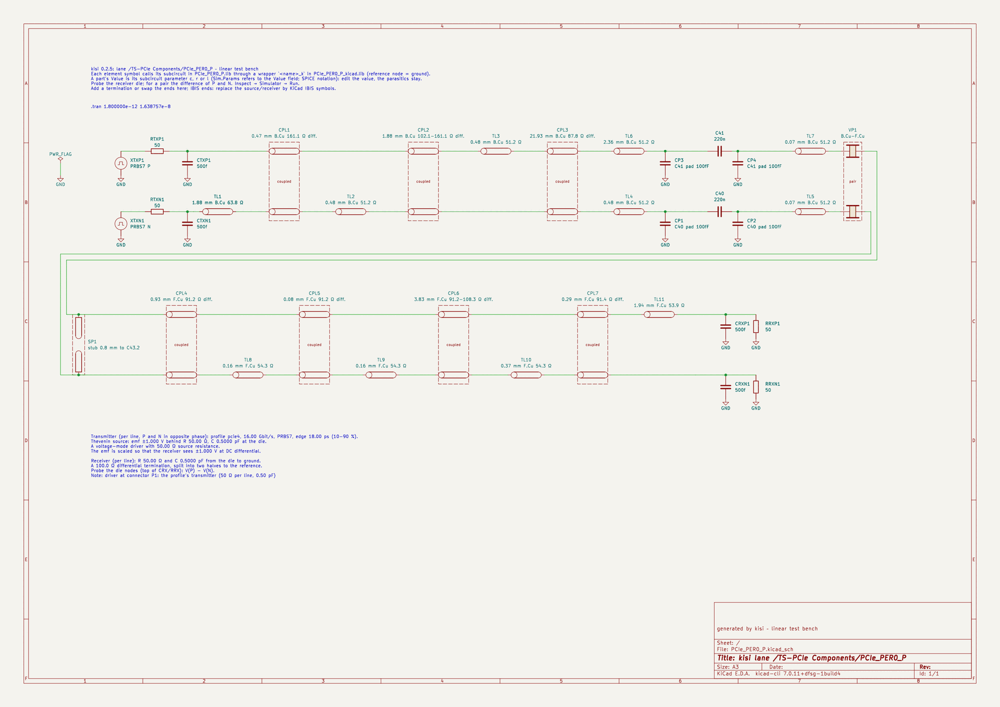
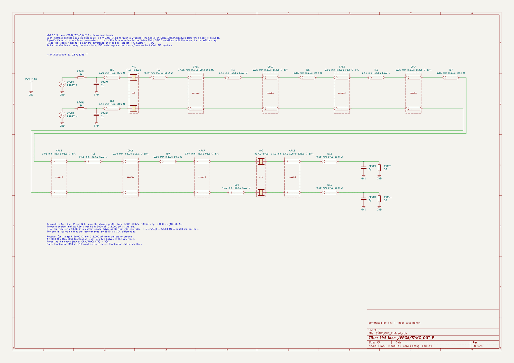
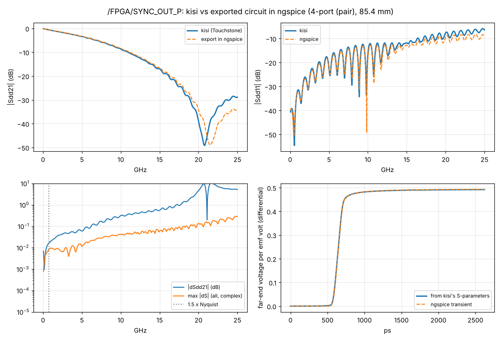
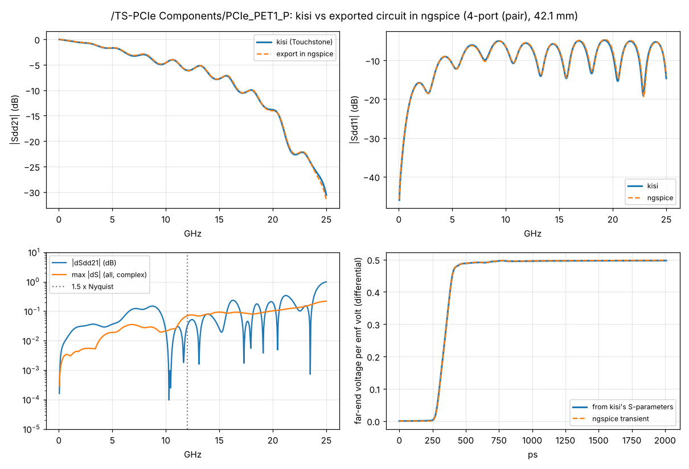

# Channel export to circuit and RF simulators – first increment and its check

Status: implemented (24 October 2026) – `kisi export`, the viewer's “Export…” in the lane detail and the bus card,
`kisi_si::export`, checked with `validation/channel_export/compare.py` (also in CI). ROADMAP block 3, steps 1 and 2;
step 3, the compact model (`--model compact`, 25 October 2026), in section 7 – its research note is
`vector-fitting.md`. Background and the KiCad facts:
`kicad-simulation.md` (option A of that note, with linear ends).

## Summary
- **What it does:** a lane – or every lane of a bus – becomes a SPICE subcircuit with ports at both ends (a pair:
  P and N at each end, with the coupling between them), plus ready test benches for ngspice, Xyce and LTspice, an
  S-parameter deck, Touchstone files (a bus also as one N-port with its port map) and a KiCad project. The channel
  is exactly the one kisi's channel check computes for the eye (same sections, same models, same ends).
- **Netlist = kisi's circuit:** ngspice's S-parameter analysis of the exported subcircuit reproduces kisi's own
  evaluation of the circuit for every lane tried (LVDS lane, nine PCIe lanes; every S-parameter to 0.001), and the
  bus subcircuit gives the same lane response as the lane alone. The KiCad project shows the lane element by element
  (lines, coupled runs, vias, parts, pads, stubs); `kicad-cli`'s netlist of it is the lane subcircuit node for node,
  and its AC response in ngspice equals the bench's to 1e-8.
- **Circuit vs kisi's S-parameters:** up to 1.5 × Nyquist |ΔS21| ≤ 0.025 dB on the LVDS lanes and 0.10–0.34 dB on
  the strongly reflecting PCIe lanes (|Sdd11| up to −5 dB: the ripples shift with small phase errors); the largest
  complex difference of any S-parameter ≤ 0.064 in that band (0.13–0.54 up to 25 GHz, mostly above 15 GHz). Step
  responses (100 ps edge, every port terminated) agree within 1.9 % of the step, the 50 % delay within 1.4–2.3 ps
  (0.3–0.8 %).
- **Why not exact:** parts of kisi's model are not passive or not causal – the Huray roughness adds resistance
  without its internal inductance, the via models use a constant loss tangent and a barrel resistance without
  internal inductance, microstrip dispersion makes the capacitance rise with frequency, and the plane-pair spans of
  via pairs have a negative resistance from a few GHz (before main's via-model changes of October 2026 this made
  ThunderScope's PCIe reference clock lane non-passive above 22 GHz; now every lane's 4-port is passive). A circuit of positive R, L, C cannot follow those
  exactly; the export is passive and causal by construction and follows the loss closely and the reactance (the
  delay) more closely still. Above about 15 GHz the via-pair spans dominate the difference.
- **Sizes:** 12–25 k elements per PCIe lane, 42 k for the 85 mm LVDS pair; ngspice (one core, shared machine):
  S-parameters (500 points) in 2–73 s, a step response in 3–89 s, the PRBS7 bench (two periods) in 100–400 s.
- **Not included (open points):** IBIS (KIBIS) ends, the channel behind a connector, crosstalk between lanes (the
  bus N-port is block-diagonal), Xyce and Qucs-S runs (not available here). A compact model for long transients is
  section 7.

## 1. Interface
```
kisi export <board.kicad_pcb> --lane NAME | --bus NAME [--format lib,spice,xyce,ltspice,touchstone,kicad]
            [--kicad-style detailed|compact] [--fmax GHZ|profile] [--fmin GHZ] [--out DIR]
            [--class CLASS=PROFILE] [--variant NAME] [--config FILE]
```
`NAME` is a lane as `kisi interfaces` lists it (or one of its nets, or the last part of a hierarchical name, e.g.
`SYNC_OUT_P`), or a bus name (`"P1 ↔ U18"`). The default folder is `analysis/export/<name>` next to the board. The
profile, direction, connector end models and assembly variant are the channel check's; the native CLI and
`kisi.mjs` give the same JSON and byte-identical files (`tools/compare_cli.py`). The viewer has one “Export…”
button in the lane detail and one in each bus card, active once the channel check has computed the lane or bus;
it uses the profile, direction and connector ends set in the viewer and downloads a zip of the same files. The
card “Export for simulators” (collapsed by default, remembered per browser) chooses the files – Touchstone, the
SPICE library, the ngspice, Xyce and LTspice benches, the KiCad project and its style – and the frequency range
(as the RF settings, 5 × Nyquist of the profile, or a fixed top frequency; the grid's start and step). The JSON names every file, the ports, the bench ends, the element
counts and the check of the circuit against kisi's S-parameters (`check_against_kisi`).

## 2. What the files contain
Per lane (`<lane>/` in a bus export):

| File | Content |
|---|---|
| `<lane>.lib` | the lane as subcircuit `<lane>_lane a b ref` (pairs: `ap an bp bn ref`; transmitter end = a, receiver end = b); one subcircuit per line section, via, part and stub, the ladders as repeated section subcircuits. Header: ports, model, the check against kisi, element counts |
| `bench_ngspice.cir`, `bench_xyce.cir` | transient test bench: PRBS7 (two periods) at the profile's bit rate and edge, the profile's linear transmitter (emf → R → C at the die → L → pin) and receiver (pin → L → C ∥ R at the die) per line, scaled so that the receiver sees ±swing at DC; ngspice writes the receiver voltage with `wrdata`, Xyce with `.print tran format=csv` |
| `sparam_ngspice.cir`, `sparam_xyce.cir` | S-parameters on kisi's grid: ngspice `.sp` with `portnum` sources, Xyce `.ac` + `.lin` with port devices (Touchstone 2 output) |
| `bench_ltspice.cir`, `<lane>_ltspice.lib`, `sparam_ltspice.cir` | LTspice (section 2b): the same bench with the received voltage as node `vrx` and `.meas` lines; the library with `Rser=0 Rpar=1e30` on every inductor; `.net` S-parameters for a single-ended lane |
| `<lane>.s2p` / `.s4p` | kisi's S-parameters of the same channel (Touchstone 1.0, RI), ports as above, the port list in the header |
| `<lane>.kicad_pro`, `.kicad_sch`, `<lane>_kicad.lib` | KiCad project (section 2a): one symbol per element of the lane subcircuit (or, with `--kicad-style compact`, the lane as one symbol), the PRBS7 sources as subcircuits, the ends as R, L, C symbols whose models KiCad infers from reference and value, ground and a power flag, a `.tran` directive, notes on what the ends stand for. KiCad 7 format (20230121) with kisi's own symbols embedded, so it opens without libraries. `<lane>_kicad.lib` includes `<lane>.lib` and holds the small wrapper subcircuits the symbols call: KiCad reads the models from the file a symbol names, and a short file loads at once |
| `README.md` | ports, files, bench ends, model, the check, what is not included, kisi's notes on the lane |

A bus adds `<bus>.s<N>p` (all lanes as one N-port: ports 1…N/2 at the first device, N/2+1…N at the other, port k
and k+N/2 the two ends of one line; every lane renormalised to the most common reference), `<bus>_ports.csv`,
`<bus>.lib` (subcircuit `<bus>_bus` with all lanes in the same port order) and a README with the port map. The
lanes are independent in kisi's network model, so the N-port is block-diagonal.

### 2a. The KiCad sheet
The sheet draws the lane subcircuit `<lane>_lane` element by element, in its order, with kisi's own symbols:
`TL` line sections (consecutive sections of one line on one layer as one element), `CPL` coupled runs drawn across
the P and N rows (consecutive runs on one layer as one), `VIA` and `VP` (via pair), the board's parts under their
reference designator (e.g. `C40`, a capacitor symbol with the value `220n`), `CP` pad capacitances (also those of
unfitted parts), `ST` and `SP` open stubs. A pair has two parallel rows; a long lane wraps into several bands
(P outside on the right, inside on the left, so the two lines never cross); the paper grows from A3 as needed.
The transmitter (PRBS7 source, R, C at the die) is on the left, the receiver (C ∥ R at the die) on the right; a note
on the sheet says what they stand for – profile, edge, emf, and for a high source resistance (LVDS: 5 kΩ against
50 Ω) “a current-mode driver as its Thevenin equivalent, I = emf/(R + R_rx)”.

- **Models:** each element symbol has `Sim.Device = SUBCKT`, `Sim.Library = <lane>_kicad.lib`, `Sim.Name =
  <element>_k` and `Sim.Pins`. The wrapper `<element>_k` calls the element's subcircuit in `<lane>.lib` with its
  reference node on ground (so lines, vias and coupled runs need no ground pin; pads and shunt parts keep theirs).
- **Parts with an editable value:** a part's wrapper is a copy of its subcircuit with the value as parameter, e.g.
  `.subckt …_C40_2_k a b params: c=220n` (ESR, ESL and the 1 GΩ DC path fixed); the symbol has `Sim.Params =
  c=${VALUE}`. KiCad substitutes the Value field (checked with kicad-cli 7: Value `100n` → `c=100n` in the netlist),
  so editing the value keeps the parasitics. The Value is in SPICE notation (`100n`, `4.7u`, `1Meg`); an inductor's
  parameter is its total inductance (kisi adds the ESL to the nominal value). Pads keep fixed values.
- **Drawing rules:** pins visible (names and numbers hidden), every wire ends on a pin end or another wire end, a
  junction wherever three or more items meet, everything on the 1.27 mm grid, a `PWR_FLAG` on ground (ERC: the
  ground net is driven). `validation/channel_export/kicad_sheet.py` checks this without KiCad, then kicad-cli's
  netlist (no unconnected pin, every element of `<lane>_lane` once and connected node for node as there, the ports at
  the transmitter's and the receiver's die), its AC response in ngspice against the bench (exact, no time steps) and,
  with kicad-cli 8 or later, KiCad's ERC.



- **Compact sheet** (`--kicad-style compact`): the lane as one symbol, as before. It stays as an option for users
  who want the lane as a black box; the detailed sheet is the default for lanes and buses (a PCIe lane is 48–55
  symbols, written in milliseconds, and opens and checks cleanly).
- **Bus:** every lane folder has its own KiCad project (simpler than hierarchical sheets and each opens on its
  own); the bus-level files stay as they are.
- **ngspice and Xyce decks:** the circuit (`<lane>.lib`) is shared; only the decks differ – ngspice writes results from a
  `.control` block (`wrdata`) and takes S-parameters from `.sp` with `portnum` sources, Xyce uses `.print` and port
  devices `P` with `.ac` + `.lin`. One deck with commented-out dialect lines would need hand editing (ngspice reads
  `P` as its coupled-line device, Xyce knows neither `portnum` nor `.control`), so each simulator has its own decks;
  the export README says so.

### 2b. LTspice
`bench_ltspice.cir` is the transient bench of the other simulators – the same PRBS7 PWL source, the profile's
linear ends and the lane subcircuit – for LTspice: the received voltage (a pair: V(P) − V(N)) as node `vrx` from a
`B` source, `.tran Tstep Tstop 0 Tstep` (the time step bounded as in ngspice), `.save V(vrx)`, `.options plotwinsize=0
numdgt=16 reject_number_tails` (uncompressed, double precision, numbers with stray letters are errors) and `.meas`
lines – the first rising zero crossing `t50`, the voltage at eight bit centres of the second pattern period, its
maximum and minimum there – which LTspice writes to its `.log`. Every value is in e-notation (in LTspice `1M` is
milli), the include path is relative, the files are ASCII.

- **The library:** LTspice adds a series resistance (1 mΩ) and an implicit parallel damping to inductors by
  default; the LTspice library sets `Rser=0` and `Rpar=1e30` so that it matches ngspice and Xyce. (1 mΩ over the
  ~9000 ladder inductors of an 85 mm pair is several ohms; the damping lowered the LVDS pair's levels during the
  reflections by 1 %.) ngspice and Xyce reject both parameters, so the export writes `<lane>_ltspice.lib`:
  `<lane>.lib` with `Rser=0 Rpar=1e30` on each inductor and ASCII comments, otherwise identical.
  Everything else in the library – E, F and 0 V sources, subcircuits, `+` continuation lines – is common to all three
  simulators; there are no subcircuit parameters in it.
- **S-parameters:** for a single-ended lane `sparam_ltspice.cir` uses LTspice's two-port `.net I(Rout) Vin` with the
  port impedance as the source's `Rser` and as `Rout` (traces `S11(Vin)`, `S21(Vin)`). LTspice has no N-port
  analysis; for pairs and buses the Touchstone files are the path (the README says so).
- **Checked without LTspice** (`validation/channel_export/ltspice.py check`, in `compare.py` and so in CI): ASCII, no
  `.control`/`wrdata`/`portnum`/`.lin`/`.print`, every subcircuit instance names a defined subcircuit with as many
  ports as nodes, no node of the flattened lane without a DC path to ground, `Rser=0 Rpar=1e30` on every inductor and no other element parameter, values in e-notation, no node names
  that differ only in case, well-formed `.tran`, `.meas`, `B` and `.net` lines, and the LTspice library equal to the
  shared one apart from `Rser=0 Rpar=1e30`. `ltspice.py expected` runs the same bench in ngspice (the `.meas` syntax is common;
  the shared library instead of the LTspice one, the LTspice-only options left out) and writes `expected.json` with
  the measurements, the run time, the element counts and – single-ended – S11/S21 at a few frequencies. LTspice
  itself runs on the maintainer's PC (LTspice 26.1.1, Windows): for REFINOUT2 `.net` gives ngspice's S11/S21 at all
  nine frequencies to 1e-4 dB and 0.001°, the bench's t50 to 0.2 ps and its levels to 0.07 % (118 s against
  ngspice's 104 s). The pair SYNC_OUT_P showed the floating converter nodes above (levels 1.1 % low, t50 to 0.1 ps);
  its export with the dual far-end converter removed the floating nodes but not the 1 % offset of the levels a few
  nanoseconds after an edge (where the reflections between the nearly open current-mode transmitter and the
  receiver add up). `validation/channel_export/ltspice_microtests.py` writes short decks to find such causes – the
  ends alone, one coupled block, one via pair, one line section, the whole lane with internal nodes, the lane with
  `.options method=trap` – with ngspice's values. With them the maintainer found it: LTspice's implicit parallel
  damping of inductors. With `Rpar=1e30` on every inductor LTspice follows ngspice within 0.16 mV during the
  reflections (default damping: up to 2.3 mV, 1 %); the integration method makes 0.2 mV. The export now writes
  `Rpar=1e30` with `Rser=0`.
- **Run time** (ngspice 42, one core of a shared machine, SYNC_OUT_P, 85 mm LVDS pair, two PRBS7 periods,
  257 ns at 30 ps steps): the ladder's top frequency sets the number of sections, and the run time follows the
  element count roughly linearly:

  | ladder f_max | RLGC sections | elements R/L/C | ngspice transient | bench result vs 25 GHz | max \|ΔS\| vs kisi to f_max |
  |---|---|---|---|---|---|
  | 25 GHz (today's default) | 819 | 20745/9091/11762 | 348 s | – | 0.29 (0.008 to 1.5×Nyq) |
  | 5 GHz (10 × Nyquist of 1 Gbit/s) | 378 | 11325/4085/7351 | 191 s | levels within 0.6 % | 0.023 |
  | 2.5 GHz (5 × Nyquist) | 355 | 11223/4213/7114 | 181 s | levels within 0.7 % | 0.012 |

  An fmax from the profile would save about 45 % for LVDS, not more: below about 5 GHz the count stops falling
  (every line section keeps at least one ladder section, the via ladders, the fitted R(f)/G(f) branches per section
  and the parts do not shrink with fmax), and the number of time steps (set by the edge and the bit time, not by
  fmax) is the same. A compact model (step 3, vector fitting per long segment) would replace the ladders by a few
  hundred elements – the run time would then fall to seconds; that, not a lower fmax, is the large saving. The
  default stays 25 GHz for now.

What the channel contains: the board between the two end pins as the eye's network uses it – lines, vias, series
parts, shunt parts, side stubs and forks, with the terminations that do not sit at the receiver. Terminations next
to the receiver act as the receiver's termination (bench and Touchstone leave them out, as kisi's eye does).

## 3. The model
- **Line sections** become RLGC ladders of π sections, at least 20 per wavelength at the top frequency (kisi's
  check frequency, 25 GHz or 1.25 × the bit rate). Per section: a Foster network R0 + sL + Σ R_k ∥ L_k for the series
  impedance R(f) + jωL(f) and a Debye network G0 + sC + Σ (R_k + 1/sC_k)⁻¹ for the shunt admittance G(f) + jωC(f),
  fitted to kisi's `LineModel::rlgc` from fmax/10⁴ to fmax with poles on a logarithmic grid and non-negative
  coefficients (non-negative least squares, `export::fit`). Microstrip gets series R–L–C branches with resonances
  above the band, so that the capacitance can rise with frequency. The fit weights the loss (R, G) at 1 and the
  reactance and susceptance at 10 to 30 (graded with frequency): a reactance error turns into a phase error along
  the line. Errors of the main sections on the example boards: R 7–8 %, X 0.7–0.9 %, G 0.7–3.2 %, B ≤ 0.3 % (the resistance gives way to the reactance where kisi's roughness has no matching inductance).
- **Vias:** the physics-based ladder (`via_pbm`) node by node – node capacitances with their dielectric loss,
  span impedances (plane-pair impedance with the return vias, barrel resistance; fitted like the lines, with parallel
  R–L–C tanks for resonances above the band), the open barrel stubs, the junction inductances and the trace over the
  antipad. The ladder runs from via centre to via centre; feed trace it adds is a lossless line inside the via,
  feed trace it removes is taken from the nearest line section (both lines of a coupled run together). Vias without
  the ladder: kisi's coaxial section stack with its stubs.
- **Parts:** R, L, C with the parasitics kisi uses (estimates from `data/components.json`); series capacitors get
  1 GΩ across them (a DC path for the simulator).
- **Stubs:** their own chain of sections, open at the end.
- **Pairs:** both lines on their own paths as `rf::mixed::align_pair` aligns them. Coupled runs, via pairs and stub
  pairs are modal blocks: the even- and the odd-mode chain between ideal mode converters – E sources set V_e =
  (V_P + V_N)/2 and V_o = (V_P − V_N)/2, F sources make I_P = I_e + I_o and I_N = I_e − I_o – exactly
  `T = P·blockdiag(T_e, T_o)·P⁻¹` of `rf::mixed::coupled`. At the near end of a block the E sources set the
  modal voltages from the line voltages and F sources draw the modal currents from the line nodes; at the far end
  the converter is the dual (E sources set V_P = V_e + V_o and V_N = V_e − V_o, F sources take (I_P ± I_N)/2 from
  the chains' ends), so every node between two blocks is driven by a voltage-defined element and has a DC path.
  (With the same converter at both ends those nodes hung between current sources only: ngspice solved it, but
  LTspice reported them as floating and the LVDS pair's levels came out 1.1 % low.) Each coupled run (consecutive runs on one layer
  joined), via pair and stub pair is its own block – back-to-back mode converters are exact, and each block is
  one element on the KiCad sheet. This keeps
  the mode-dependent conductor loss and the even mode of the via pairs, which a K/C_m ladder would not.
- **The check inside kisi:** the circuit is evaluated element by element (cascade matrices of exactly the values
  written) and compared with kisi's cascade of the same build (`check_against_kisi`); ngspice must give the same.

## 4. Verification
Numbers of 25 October 2026, after the merge of main's via-model changes (Block 2). `validation/channel_export/compare.py` runs `kisi export`, then ngspice on the S-parameter deck and on a step
response (100 ps edge, every port in its reference), and compares with kisi's Touchstone file and with the step
response computed from it; scikit-rf reads every Touchstone file (passivity, reciprocity). ngspice 42, scikit-rf
2.2.0, kicad-cli 7.0.11; ThunderScope Rev5.3 with `web/samples/ts.kisi.json`, formula impedances (native CLI).

| Lane | model | mm | elements R/L/C/sources | ngspice vs kisi up to 1.5×Nyquist: \|ΔS21\| dB, max \|ΔS\| | up to 25 GHz: \|ΔS21\| dB, max \|ΔS\| | kisi's evaluation: max \|ΔS\| | step: max diff, t50 ngspice / kisi (ps) | ngspice s (S-par. / step) |
|---|---|---|---|---|---|---|---|---|
| SYNC_OUT_P | pair | 85.4 | 20763/9109/11762/200 | 0.016, 0.008 | 10.26, 0.242 | 0.242 | 1.9 %, 572.4 / 570.1 | 16 / 26 |
| REFINOUT2 | single | 70.2 | 5582/2754/3094/0 | 0.024, 0.005 | 2.82, 0.295 | 0.295 | 1.7 %, 403.5 / 401.7 | 2 / 3 |
| PCIe_PER0_P | pair | 34.7 | 6122/3096/3537/170 | 0.309, 0.064 | 1.52, 0.168 | 0.168 | 1.4 %, 205.3 / 203.7 | 56 / 68 |
| PCIe_PER1_P | pair | 32.9 | 6112/3120/3515/170 | 0.321, 0.048 | 1.24, 0.129 | 0.129 | 1.5 %, 195.0 / 193.2 | 73 / 89 |
| PCIe_PER2_P | pair | 31.1 | 5831/2950/3366/170 | 0.206, 0.045 | 2.44, 0.181 | 0.181 | 1.3 %, 188.0 / 186.3 | 50 / 82 |
| PCIe_PER3_P | pair | 30.5 | 5702/2819/3359/210 | 0.343, 0.061 | 0.99, 0.147 | 0.147 | 1.3 %, 181.5 / 180.0 | 38 / 61 |
| PCIe_PET0_P | pair | 59.7 | 12571/5854/7281/190 | 0.100, 0.059 | 3.34, 0.164 | 0.164 | 1.5 %, 377.2 / 375.5 | 35 / 47 |
| PCIe_PET1_P | pair | 42.1 | 8423/4037/4925/150 | 0.128, 0.063 | 0.89, 0.230 | 0.230 | 1.2 %, 267.8 / 266.4 | 15 / 28 |
| PCIe_PET2_P | pair | 45.1 | 9264/4529/5271/70 | 0.165, 0.051 | 1.37, 0.535 | 0.535 | 1.5 %, 300.8 / 299.0 | 14 / 25 |
| PCIe_PET3_P | pair | 39.1 | 8172/3956/4728/150 | 0.141, 0.063 | 1.73, 0.246 | 0.246 | 1.4 %, 258.9 / 257.2 | 23 / 36 |
| PCIe_REFCLK_P | pair | 37.6 | 7747/3636/4515/170 | 0.003, 0.001 | 33.79, 0.329 | 0.329 | 1.3 %, 247.6 / 246.0 | 15 / 20 |

LVDS lanes (profile lvds, 1.5 × Nyquist = 0.75 GHz) and the PCIe lanes (pcie4, 16 GT/s, 1.5 × Nyquist = 12 GHz), single-ended references 50 Ω (LVDS) and 42.5 Ω (PCIe) per port. Fits of the main line sections: R 7–8 %, X 0.7–0.9 %, G 0.7–3.2 %, B ≤ 0.3 % (worst over all sections, short ones included: G 5 %, B 0.9 %; a microstrip piece over a distant plane on the PCIe receive lanes: G 96 %, B 19 %, a few tenths of a millimetre).

Plots (|S21|/|Sdd21|, |S11|/|Sdd11|, the differences, the step responses):




- **ngspice = kisi's evaluation of the circuit:** for all lanes the largest S-parameter difference against kisi
  is the same to three digits in ngspice and in kisi's own evaluation – the netlist text is the circuit.
- **Bus:** the N-port's blocks equal the lanes' Touchstone files (difference 0); the bus subcircuit in ngspice with
  one lane's four ports driven and all other ports terminated gives that lane's response (same difference to kisi
  as the lane alone). For the PCIe bus (9 lanes, 36 ports) the bus subcircuit's S-parameter run took 9–12 minutes in ngspice (4 ports driven, 32 terminated, 500 points).
- **Transient:** the PRBS7 benches run in ngspice (about 100 s per lane on one core).
- **KiCad** (`--kicad`, `kicad_sheet.py`): every lane's sheet passes the wiring check (visible pins, no open pin or
  dangling wire, junctions, grid); kicad-cli's netlist equals the lane subcircuit node for node, and its AC response
  in ngspice equals the bench's (relative difference 1e-10 to 5e-8, rounding). With kicad-cli 7.0.11 here for the LVDS
  lanes and all nine PCIe lanes (27–55 symbols per sheet); with kicad-cli 9.0.9 in CI (KiCad 9 from the KiCad PPA)
  for SYNC_OUT_P, PCIe_PER0_P and PCIe_PET1_P, where KiCad's ERC (all severities) reports no violation at all (before
  the export shipped kisi's symbols as a project library, `kisi.kicad_sym` with a `sym-lib-table`, it warned once per
  symbol about the unknown library `kisi`). KiCad 9 thus reads the KiCad 7 file, its models and `Sim.Params` with
  `${VALUE}`. The sheets as kicad-cli renders them:
  `docs/img/channel-export/kicad_*.png` (kicad-cli 7) and the CI artifact `kicad-sheets` (kicad-cli 9). Transients of
  the KiCad netlist and the bench differ by about 1e-4 of the swing: ngspice's time steps depend on the element order.
  Not tested: the simulator dialog of the KiCad GUI.
- **scikit-rf** reads every file (2-, 4- and 36-port). The lanes' Touchstone files and the bus N-port are passive
  (largest singular value 0.9993) and reciprocal.
- **Not run here:** Xyce (no package), Qucs-S/Qucsator, PyBERT – the decks follow the Xyce reference guide
  (`.lin sparcalc=1`, port devices `P`, `.print tran format=csv`) but are untested.

Where the differences come from (diagnosed element by element while building the export): line ladders against
kisi's line model ≤ 0.005 per element; the via ladders ≤ 0.03 up to 12 GHz, more above where kisi's via-pair spans
turn active; the remaining in-band differences of the PCIe lanes come from small phase errors in channels with
large reflections. The fallback model of sections without a reference plane is the one kisi's 4-port uses.

## 5. Choices and why
- **Physical ladder, not a macromodel**, as the default: passive and causal by construction, readable (a user can add
  a termination at a via), no fitting failures, one generator for all lanes. Its size (10–40 k elements) is fine for
  AC and for transients of a few hundred unit intervals.
- **Modal blocks** for pairs (controlled sources) instead of coupled inductors: exact for kisi's model, including the
  common-mode loss; every SPICE reads E and F elements.
- **Terminations at the receiver** belong to the receiver (as in kisi's eye), so the Touchstone file and the
  subcircuit are the interconnect and the bench is the profile's ends plus that termination.
- **KiCad 7 format** for the project: the oldest format with the simulation model fields; KiCad 8 and 9 read it
  (and convert it when saving), and it can be tested with kicad-cli 7 here and kicad-cli 9 in CI.
- **One symbol per element, through wrappers:** the sheet is the netlist a user can edit; the wrappers keep the
  file KiCad parses short (with the 7 k-line lane library as `Sim.Library`, kicad-cli 7 sometimes did not find the
  model) and the elements' own subcircuits stay in one library shared with ngspice and Xyce.
- **20 sections per wavelength:** 40 or 80 change nothing measurable against kisi's model (the fits dominate).

## 6. Step 3 – compact models (design study before the research note)
A first study fitted a lane's differential 2-port as a whole with scikit-rf's vector fitting (a prototype script,
removed once the compact model replaced it; in the repository's history up to commit fa51dfb):

| Lane | delay | poles | max |ΔS| | passive |
|---|---|---|---|---|
| PCIe PET1 (42 mm) | 270 ps | 17 (32 requested) | 0.021 | yes |
| PCIe PET1, delay taken out of S21 only | 270 ps | 19 | 0.37 | no |
| LVDS SYNC_OUT (85 mm) | 574 ps | 13 | 0.145 | yes |
| LVDS SYNC_OUT | 574 ps | 32 (60 requested) | 0.014 | no – scikit-rf's enforcement diverges |

A lane with its delay needs about two poles per ripple (delay × top frequency); taking the delay out of S21 alone
does not help a reflecting lane, because the delay sits in S11 as well. A compact model therefore needs the delay as
ideal lines (T elements) at the ports and a fit of what lies between them (delayed rational fitting), with a robust
passivity enforcement – the hard part. Plan: per long line segment (not per lane) a constant-delay T line plus a
fitted loss network (the line's attenuation is smooth and minimum-phase), the vias and parts stay ladders; this
shrinks a 100 mm lane from ~40 k to a few hundred elements and keeps the export's structure.

What came of it: the research note ([vector-fitting.md](vector-fitting.md)) and the compact model of section 7 –
lossless-line cells in `kisi_si::export` (`--model compact`, the default), with no fitted delay at all.

## 7. Step 3 – the compact model (`--model compact`)
Research, alternatives and why: `vector-fitting.md`. In short: the same passive Foster/Debye fits as the ladder, but
each line section as a few lossless-line cells – a lossless LC ladder (40 π sections per wavelength at f max, 2
elements each) carries the fit's L and C, the rest of both networks is lumped once per cell (at least 3 cells per
delay × f max, more where the lumps are large, as on microstrip); consecutive sections with nearly the same model
are merged (SYNC_OUT_P's coupled run is ~140 pieces). Passive and causal by construction; vias, parts, stubs and the
modal blocks unchanged. "Lines in the SPICE netlist" in the viewer's export settings, `--model compact` in the CLIs;
the default since 25 October 2026, after the LTspice check below (`--model ladder` remains). `--fmax profile` takes
5 × Nyquist or 0.5 / t_r of the profile's edge, whichever is higher, so that a slow rate with a fast edge (the PCIe
reference clock, the generic profiles) keeps its edge; the default stays 25 GHz.

**Check** (`compare.py --models ladder,compact --transient --passivity`, ngspice 42 on a shared 2-core machine, two
runs in parallel – the times compare the two models of one run): ThunderScope with `web/samples/ts.kisi.json`
(formula impedances), LibreVNA with `web/samples/vna.kisi.json`; f max 25 GHz.

| Lane | model | elements | ngspice S-par. s | PRBS bench s | \|ΔS21\| dB vs kisi to 1.5×Nyq / f max | max \|ΔS\| vs kisi to 1.5×Nyq / f max | step vs kisi | largest singular value: kisi to 10×f max / ngspice to 5×f max |
|---|---|---|---|---|---|---|---|---|
| SYNC_OUT_P (LVDS pair, 85 mm) | ladder | 37840 | 19.5 | 480 | 0.004 / 4.69 | 0.0005 / 0.154 | 1.15 % | 0.999982 / 0.999987 |
| | compact | 8252 | 2.4 | 46 | 0.004 / 4.58 | 0.0005 / 0.160 | 1.14 % | 0.999982 / 0.999981 |
| REFINOUT2 (single, 70 mm) | ladder | 11138 | 2.7 | 200 | 0.005 / 2.68 | 0.0005 / 0.103 | 1.51 % | 0.999986 / 0.999986 |
| | compact | 3313 | 0.3 | 20 | 0.005 / 2.79 | 0.0006 / 0.113 | 1.51 % | 0.999986 / 0.999986 |
| PCIe_PET1_P (pair, 42 mm) | ladder | 18117 | 16.4 | 585 | 0.006 / 0.48 | 0.0064 / 0.182 | 1.32 % | 0.999993 / 0.999996 |
| | compact | 7466 | 1.5 | 35 | 0.006 / 0.44 | 0.0059 / 0.187 | 1.32 % | 0.999993 / 0.999996 |
| PCIe_PER0_P (pair, 35 mm) | ladder | 13421 | 409 | > 3600 | 0.135 / 0.64 | 0.0519 / 0.092 | 1.74 % | 0.999993 / 0.999994 |
| | compact | 4663 | 1.3 | 35 | 0.141 / 0.60 | 0.0532 / 0.099 | 1.78 % | 0.999993 / 0.999994 |
| PCIe_REFCLK_P (pair, 38 mm) | ladder | 17402 | 107 | > 3000 | 0.002 / 5.01 | 0.0004 / 0.343 | 1.59 % | 0.999992 / 0.999992 |
| | compact | 7161 | 1.6 | 181 (Gear) | 0.002 / 5.04 | 0.0004 / 0.352 | 1.60 % | 0.999992 / 0.999992 |
| LibreVNA FPGA_CLK (single, 84 mm) | ladder | 13212 | 3.4 | 313 | 0.003 / 4.57 | 0.0006 / 0.458 | 1.33 % | 0.999978 / 0.999978 |
| | compact | 4298 | 0.5 | 45 | 0.004 / 4.49 | 0.0006 / 0.456 | 1.32 % | 0.999978 / 0.999978 |
| LibreVNA PORT1LO2 (single, 120 mm) | ladder | 25104 | 9.3 | 1443 | 0.007 / 2.59 | 0.0014 / 0.103 | 1.56 % | 0.999968 / 0.999985 |
| | compact | 5818 | 1.2 | 84 | 0.007 / 2.56 | 0.0014 / 0.103 | 1.55 % | 0.999968 / 0.999985 |
| LibreVNA Net-(IC33-OUT+) (pair, odd mode, 13 mm) | ladder | 2872 | 1.2 | 179 | 0.006 / 0.32 | 0.0010 / 0.062 | 4.92 % | 0.999700 / 0.999999 |
| | compact | 1409 | 0.2 | 18 | 0.006 / 0.11 | 0.0010 / 0.061 | 4.92 % | 0.999700 / 0.999999 |

The compact circuit against the ladder (both in ngspice):

| Lane | \|ΔS21\| dB to 1.5×Nyq / f max | max \|ΔS\| to 1.5×Nyq / f max | step | PRBS levels at the bit centres (of the swing) |
|---|---|---|---|---|
| SYNC_OUT_P | 0.0000 / 0.19 | 0.0001 / 0.023 | 0.05 % | 0.04 mV (0.01 %) |
| REFINOUT2 | 0.0003 / 0.33 | 0.0001 / 0.025 | 0.02 % | 0.02 mV (0.00 %) |
| PCIe_PET1_P | 0.0083 / 0.07 | 0.0029 / 0.023 | 0.06 % | 2.8 mV (0.22 %) |
| PCIe_PER0_P | 0.0057 / 0.07 | 0.0029 / 0.022 | 0.07 % | – (ladder bench not finished) |
| PCIe_REFCLK_P | 0.0000 / 0.12 | 0.0000 / 0.029 | 0.05 % | – (ladder bench not finished) |
| FPGA_CLK | 0.0001 / 0.23 | 0.0001 / 0.019 | 0.04 % | 0.18 mV (0.02 %) |
| PORT1LO2 | 0.0000 / 0.11 | 0.0000 / 0.019 | 0.04 % | 0.13 mV (0.01 %) |
| Net-(IC33-OUT+) | 0.0000 / 0.31 | 0.0000 / 0.014 | 0.00 % | 0.10 mV (0.01 %) |

At 5 × Nyquist (`--fmax profile`, 2.5 GHz for these 1 Gbit/s lanes):

| Lane | model | elements | max \|ΔS\| vs kisi | PRBS bench s | compact vs ladder: PRBS levels |
|---|---|---|---|---|---|
| SYNC_OUT_P | ladder / compact | 22743 / 3883 | 0.004 / 0.004 | 397 / 24 | 0.40 mV (0.10 %) |
| FPGA_CLK | ladder / compact | 5021 / 2096 | 0.010 / 0.004 | 940 / 40 | 2.5 mV (0.30 %) |

- **Accuracy:** in the band the compact model is the ladder (|ΔS| between them ≤ 0.003 up to 1.5 × Nyquist), and
  both are as close to kisi as before; up to 25 GHz they differ by ≤ 0.03 – the ladder's own discretisation (its
  π sections lag 0.4 % in phase at f max, the cells' LC lines 0.1 %). At 5 × Nyquist the compact model is closer to
  kisi than the ladder (FPGA_CLK 0.004 vs 0.010). PRBS levels agree to 0.3 % of the swing or better.
- **Size and speed:** 2.0–4.6 × fewer elements at 25 GHz (the vias and short sections keep theirs), 2.4–5.9 × at
  5 × Nyquist; S-parameters 6–300 × and PRBS benches 7–17 × faster at 25 GHz, 17–23 × at 5 × Nyquist. The two PCIe
  lanes whose ladder benches did not finish within the hour (PER0, the reference clock) finish in 35 s and 181 s.
- **Passivity:** every exported circuit (ladder and compact) has singular values ≤ 1 from 1 kHz to 10 × f max in
  kisi's own evaluation (star products of scattering matrices) and in ngspice's sweep to 5 × f max (to 10⁻⁴: near DC
  ngspice's AC solution is accurate to ~10⁻⁵; above an RLGC ladder's cut-off near 6.4 × f max it breaks down
  numerically – 10⁴⁰ at 200 GHz for SYNC_OUT_P's ladder, 0.99998 in kisi's evaluation). Both models are passive by
  construction, also asymptotically.
- **Open receivers:** the reference clock's profile has a high-impedance receiver; the lane is then an undamped
  resonator on which ngspice's default trapezoidal integration rings and stops with "timestep too small" (the
  compact bench at 440 ns of 1.28 µs) or crawls (the ladder bench). Benches and KiCad projects with an open
  receiver therefore use `.options method=gear` (181 s); terminated lanes keep the trapezoidal default, because
  Gear's numerical damping moves the edges of SYNC_OUT_P by up to 3 % of the swing at the bench's 30 ps steps.
- **Other checks:** the LTspice files of the compact export pass `ltspice.py check` (every lane above); the KiCad
  project of SYNC_OUT_P (kicad-cli 7) has the lane subcircuit node for node with an AC response equal to the bench's
  (5·10⁻⁹); CI runs the compact model against the ladder on three ThunderScope lanes with the passivity sweep and
  the KiCad check (kicad-cli 9 with ERC) on PCIe_PER0_P. Not run here: Xyce.
- **LTspice** (26.1.1 on the maintainer's PC, `bench_ltspice.cir` of the compact SYNC_OUT_P against `expected.json`
  from ngspice): at 25 GHz t50 equal (7.7303 ns), the eight bit levels within 0.97 mV (mean 0.53 mV), maximum and
  minimum within 0.9 mV (0.22 %), 61 s (the ladder bench took 938 s there); at 5 × Nyquist t50 within 0.7 ps, bit
  levels within 0.42 mV, maximum and minimum within 1.2 mV (0.3 %), 61 s. As close as the ladder's LTspice run
  (section 4: levels within 1 mV, maximum and minimum 1.3 mV).

## Sources
- ngspice manual (S-parameter analysis `.sp`, `portnum`; E/F sources) – https://ngspice.sourceforge.io/docs.html
- Xyce Reference Guide (`.LIN`, port device) – https://xyce.sandia.gov/documentation-tutorials/
- KiCad source, simulation model fields and inference (`eeschema/sim/sim_model.cpp`) – see `kicad-simulation.md` [K1]
- scikit-rf `VectorFitting` – https://scikit-rf.readthedocs.io/en/latest/api/vectorFitting.html
- A. Djordjevic et al., “Wideband frequency-domain characterization of FR-4 and time-domain causality”, IEEE Trans.
  EMC 43 (2001) – the dielectric model the Debye fits follow
- B. Gustavsen, A. Semlyen, “Rational approximation of frequency domain responses by vector fitting”, IEEE Trans.
  Power Delivery 14 (1999)
