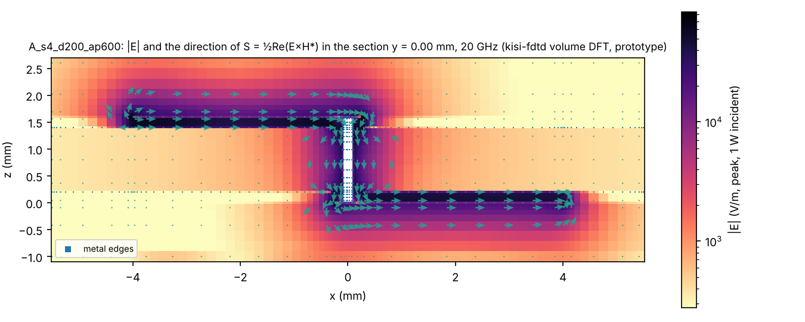
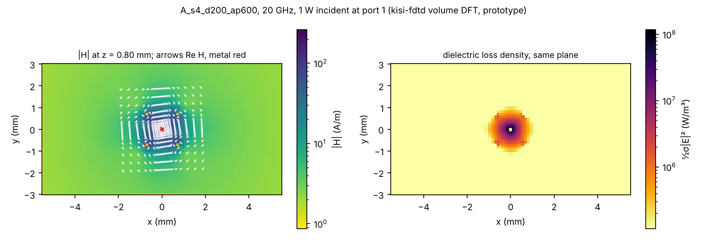
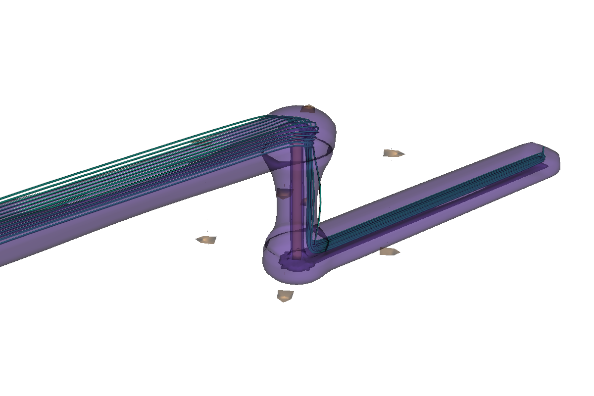

# 3D field view of a via (kisi-fdtd in the browser) – design note and effort estimate

Status: research (17 November 2026, branch `research/fdtd-field-view`). A small prototype of the field output is
on the branch (`kisi_fdtd::simulate_volume`, `fd_run_volume`, `validation/fdtd/volume_fields.py`); the product
does not use it. Numbers marked **measured** come from runs on this branch (`fdtd-field-view/measurements.json`);
everything marked **estimate** is a judgement, not a measurement.

ROADMAP: "Field views of a selected segment or via" (3D part) and "Advanced: 3D check with kisi-fdtd";
`validation/fdtd/BOARD_VIAS.md` sections 3, 4 and 5.6 (the 3D check in the viewer, cost and run times).

## Summary
- **Field output is cheap in kisi-fdtd.** A running DFT of all six components on the domain nodes, sampled every
  ~70–80 time steps (six samples per period of fmax, enough because the pulse has no content above ~1.5·fmax),
  costs **+2–6 % run time for three frequencies** (measured) and **48 bytes per node and frequency** (complex
  E and H in f32). Sampling every step instead changes the fields by 2·10⁻⁵ (relative rms) and costs +87 % for
  one frequency (measured). WebAssembly and native give bit-identical fields.
- **The fields are physically consistent.** On a 4-layer through via (457 k cells), the Poynting flux through
  the trace next to each port equals 1 − |S11|² and |S21|² within 0.9 % at 10–30 GHz, and the closed balance
  1 − |S11|² − |S21|² = dielectric loss + outflow into the PML holds within 0.2–1.3 % at 10/20/30 GHz (measured).
  A unit test does the same on a microstrip (flux 0.998 W for 1.000 W).
- **The browser is no limit for small via cut-outs.** A 0.46 M-cell case with three frequencies needs 103 MB
  of WebAssembly memory and 24 s in a Web Worker in headless Chromium (25 s in node, 20 s native: WebAssembly at
  0.8 of native); the 1.53 M-cell board via LibreVNA 413 MB. A worker may grow its memory to 4 GB (measured,
  Chromium, desktop); iOS Safari is the exception (often only 0.3–1 GB, WebKit bug 269777). Two workers ran two
  excitations at full speed side by side (measured, 2 vCPUs). Threads inside one run need SharedArrayBuffer,
  which a page from disk does not get (measured: `crossOriginIsolated` false, `SharedArrayBuffer` undefined).
- **Effort** (estimate, days of focused work): cut planes in the viewer **6–7 d to a first usable version,
  12–13 d to production** (including the solver plumbing that the 3D check needs anyway); real 3D with
  three.js on top of that **+6–8 d first, +12–15 d production** and +141 KB gzip (570 KB minified); volume
  rendering on top of 3D **+3–4 d first, +6–8 d production**, not recommended.
- **Recommendation:** field output in Rust and a VTK export for ParaView first (CLI, ~3 d, immediately usable
  for teaching), then the cut-plane view in the viewer next to the 3D check, then – if students ask for it – a
  lean 3D view (conductors, the movable cut plane in 3D, streamlines of S) in `kisi-advanced.html`.

## 1. Field output in kisi-fdtd

### What exists (main)
- **Monitor planes** (`Case::monitors`): the DFT of chosen **E** components on one mesh plane per monitor,
  every time step, during the first excitation; normalised per volt of the incident wave
  (`RunResult::fields`). The reference cases record a top view (Ez in the thickest dielectric) and a section
  through port 1 at 10/20/30 GHz, and `kisi-references-3d.html` draws them as 2D heat maps with the phase animated
  (`validation/fdtd/viewer_template.html`, `fieldPanel`, about 150 lines of canvas code with a geometry overlay).
- No H, no volume, no derived quantities; port voltages and currents are the only time-domain output. Metal is
  PEC (zero-thickness sheets, solid via cylinders, conformal or staircase), dielectric loss a conductivity fixed
  at `f_loss` (default fmax/2).

### Prototype on this branch
`VolumeSpec { freqs, stride, every }` and `simulate_volume(case, mesh, port, spec)` (one excitation; the S column
of that excitation comes with it), the native `kisi-fdtd case.json --volume out.bin` (spec under the case key
`volume`) and `fd_run_volume` in WebAssembly. `simulate` is unchanged in behaviour (S bit-identical to main,
measured); the work sits in a shared `excite` helper.
- **Accumulation:** after each sampled step `X += x·e^{−jωt}` for the six components on the sampled nodes, with
  E at (n+1)Δt and H at (n+½)Δt in the kernel – E and H phasors refer to the same instant, and the Yee offsets
  stay as they are (documented per component in `VolumeField`). `every = 0` chooses ⌊1/(6·fmax·Δt)⌋
  (72 steps at Δt = 58 fs, fmax = 40 GHz).
- **Normalisation:** peak phasors for **1 W incident** at the driven port (½|a|² = 1 W), so S = ½ Re(E × H*) is
  in W/m² and its flux in W, directly comparable with |S11|², |S21|². (The monitor planes use 1 V incident.)
- **Grid:** the domain only (the 8 PML cells per side are left out: they are 53 % of the cells of a small case
  and 40 % of a board via), optionally every `stride`-th line (stride 2: 1/8 of the data).
- **Material per E edge** (free fraction as u8, εr, σ) goes out with the fields: the loss density needs σ, a
  viewer the metal.
- **Output:** one blob, a JSON header (mesh lines, frequencies, the S column, array offsets) and little-endian
  arrays. `validation/fdtd/volume_fields.py` reads it (`check`: power balance; `compare`; `plot`: cut planes;
  `vtk`: a legacy VTK rectilinear grid for ParaView); `validation/fdtd/volume_wasm.mjs` runs it in node.

### Derived quantities and what is honest
| Quantity | How | Honest? |
|---|---|---|
| \|E\|, \|H\|, components, phase animation | the phasors, averaged to the nodes for display | yes, away from metal edges; within a cell of a metal edge the staircase/conformal fields are not resolved (field singularity at trace edges) |
| Poynting vector S = ½ Re(E × H*) | H averaged over the half cell to the E positions; flux through any mesh plane exactly (prototype `flux_x`, `box_flux`) | yes – checked against S (below); the 50/90 % "power tubes" of the 2D fork carry over |
| Dielectric loss density ½ σ \|E\|² | σ of the run | exact only at `f_loss`: σ is fixed, so at f ≠ f_loss the loss is tanδ·f_loss/f (the 0.14 W of the via case at 10 GHz is twice FR-4's). A field run should set `f_loss` to the shown frequency, or display ½ωε₀εr tanδ \|E\|² as an estimate |
| Conductor (surface) loss | not in the solver (PEC). Perturbation: ½ Rs \|H_t\|² on the metal surfaces, Rs = √(ωμ₀/2σ_Cu), H_t half a cell off the sheet, both sides of a sheet; the barrel from Hφ next to the cylinder | **estimate** only: under-resolved at trace edges (current crowding), no roughness unless Huray is applied as in kisi's line model; must be labelled so |
| Energy density, stored E/H energy | ¼ε\|E\|², ¼μ\|H\|² | yes |
| Time-domain picture (the pulse running through the via) | needs snapshots, not a DFT: 24 B per node and frame (E, H real) | possible for planes; for volumes memory-bound (60 frames × 0.9 M nodes = 1.3 GB) |

### Measured: memory and run time
Workspace: 2-vCPU Xeon VM, 8 GB, shared with two other agents (load average per line in the logs). One excitation.

| Case | cells / domain nodes | run | native: time, peak RSS | WebAssembly (node 22): time, memory | Chromium worker |
|---|---|---|---|---|---|
| A_s4_d200_ap600 (via L1→L4, 4 GND vias), 4001 steps | 457 k / 216 k | S only | 19.7 s, 34 MB | 25.2 s, 32 MB | 24.3 s |
| | | + volume 1 frequency | – | 25.8 s, 48 MB (blob 15.5 MB) | – |
| | | + volume 3 frequencies | 20.9 s (+6 %), 102 MB | 25.6 s (+2 %), 103 MB (blob 35.3 MB) | 24.3 s, 104 MB |
| | | + volume 1 freq., **every step** | +87 % (load 3) | – | – |
| | | + volume 1 freq., stride 2 | 36 MB, blob 2.2 MB | – | – |
| BV_vna_rf_hblb1 (LibreVNA board via), setup + 600 steps | 1.53 M / 0.92 M | S only | 33.0 s (setup 9.9 s), 117 MB | 47.5 s (setup 21.8 s), 110 MB | – |
| | | + volume 1 / 3 frequencies | 187 / 420 MB | 3 freq.: 413 MB, blob 150 MB | – |

- **Per node and frequency 48 B** (accumulators), **27 B per node** for the material arrays. The prototype
  builds the blob as a copy, so the peak is accumulators + blob (WebAssembly memory never shrinks): 413 MB for
  three frequencies on 0.92 M nodes. Handing JS views on the accumulators instead (zero copy) brings it down to
  solver + accumulators: ~275 MB there (estimate from the measured parts).
- **Projection** (estimate, linear in the measured bytes; domain nodes 47–60 % of the cells):

| cells | solver (75 B/cell) | + 1 frequency | + 3 frequencies, zero copy | + 3 frequencies, prototype (copy) |
|---|---|---|---|---|
| 0.5 M | 38 MB | 55 MB | 90 MB | 130 MB |
| 1 M | 75 MB | 110 MB | 180 MB | 270 MB |
| 3 M | 225 MB | 350 MB | 520 MB | 810 MB |
| 5.4 M (largest reference) | 405 MB | 650 MB | 1.0 GB | 1.5 GB |

- **Run time:** the DFT adds `steps/every × frequencies × 6 × nodes` multiply-adds: for the via case 55 samples
  → +2–6 % for three frequencies including writing the blob. Sampling every step would roughly double the run,
  the sampled DFT is as accurate (2.3·10⁻⁵ / 2.6·10⁻⁵ relative rms for E / H against every step, measured).
- **Accuracy check** (`volume_fields.py check`, via case, 1 W incident):

| f | 1 − \|S11\|² | flux on trace 1 (0.1 mm after the port) | \|S21\|² | flux on trace 2 (0.1 mm before the port) | 1 − \|S11\|² − \|S21\|² | dielectric loss + outflow |
|---|---|---|---|---|---|---|
| 10 GHz | 0.9967 W | 0.9915 W | 0.8552 W | 0.8559 W | 0.1414 W | 0.1368 + 0.0054 = 0.1422 W |
| 20 GHz | 0.9671 W | 0.9583 W | 0.7987 W | 0.8011 W | 0.1684 W | 0.1387 + 0.0293 = 0.1680 W |
| 30 GHz | 0.8425 W | 0.8357 W | 0.6374 W | 0.6427 W | 0.2051 W | 0.1398 + 0.0627 = 0.2024 W |

  The fluxes agree with the S-parameters within 0.5–0.9 % (port 1 side, the lumped port's near field) and
  0.1–0.8 % (port 2 side). Along each trace the flux falls by 1.4 %/mm (the FR-4 loss at σ(20 GHz)). The power that leaves the box (3–6 % at 20–30 GHz) is the via's radiation into the
  plane pair, which the PML absorbs – exactly what a field view should make visible.





## 2. Browser limits

| Topic | Finding |
|---|---|
| WebAssembly memory | wasm32: at most 4 GB per module. **Measured:** a worker in headless Chromium 153 (Linux, 8 GB) grew a `WebAssembly.Memory` to 4096 MB. Chrome has allowed 4 GB since version 83 ([V8 blog](https://v8.dev/blog/4gb-wasm-memory)), 64-bit Firefox reserves the same 4 GB per module ([SpiderMonkey blog](https://spidermonkey.dev/blog/2025/01/15/is-memory64-actually-worth-using.html)). **iOS Safari:** often only ~1 GB on a first load and 0.3–0.5 GB after a reload (WebKit [bug 269777](https://bugs.webkit.org/show_bug.cgi?id=269777), a duplicate of the open 269937); an Android phone with Chrome allocated 4 GB there. Practical limit (estimate): desktop 1.5–2 GB per worker without trouble, mobile ≤ 300 MB → cap the cells there (≈ 1 M cells with one frequency) |
| Run time, one worker | **Measured:** 0.46 M cells × 4001 steps in 24.3 s (Chromium) / 25.2 s (node) / 19.7 s (native); WebAssembly with SIMD at 0.78–0.81 of native (BOARD_VIAS: 0.84–0.88). Board vias: the setup dominates short runs (9.9 s native, 21.8 s WebAssembly for 1.53 M cells – the conformal polygon faces, BOARD_VIAS section 3). For 0.5 / 1 / 3 M cells see the table below |
| Several workers | **Measured:** two excitations in two workers at the same time: 24.7 / 24.8 s against 24.3 s for one alone (2 vCPUs, the other agents idle) – one worker per excitation or per frequency scales as long as the memory bandwidth lasts (BOARD_VIAS measured only +8 % for two native threads on a 1 M-cell case under load). A field view needs **one** excitation (port 1 driven); the S-parameters of the 3D check run the other ports in parallel |
| Threads inside one run | needs `SharedArrayBuffer` and a WebAssembly build with atomics (Rust: nightly or wasm-bindgen-rayon), i.e. a cross-origin-isolated page (COOP/COEP headers). **Measured:** a `file://` page has `crossOriginIsolated == false` and no `SharedArrayBuffer`; GitHub Pages sends no such headers (a service-worker shim such as coi-serviceworker can add them on Pages, never on `file://`). Domain decomposition over workers with halo exchange by `postMessage` (two exchanges per step, 4–40 k steps) is possible but costs latency and complexity (CPML and conformal faces across the cut) – not worth it |
| What kisi does today | classic-script workers from blob URLs (`web/src/field-pool.js`, `check-pool.js`, `export.js`, `prepare.js`), each with its own WebAssembly instance; no SharedArrayBuffer anywhere |
| Field data to the main thread | **Measured:** 35 MB (three frequencies): copy out of the WebAssembly memory 23 ms, `postMessage` with the buffer transferred 1 ms. For the main thread keep what is drawn: complex E, H at one frequency (48 B/node) or derived real fields (\|E\|, \|H\|, S, loss: 24 B/node); stride 2 or 8-bit quantisation (as the reference page does) for large cases |

**Run time per field view** (one excitation; estimate from the measured rates: 70 Mcells/s per WebAssembly worker on
this VM; a current laptop core 1.5–2× that, not measured; steps from BOARD_VIAS section 3):

| cells | typical steps | this VM, 1 worker | laptop (estimate) | memory with 3 frequencies (zero copy) |
|---|---|---|---|---|
| 0.5 M (via cut-out, quick mesh) | 8 k | ~1 min | 30–40 s | 90 MB |
| 1 M (board via, quick mesh / small reference) | 15 k | ~3.6 min | 1.8–2.5 min | 180 MB |
| 3 M (board via, standard mesh, −35 dB stop) | 25 k | ~18 min | 9–13 min | 520 MB |

Plus the setup (0.7–22 s in WebAssembly, to be reduced first, BOARD_VIAS 5.6). Above ~1 M cells the browser is
patience-bound, not memory-bound; the CLI (all cores, native) is the place for those.

## 3. Viewer options

All three start from the same data: the blob of one field run (or the arrays handed from the worker), the case
JSON (the conductor geometry in mm) and the derived fields. Shared work, needed for any option:

| Shared step | first (d) | production (d) |
|---|---|---|
| Solver: zero-copy array export, crop box around the via, progress import, `f_loss` = shown frequency, derived quantities in Rust (S, loss, ∫S·dA per plane, conductor-loss estimate), VTK/CSV export, tests | 1.5 | 3 |
| 3D-check plumbing (BOARD_VIAS 5.6 steps 1, 2 and the setup time): exporter in `kisi_core`, `kisi_fdtd.wasm` in a worker with progress/cancel | 2.5 | 4 |

### (a) Cut planes (canvas 2D)
One plane normal to x, y or z with a slider through the mesh lines; colour map of |E|, |H|, |S|, the loss density
or a component (log/linear, dB range); arrows of the in-plane E, H (at a phase, animated) or S (time average);
the conductors cut by the plane drawn from the case geometry (as the reference page's `overlay()` does for
z and y planes) or from the metal mask; a readout under the cursor; the power through the plane (∫S·dA) as a
number – the students' check that the picture and |S21|² agree; a small isometric sketch of where the plane is.
- **Reuse:** the reference page's field panel (colour ramp, phase animation, overlay), kisi's map code
  (`pi-map.js`: LUTs, marching-squares isolines, arrows on the power maps) – no WebGL in kisi so far.
- **Effort (estimate):** first usable **2–3 d**, production **5–6 d** (layout in the via panel, dark/light,
  phone width, hover, plane locator, `check_viewer.py` test, docs).
- **Bundle:** no library; ~20 KB own JS (estimate). `kisi_fdtd.wasm` (411 KB, 146 KB gzip, 194 KB gzip+base64 as
  `tools/bundle.py` stores modules – measured) is needed by the 3D check anyway.
- **Risks:** low. Readability is good (students know cross-sections from the 2D field views); one plane at a
  time hides the 3D path – the y = 0 section plus the z = mid-dielectric top view already tell most of the
  via's story (pictures above).

### (b) Real 3D with WebGL (three.js)
Conductors as meshes from the **case geometry** (sheets: rectangles and polygons with circular/slot holes via
three.js `ShapeGeometry` (earcut inside); barrels as cylinders, pads as discs; dielectric layers as faint
boxes), orbit camera, layer toggles; the movable cut plane of (a) as a textured quad in the scene; arrow glyphs
(`InstancedMesh` cones on a decimated grid above a magnitude threshold); streamlines of S seeded on port 1's
cross-section weighted by flux (RK4 with trilinear interpolation on the rectilinear grid); one isosurface
(marching cubes) of |E| or |H|.
- **Conductors from the voxel mask do not work:** the metal-mask contour loses the zero-thickness planes (the
  3D picture below shows only fragments of them); build them from the case.
- **Library:** three.js (MIT). Measured with esbuild: the subset a field view needs (WebGLRenderer, scene,
  meshes, lines, InstancedMesh, Data3DTexture, ShaderMaterial, OrbitControls) **570 KB minified, 141 KB gzip,
  188 KB gzip+base64**; all of three.js 750 / 190 / 254 KB (the renderer pulls most of the library in, so tree
  shaking saves only a quarter). regl (MIT) is 123 / 41 / 55 KB but brings no scene graph, controls, geometry
  or triangulation – 3–5 days of own code to save ~100 KB gzip; three.js fits better. Neither is in kisi today;
  either goes in as a vendored, pinned file (as `third_party/`), MIT is compatible with GPL-3.0.
- **Effort (estimate), on top of (a):** conductors 1.5 d, scene/camera/picking/toggles 1 d, cut plane in 3D
  0.5–1 d, arrows 1–1.5 d, streamlines with useful seeding 2–3 d, isosurface 1–1.5 d, integration (WebGL
  context loss, fallback to (a) without WebGL, theme, tests with screenshots, docs) 2 d → first usable
  **6–8 d** (conductors, cut plane, streamlines), production **12–15 d**.
- **Bundle:** +141 KB gzip (+570 KB as plain inlined JS, +15 % on kisi.html's 3.8 MB).
- **Risks:** readability – 3D vector fields clutter quickly; arrows need decimation and a threshold,
  isosurfaces need a chosen level (the "blob" around the trace in the picture below), and the conductors hide
  the field inside the via; streamlines of S are the clearest 3D picture (power following the barrel and
  leaking into the plane pair). Performance is no problem at ≤ 1 M nodes (5–20 k arrow instances, ~100
  streamlines); WebGL in CI runs on SwiftShader (headless Chromium), Firefox/WebKit headless vary.



### (c) Volume rendering
Ray marching through a 3D texture (WebGL2 `Data3DTexture`, half floats; the non-uniform mesh mapped with one
lookup texture per axis), a transfer-function editor, log scaling.
- **Effort (estimate), on top of (b):** first **3–4 d**, production **6–8 d**. Bundle: no further library.
- **Risks:** the least readable of the three for students (fuzzy clouds dominated by the edge singularities;
  needs a log transfer function and explanation); costly on mobile GPUs; adds little that a cut plane plus
  one isosurface does not show. Not recommended.

### In between
- **(a+) three planes at once** (x, y, z through a chosen point, side by side) and the isometric locator:
  +1–1.5 d on (a), no library – the "2.5D" view.
- **(b-lean)** three.js with conductors, the textured cut plane and S streamlines only (no arrows, no
  isosurface): first **4–5 d** on (a), production **7–9 d**; most of the teaching value of (b).
- **ParaView** via the VTK export (prototype works: an 11 MB legacy VTK file per frequency for 216 k nodes,
  read back with VTK 9.5): everything of (b) and (c), for teaching and for the curious, at ~0.5 d.

### Effort overview (estimate, days)
| Option | first usable | production | bundle added | totals with the shared steps (first / production) |
|---|---|---|---|---|
| shared: solver field output + 3D-check plumbing | 4 | 7 | `kisi_fdtd.wasm` 146 KB gzip (needed by the 3D check anyway) | – |
| (a) cut planes, canvas 2D | 2–3 | 5–6 | ~20 KB own JS | **6–7 / 12–13** |
| (a+) three planes and locator | +1–1.5 | +1.5–2 | – | 7–8.5 / 13.5–15 |
| (b-lean) three.js: conductors, cut plane in 3D, streamlines | +4–5 | +7–9 | +141 KB gzip (570 KB min) | 10–12 / 19–22 |
| (b) full 3D: + arrows, isosurface | +6–8 | +12–15 | +141 KB gzip | 12–15 / 24–28 |
| (c) volume rendering | +3–4 | +6–8 | – | 15–19 / 30–36 |
| VTK/CSV export for ParaView (CLI and viewer download) | 0.5 | 1 | – | part of the shared step |

## 4. Fit with "Advanced solvers" and `kisi-advanced.html`
- The 3D check (S-parameters, TDR against kisi's ladder) is planned under the "Advanced solvers" option of the
  viewer; `kisi_fdtd.wasm` adds ~0.2 MB (gzip+base64) to `kisi.html` and runs on demand in a worker. The cut-plane
  view needs nothing more and belongs next to it: same run (one excitation with field output), one more tab in
  the via's 3D-check panel.
- A WebGL view (b/c) needs three.js (+0.19 MB gzip+base64, +0.57 MB as plain inlined JS) and is used by few –
  it fits the second HTML `kisi-advanced.html` (prototyped on `feat/advanced-solvers` for the 2D field views of
  the fork, which carries gmsh + OCCT ≈ 12.5 MB anyway, so three.js is marginal there), with the same colour
  maps and normalisation (one excitation for all views) as the 2D field views. `kisi.html` stays lean.
- The reference page (`kisi-references-3d.html`) can show H, S and loss planes of the reference cases from the
  same output (~1 d once `fdtd_refs.py` records them), a ready-made teaching gallery.

## 5. Recommendation and staged plan
1. **Stage 1 – CLI and teaching material (≈3 d):** field output in kisi-fdtd production-ready (zero-copy, crop
   box, `f_loss` per run, derived quantities and ∫S·dA in Rust, conductor-loss estimate labelled as such),
   `kisi-validate via-case … --fields f` → VTK for ParaView, CSV of a plane, PNG cut planes; the power balance as
   a test. Course material and design reviews can use it right away, with all cores and board-sized cases.
2. **Stage 2 – the 3D check in the viewer with cut planes (≈9–10 d):** BOARD_VIAS 5.6 (exporter in `kisi_core`,
   worker with progress/cancel, faster setup, S/TDR against the ladder) and the cut-plane view (a), with the
   ∫S·dA number and a VTK/CSV download. Cell limit with an up-front time estimate; ≤ 1 M cells in the browser.
3. **Stage 3 – optional 3D in `kisi-advanced.html` (≈7–9 d for b-lean):** conductors from the case, the movable
   cut plane in 3D, S streamlines; arrows and one isosurface only if the lean version proves useful in a course.
   Volume rendering: no.

Total to a production cut-plane view in the viewer ≈ 12–13 d; with lean 3D ≈ 19–22 d; full 3D ≈ 24–28 d
(estimates, one developer, including tests and docs).

**Teaching reuse:** PNG of every plane (canvas `toBlob`; WebGL with `preserveDrawingBuffer`), the VTK file for
ParaView (slices, glyphs, streamlines, volume rendering without kisi code), CSV of a plane for spreadsheets/Python,
the case JSON for the `kisi-fdtd` CLI, and the reference page as a gallery of its cases with fields.

## 6. Open questions
- CLI first (ParaView material within days) or viewer first?
- Is a cut-plane view enough in the viewer, with WebGL only in `kisi-advanced.html` – or is 3D the goal?
- Frequencies: one chosen per run with `f_loss` set to it (exact loss density), or a fixed set (10/20/30 GHz)
  with the loss density at other frequencies marked as an estimate?
- Conductor loss: show a perturbation estimate (labelled), or leave it out (the solver is PEC)?
- Mobile/iOS: support it with a cell cap (~1 M cells, one frequency), or desktop only?
- Normalisation for students: 1 W incident (prototype, power flux in W) or 1 V incident (reference page)?
- A time-domain view (the pulse running through the via, plane snapshots) as well? Different output
  (snapshots, 24 B per node and frame); planes are affordable, volumes not.

## Reproduce
```
CARGO_TARGET_DIR=… cargo build --release -p kisi-fdtd
RUSTFLAGS="-C target-feature=+simd128" cargo build --release -p kisi-fdtd --lib --target wasm32-unknown-unknown
# a case with "volume": {"freqs": [1e10, 2e10, 3e10]} (and "excite": [0]), e.g. via_cases/A_s4_d200_ap600.json
kisi-fdtd case.json --volume out.bin > header.json
node validation/fdtd/volume_wasm.mjs kisi_fdtd.wasm case.json out_wasm.bin
python3 validation/fdtd/volume_fields.py check out.bin        # power balance
python3 validation/fdtd/volume_fields.py plot out.bin pics --freq 2e10 --y 0 --z 0.8
python3 validation/fdtd/volume_fields.py vtk out.bin field.vtk --freq 2e10   # ParaView
python3 docs/research/fdtd-field-view/vtk3d.py field.vtk 3d.png              # pip: vtk
cargo test --release -p kisi-fdtd volume_power_flux
```
