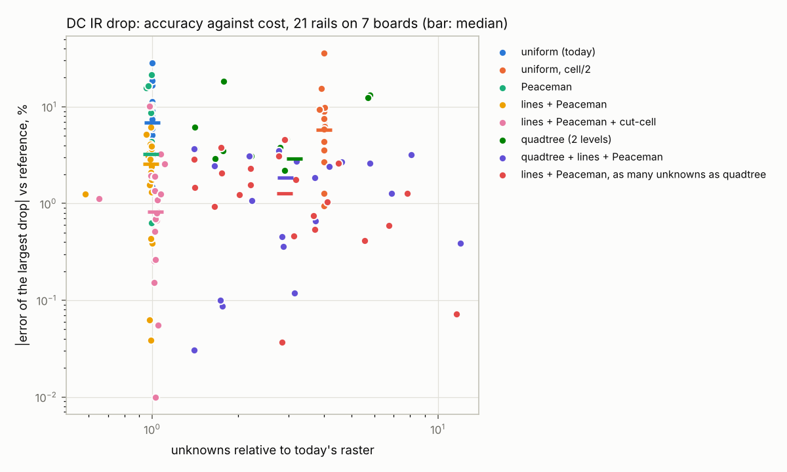
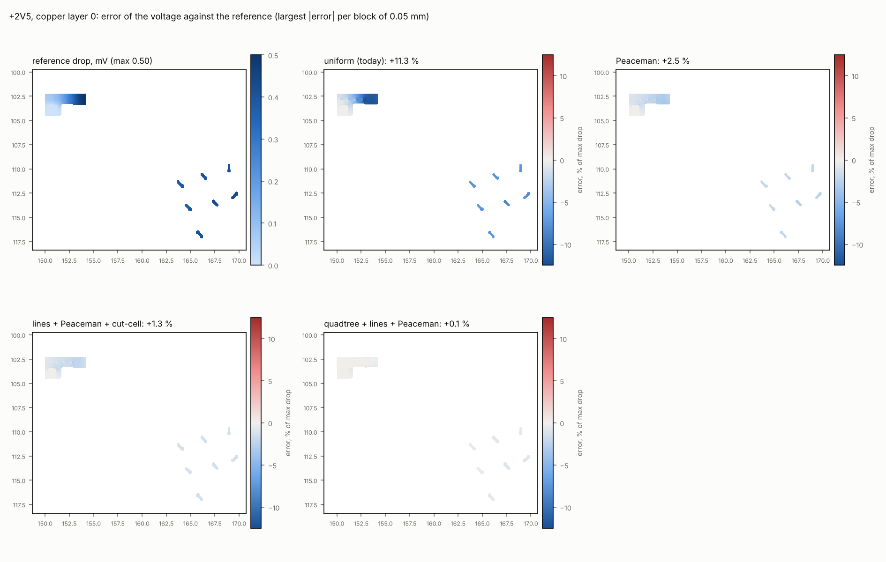
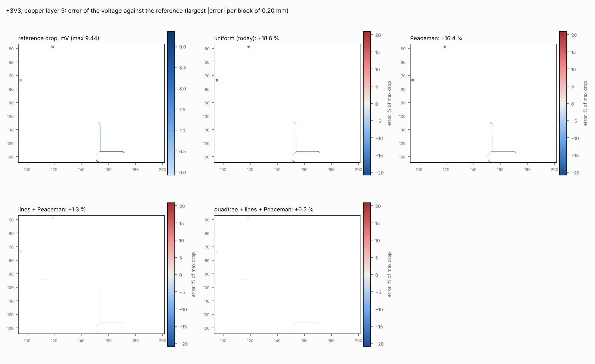

# DC IR drop: does a quadtree raster pay? – experiment

Status: experiment (November 2026, branch `exp/pi-quadtree`). The default solver is unchanged (golden results
identical); the refined solver is reachable only through `PiParams::refine` (JSON, no CLI or viewer control) and
the development harness `kisi-validate pi-refine`. Question: does quadtree refinement of the DC IR-drop raster
(`kisi_pi::pi`) improve accuracy per unknown and per second against today's uniform square raster, and how does it
compare with cheaper fixes?

## Summary

- **Today's raster is off by 7 % (median of 21 rails on 7 boards) in the largest drop, up to +28 % / −19 %**,
  almost always too much drop. Two causes dominate, and neither is what a quadtree addresses best:
  1. **Via contacts.** A barrel joined to the one cell that holds its centre behaves like a disc of 0.2 cell
     (Peaceman); real barrels are 1.5–15 times larger than that on kisi's rasters. The spreading resistance into a pour
     is overestimated by Rs/2π·ln(r_w/0.2h) per contact – +29 % for two vias in a plane – and refining the raster makes
     it *worse* (log divergence of a point contact: cell/2 has a 5.8 % median error, cell 0.1 instead of 0.25 +53 % in
     the two-vias case).
  2. **Tracks.** A slanted track is a staircase of cells (up to √2 longer), tracks one to a few cells wide are rounded
     to whole cells (−15 … +110 % per track on a 0.2 mm raster); cell/8 still leaves +6 … +22 %. Two connectivity
     bugs (45° tracks) disconnect loads at some cell sizes (26 of 29 loads of a Marble rail at 0.3 mm).
- **Cheap fixes beat the quadtree.** A Peaceman-type correction of the contact cell's links (no extra unknowns,
  exact on the analytic cases at any cell), tracks as line conductors (fewer unknowns, exact at any angle) and
  cut-cell weights bring the median error from 6.9 % to **0.8 % at the same unknowns** (1.8× time, all in the
  rasterisation). The quadtree (2 levels around vias and pads) alone: 2.9 % at 3.1× unknowns and 3.6× time; with
  lines and Peaceman 1.8 % at 2.9× – a uniform raster with the same fixes and the same unknowns gets 1.3 %.
- **Recommendation:** do not productise the quadtree for the DC drop. Productise, in this order, the fix of the two
  `fill_track` connectivity bugs, the Peaceman link correction, line tracks, then cut-cell weights (supersampling only
  at boundary cells to keep the rasterisation cheap). The PDN grid shares the via and track weak spots (same fixes,
  no quadtree: it is solved once per frequency); the thermal grid already uses copper fractions and gets the
  better IR drop through `solve_rail_scaled`.

## 1 Today's raster and its expected weak spots

`pi::solve_rail` rasterises the rail's copper per layer into square cells (automatic size 0.05 … 1 mm, at most
250 000 copper cells, a tidy value; 0.05 … 0.5 mm on the boards below), a cell is copper when its centre is
(`fill_polygon`), tracks narrower than 1.05 cells mark the cells within half a cell diagonal of their centre line
with the weight width/cell (`fill_track`), neighbours are joined by the sheet conductance (harmonic mean of the
weights), a via or a plated hole joins the cell that contains its centre on every layer of its span through its
barrel (25 µm plating), source pads are fixed at the rail voltage, load pads draw their current evenly from their
cells. Expected weak spots (from the discussion with the maintainer): spreading at vias and pads (a via is about
one cell), necks in copper zones, staircase edges.

## 2 What was built

`crates/kisi-pi/src/pi_refine.rs` – one solver with options (`Mesh`); without options it is `solve_rail` to the
last bit (test `unrefined_is_solve_rail`).

- **Quadtree per base cell.** The base grid of `solve_rail` (same cell, same origin) is kept; a base cell of level
  k is split into 2^k × 2^k square leaves. Levels are set per base cell – within `radius` × drill diameter of vias
  and plated holes, on the pads of loads and sources, at necks, at copper edges, or everywhere (a uniform finer
  grid aligned with the base grid, used for the references) – and balanced 2:1 between face neighbours. Leaves are
  rasterised like the base grid at their own size, tile by tile (16 × 16 base cells). Neighbouring leaves are
  joined by sheet conductance × face length / centre distance (two-point flux; a leaf and a half-size neighbour get
  2/3 of a square's conductance; the tangential offset of the centres is ignored – a known first-order
  inconsistency of this scheme that the measurements below include). Pads and load currents follow the leaves
  (current by leaf area). Results go back to the base grid (mean voltage, largest current density, summed loss) so
  that the viewer, the loss map and the thermal step could use them unchanged.
- **Via contacts.** `Contact::Cell` as today. `Contact::Disc`: the barrel is an equipotential circle of radius
  drill/2; all copper leaves whose centres lie within r_w + 0.35 leaf become one node. The 0.35 was found on the
  two-vias case (scan in the test `disc_grow_scan`): leaves tied at their centres short a region about a third of a
  leaf beyond them; without it the disc contact converges slowly (+13 % at r_w/h = 1.2, +1.8 % at r_w/h = 4.8).
- **Peaceman-type correction** (Peaceman 1978/1983, well index of reservoir simulation). A single cell node of the
  5-point stencil with a point source behaves like a disc of radius r_eq ≈ 0.198 h. Barrels are larger than that on
  every kisi raster (r_w = 0.1 … 0.15 mm, h = 0.05 … 0.5 mm), so the textbook correction – a resistance
  Rs/2π · ln(r_eq/r_w) between barrel and cell – is *negative*: as a series element it makes the matrix
  indefinite, and between more than two layers it is not even passive. The correction is therefore put into the
  contact cell's own links: with the neighbours at their undisturbed potential (V_c − V_nb = I·Rs/4 for the plain
  stencil), the cell holds the rim potential of the barrel when each of its four links is scaled by
  f = 1 / (1 − (2/π)·ln(r_w / (0.198 h))), positive for r_w < 0.95 h (f = 1 at r_w = 0.198 h, f ≈ 3.4 at
  r_w = 0.6 h). Only links between full-copper cells are scaled. Barrels larger than 0.7 h use the disc contact. The
  same ln(r/r_w) spreading holds for the plane-pair inductance in the AC grid (`pdn_ic`) and for heat in a copper
  sheet (`thermal`).
- **Cut-cell weights** (option `cut_cell`): a cell's weight is its copper fraction from s × s samples instead of
  copper-at-the-centre.
- **Line tracks** (option `track_lines`), not on the original list: tracks narrower than N base cells are not
  rasterised but become line conductors – the leaves along the centre line in order, joined by
  sheet conductance × width / distance between the mean positions of the line in consecutive leaves (exact for a
  straight track at any angle); none where both leaves are full raster copper (a track over a pour); a track end
  lying on another track or within half its width of raster copper is joined to it; tracks that overlap another
  track of the net along their length (parallel or stacked tracks) stay rasterised, their union is what conducts.

Harness: `kisi-validate pi-refine <board> [--config F | --no-config] [--auto N] [--rails …] [--variants …]
[--max-ref N] [--json F] [--dump DIR --dump-rail NAME]` (`crates/kisi-cli/src/pirefine.rs`). Per rail it solves
today's raster, the variants and a **reference**: the base grid refined uniformly (cell/8 where it fits in
4 M unknowns, else cell/4 or cell/2), disc contacts, line tracks below 4 base cells. Errors: of the largest drop
(the number kisi reports), of the voltage field (every reference leaf against the variant's leaf at its centre:
max, area mean, and the max away from barrels and load/source pads), at the loads (v_min) and at the barrels (every
contact), all in % of the rail's largest drop. Boards without a power configuration (the corpus) get synthetic
setups (`--auto 2`: the two largest supply pours, the source the inductor – else connector, else IC – with the most
pads on the net, the ICs on the net as loads, 1 A split by pad count). Memory is the rise of the peak resident
memory during a solve (indicative: freed memory the allocator keeps counts as resident).

Independent reference: padne (KiCad FEM DC solver, GPL) was inspected but not installed – it builds a C++
extension against CGAL (submodule) and MKL wheels and pulls PySide6 (about 1 GB of build dependencies against
5 GB of free disk here), and it takes its sources and loads from text directives in the schematic, which the
shrunk example boards do not have. The references are therefore kisi's own refined rasters, checked on analytic
cases (section 3) and by their own convergence (column "ref − next coarser" below).

## 3 Analytic cases (tests in `pi_refine.rs`)

35 µm copper (Rs = 0.491 mΩ/□), 0.3 mm drill vias.

| case | expected | today | Peaceman | quadtree 2 levels | uniform cell/8, disc | other |
|---|---|---|---|---|---|---|
| two vias 6 mm apart in a 20 × 20 mm plane, cell 0.25 (images for the edges) | 0.601 mΩ | +28.8 % | −0.1 % | −0.5 % | −0.6 % | today at cell 0.1: +53 %; Peaceman at 0.1 / 0.5: −1.3 % / −0.1 % |
| via in a round plane fed from a ring, cell 0.25: Rs/2π·ln(R/r_w) | 0.268 mΩ | +32.8 % | +0.5 % | −0.5 % | −0.4 % | |
| 4 mm strip with a 1 × 2 mm neck, cell 0.25: squares + 2 × conformal step | 3.329 mΩ | +1.7 % | – | – | +0.1 % | edges refined once: −0.1 % |

Tracks of 10 mm on a 0.2 mm raster, source and load at the ends (R = Rs·L/w):

| width | angle | today | cell/2 | cut-cell 4×4 | cell/8 | line tracks |
|---|---|---|---|---|---|---|
| 0.15 mm | 0° | −0.5 % | −24.5 % | 0.0 % | +0.4 % | −0.7 % |
| | 30° | +31.5 % | +84.5 % | +32.0 % | +13.6 % | −1.2 % |
| | 45° | +39.5 % | +113 % | +39.8 % | +21.6 % | −1.5 % |
| 0.3 mm | 0° | +50.0 % | +0.9 % | +0.9 % | +1.4 % | −0.8 % |
| | 30° | +83.0 % | +32.0 % | +37.3 % | +7.5 % | −1.2 % |
| | 45° | +110 % | +42.6 % | +59.7 % | +7.5 % | −1.5 % |
| 0.5 mm | 0° | −15.0 % | +2.3 % | +1.5 % | +3.2 % | −0.7 % |
| | 30° | +39.8 % | +18.7 % | +20.1 % | +6.5 % | −1.2 % |
| | 45° | +75.0 % | +20.3 % | +24.7 % | +8.0 % | −1.5 % |

Why: a slanted track narrower than a cell is a 4-connected staircase of cells, up to √2 longer than the track;
a track between 1.05 and a few cells wide is filled by its width alone and rounded to whole rows (0.3 mm on 0.2 mm
cells: one row or two, −33 … +50 %), a slanted one keeps only the staircase's core; refining the raster only
shrinks this slowly (cell/8: still +6 … +22 %). The line tracks' −0.7 … −1.5 % is the half leaf at each end where
the line starts at a leaf's centre instead of the track's end.

**Two connectivity bugs of today's raster** (test `diagonal_breaks`): (1) a thin 45° track whose centre line runs
through cell centres puts its side cells exactly at the reach (half the cell diagonal); rounding drops them and the
chain falls apart ("cells without connection", the load not connected); (2) a 45° track 1.05 … 1.41 cells wide is
filled by its width alone and can leave one diagonal row of cells, which is not 4-connected. Both happen on real
boards: on the Marble board a 0.3 mm raster leaves 26 of 29 loads of a rail unconnected (table below, `uniform_eq`
at 0.304 mm). A fix in `fill_track` (a reach with a margin; the thin-track rule up to √2 cells) is independent of
this experiment.

## 4 Boards

Seven boards, 21 rails: ThunderScope Rev5.3 and LibreVNA with their power trees (`web/samples/*.kisi.json`), and
five corpus boards (`data/corpus.json`: bitaxe, moteus, zynq-som, hackrf, marble) with synthetic setups (`--auto 2`).
Error of the largest drop against the reference, % (positive: kisi reports more drop than the reference; "open":
loads the raster leaves unconnected). Columns: `uniform` today; `uniform_x2` cell/2; `peaceman` the via
correction; `cut4` cut-cell weights (4 × 4 samples); `lines` line tracks (narrower than 3 cells); `lines_pm`
lines + Peaceman; `lines_pm_cut4` all three; `lines_pm_x2` lines + Peaceman at cell/2; `qt2` quadtree, 2 levels within
3 drill diameters of every via and plated hole and on load/source pads, disc contacts; `qt2_lines_pm` quadtree +
lines + Peaceman; `uniform_eq` / `lines_pm_eq` a uniform raster with as many unknowns as `qt2` (cell scaled).
"ref − next coarser": how much the reference moved in its last refinement step (its own uncertainty is of that
order or less).

| board | rail | cell mm | ref | ref − next coarser | uniform | uniform_x2 | peaceman | cut4 | lines | lines_pm | lines_pm_cut4 | lines_pm_x2 | qt2 | qt2_lines_pm | uniform_eq | lines_pm_eq |
|---|---|---|---|---|---|---|---|---|---|---|---|---|---|---|---|---|
| bitaxeUltra | /3V3 | 0.125 | ref_l2 (3.44 M) | -0.32 % | +16.9 | +9.6 | +10.2 | +9.0 | +5.2 | +0.4 | +0.3 | +0.3 | +6.1 | +0.0 | +17.8 | +1.5 |
| bitaxeUltra | /VDD | 0.050 | ref_l2 (1.94 M) | -1.75 % | +4.8 | +3.4 | +3.3 | +3.5 | +4.8 | +3.3 | +1.9 | +1.8 | +3.2 | +3.2 | +3.0 | +1.3 |
| hackrf-one | VCC | 0.150 | ref_l2 (3.29 M) | -0.54 % | +6.9 | +1.0 | +6.4 | +0.9 | +6.6 | +6.1 | +0.3 | +0.3 | +4.6 | +4.7 | +5.1 | +4.6 |
| hackrf-one | VAA | 0.100 | ref_l2 (3.93 M) | -1.53 % | +28.3 | +35.6 | -0.6 | +27.0 | +28.9 | -0.0 | -1.9 | +1.5 | -3.8 | -3.5 | +28.9 | -3.1 |
| Marble | +3V3 | 0.500 | ref_l2 (1.01 M) | -0.15 % | +5.1 | +2.7 | +4.4 | +1.6 | +1.1 | +0.4 | -3.2 | +0.1 | +3.5 | +0.1 | -52.8 (1 open) | +2.1 |
| Marble | +3.3P | 0.400 | ref_l3 (2.81 M) | -0.14 % | -18.9 | -15.4 (5 open) | -21.4 | -19.3 | -3.9 | -4.1 | -0.7 | +1.5 | -18.2 (1 open) | -0.1 | -98.0 (26 open) | +3.8 |
| moteus_x1 | V+ | 0.125 | ref_l2 (3.16 M) | -3.30 % | +16.7 | +8.9 | +15.7 | +7.7 | -4.1 | -5.1 | -10.1 | +3.3 | +13.2 | -2.6 | +7.7 | -0.4 |
| moteus_x1 | +3V | 0.100 | ref_l2 (1.76 M) | +0.21 % | +7.0 | +4.4 | +3.2 | +3.4 | +3.4 | +0.1 | -1.9 | -0.2 | +2.2 | +0.4 | +3.4 | +0.0 |
| Thunderscope_Rev5.3 | +5V | 0.100 | ref_l2 (2.67 M) | -2.16 % | +4.9 | +4.3 | +3.6 | +2.1 | +4.9 | +3.6 | +0.8 | +2.2 | +3.1 | +3.1 | +4.3 | +2.3 |
| Thunderscope_Rev5.3 | +1V8 | 0.050 | ref_l3 (3.68 M) | -0.23 % | +5.7 | +5.6 | +3.0 | +3.8 | +5.7 | +3.0 | +1.1 | +2.2 | +2.7 | +2.7 | +5.0 | +1.8 |
| Thunderscope_Rev5.3 | +5V3 | 0.050 | ref_l3 (1.43 M) | -0.19 % | +1.5 | +1.3 | +1.3 | +0.9 | +1.5 | +1.3 | +0.7 | +1.1 | +1.1 | +1.1 | +1.7 | +1.6 |
| Thunderscope_Rev5.3 | +VUSB | 0.125 | ref_l2 (3.31 M) | -0.33 % | +6.0 | +3.5 | +3.9 | +2.1 | +6.0 | +3.9 | +0.1 | +0.3 | +3.7 | +3.7 | +5.4 | +2.9 |
| Thunderscope_Rev5.3 | +1V0 | 0.050 | ref_l3 (3.76 M) | -0.14 % | +6.6 | +6.6 | +1.5 | +5.6 | +6.6 | +1.5 | +0.5 | +0.8 | +1.3 | +1.3 | +6.8 | +0.6 |
| Thunderscope_Rev5.3 | +2V5 | 0.050 | ref_l2 (1.07 M) | +0.32 % | +11.3 | +9.8 | +2.5 | +9.9 | +11.3 | +2.5 | +1.3 | -0.3 | +0.1 | +0.1 | +10.5 | +0.5 |
| Thunderscope_Rev5.3 | GND | 0.500 | ref_l2 (2.56 M) | -3.16 % | +9.1 | +6.3 | +8.7 | -2.3 | +10.5 | +10.1 | -2.6 | +2.4 | +0.4 | +0.4 | +3.7 | +0.1 |
| VNA | +6V | 0.125 | ref_l2 (1.30 M) | -0.53 % | +3.5 | +1.3 | +3.0 | +0.7 | +2.9 | +2.4 | +0.0 | +0.5 | +2.9 | +2.4 | +1.6 | +0.9 |
| VNA | +3V3 | 0.200 | ref_l3 (0.12 M) | -0.06 % | +18.6 | +9.3 | +16.4 | +11.3 | +1.3 | +1.3 | +1.1 | +0.4 | +12.4 | +0.5 | +7.8 | +1.2 |
| VNA | +5V{slash}2 | 0.050 | ref_l3 (1.07 M) | -0.01 % | +5.1 | +3.6 | +3.1 | +3.2 | +5.1 | +3.1 | +1.3 | +1.6 | +2.7 | +2.7 | +4.6 | +2.6 |
| VNA | +5V | 0.075 | ref_l2 (1.29 M) | -0.53 % | +6.0 | +5.8 | +1.8 | +4.8 | +6.0 | +1.8 | +0.2 | +0.5 | +0.7 | +0.7 | +5.8 | +0.5 |
| Zynq_SoM | VIN | 0.075 | ref_l2 (2.12 M) | -0.73 % | +7.9 | +7.5 | +2.1 | +6.2 | +7.9 | +2.1 | +0.5 | +0.7 | +1.8 | +1.8 | +7.3 | +0.7 |
| Zynq_SoM | +1V8 | 0.075 | ref_l2 (1.27 M) | -0.92 % | +7.4 | +5.8 | +3.1 | +5.1 | +6.9 | +2.8 | +0.8 | +0.9 | +2.4 | +2.4 | +5.9 | +1.0 |

Medians over the 21 rails (unknowns and time relative to today's raster on the same rail; native, one thread):

| variant | median abs drop error | max abs drop error | median abs error at the loads | median unknowns | median time |
|---|---|---|---|---|---|
| uniform (today) | 6.88 % | 28.3 % | 6.97 % | 1.0× | 1.0× |
| uniform, cell/2 | 5.78 % | 35.6 % | 5.92 % | 4.0× | 5.4× |
| Peaceman | 3.23 % | 21.4 % | 3.90 % | 1.0× | 1.0× |
| cut-cell | 3.78 % | 27.0 % | 5.05 % | 1.0× | 1.9× |
| line tracks | 5.20 % | 28.9 % | 5.73 % | 1.0× | 1.0× |
| lines + Peaceman | 2.55 % | 10.1 % | 2.95 % | 1.0× | 1.0× |
| lines + Peaceman + cut-cell | 0.83 % | 10.1 % | 1.08 % | 1.0× | 1.8× |
| lines + Peaceman, cell/2 | 0.81 % | 3.3 % | 0.95 % | 4.0× | 5.3× |
| quadtree (2 levels) | 2.90 % | 18.2 % | 2.90 % | 3.1× | 3.6× |
| quadtree + lines + Peaceman | 1.84 % | 4.7 % | 1.97 % | 2.9× | 3.5× |
| uniform, as many unknowns as quadtree | 5.77 % | 98.0 % | 5.77 % | 3.2× | 4.0× |
| lines + Peaceman, as many unknowns as quadtree | 1.27 % | 4.6 % | 1.40 % | 2.9× | 4.2× |



Unknowns / time per rail relative to today's raster:

<details><summary>table</summary>

| board | rail | uniform N / t | uniform_x2 N / t | peaceman N / t | cut4 N / t | lines N / t | lines_pm N / t | lines_pm_cut4 N / t | lines_pm_x2 N / t | qt2 N / t | qt2_lines_pm N / t | uniform_eq N / t | lines_pm_eq N / t |
|---|---|---|---|---|---|---|---|---|---|---|---|---|---|
| bitaxeUltra | /3V3 | 1.0× / 1.0× | 4.0× / 4.9× | 1.0× / 0.9× | 1.0× / 1.1× | 1.0× / 0.9× | 1.0× / 1.1× | 1.0× / 1.1× | 4.0× / 4.7× | 1.4× / 1.5× | 1.4× / 1.5× | 1.4× / 1.4× | 1.4× / 1.5× |
| bitaxeUltra | /VDD | 1.0× / 1.0× | 4.0× / 4.9× | 1.0× / 0.9× | 1.0× / 1.8× | 1.0× / 0.9× | 1.0× / 0.9× | 1.0× / 1.5× | 3.9× / 4.7× | 8.1× / 9.4× | 8.1× / 9.9× | 8.1× / 10.4× | 7.8× / 10.7× |
| hackrf-one | VCC | 1.0× / 1.0× | 4.0× / 5.6× | 1.0× / 0.9× | 1.0× / 1.9× | 1.0× / 1.0× | 1.0× / 1.0× | 1.0× / 2.0× | 4.0× / 5.2× | 3.0× / 3.3× | 2.9× / 3.5× | 2.9× / 3.2× | 2.9× / 3.4× |
| hackrf-one | VAA | 1.0× / 1.0× | 4.0× / 5.4× | 1.0× / 1.0× | 1.0× / 1.7× | 1.0× / 1.0× | 1.0× / 1.0× | 1.0× / 1.6× | 4.0× / 5.0× | 2.8× / 3.1× | 2.8× / 3.2× | 2.8× / 3.2× | 2.8× / 3.5× |
| Marble | +3V3 | 1.0× / 1.0× | 4.0× / 8.0× | 1.0× / 1.0× | 1.1× / 3.2× | 1.0× / 1.1× | 1.0× / 1.2× | 1.1× / 3.0× | 4.0× / 7.2× | 1.8× / 3.2× | 1.8× / 4.0× | 1.8× / 1.9× | 1.8× / 2.0× |
| Marble | +3.3P | 1.0× / 1.0× | 3.9× / 5.5× | 1.0× / 1.0× | 1.1× / 3.1× | 1.0× / 1.1× | 1.0× / 1.1× | 1.0× / 3.8× | 3.8× / 6.2× | 1.8× / 2.0× | 1.7× / 2.0× | 0.0× / 0.6× | 1.7× / 2.0× |
| moteus_x1 | V+ | 1.0× / 1.0× | 4.0× / 4.2× | 1.0× / 0.8× | 1.0× / 1.4× | 1.0× / 1.0× | 1.0× / 0.8× | 1.0× / 1.4× | 3.8× / 3.7× | 5.8× / 6.1× | 5.8× / 5.9× | 5.8× / 5.8× | 5.5× / 5.9× |
| moteus_x1 | +3V | 1.0× / 1.0× | 4.0× / 5.4× | 1.0× / 0.9× | 1.0× / 2.1× | 1.0× / 1.1× | 1.0× / 1.1× | 1.0× / 2.1× | 3.9× / 6.1× | 2.9× / 3.6× | 2.9× / 3.4× | 2.9× / 4.0× | 2.9× / 4.3× |
| Thunderscope_Rev5.3 | +5V | 1.0× / 1.0× | 4.0× / 7.1× | 1.0× / 1.1× | 1.1× / 2.8× | 1.0× / 1.2× | 1.0× / 1.2× | 1.0× / 2.9× | 4.0× / 7.2× | 2.2× / 2.7× | 2.2× / 3.4× | 2.2× / 3.0× | 2.2× / 3.1× |
| Thunderscope_Rev5.3 | +1V8 | 1.0× / 1.0× | 4.0× / 5.8× | 1.0× / 1.0× | 1.1× / 1.3× | 1.0× / 1.0× | 1.0× / 1.0× | 1.0× / 1.4× | 4.0× / 5.5× | 3.2× / 4.0× | 3.2× / 4.1× | 3.2× / 4.6× | 3.2× / 4.2× |
| Thunderscope_Rev5.3 | +5V3 | 1.0× / 1.0× | 4.0× / 4.4× | 1.0× / 0.8× | 1.0× / 1.1× | 1.0× / 0.8× | 1.0× / 1.0× | 1.0× / 1.8× | 4.0× / 4.6× | 2.2× / 2.3× | 2.2× / 2.3× | 2.2× / 2.1× | 2.2× / 2.2× |
| Thunderscope_Rev5.3 | +VUSB | 1.0× / 1.0× | 4.0× / 7.7× | 1.0× / 1.0× | 1.1× / 2.3× | 1.0× / 1.2× | 1.0× / 1.3× | 1.0× / 2.6× | 4.0× / 7.7× | 1.4× / 1.9× | 1.4× / 1.9× | 1.4× / 2.0× | 1.4× / 2.2× |
| Thunderscope_Rev5.3 | +1V0 | 1.0× / 1.0× | 4.0× / 6.8× | 1.0× / 1.2× | 1.0× / 2.2× | 1.0× / 1.2× | 1.0× / 1.0× | 1.0× / 1.5× | 3.9× / 5.8× | 6.9× / 12.3× | 6.9× / 13.3× | 6.9× / 13.7× | 6.8× / 13.6× |
| Thunderscope_Rev5.3 | +2V5 | 1.0× / 1.0× | 4.0× / 4.9× | 1.0× / 0.9× | 1.0× / 1.2× | 1.0× / 0.9× | 1.0× / 0.9× | 1.0× / 1.2× | 4.0× / 4.8× | 3.1× / 3.4× | 3.1× / 3.4× | 3.2× / 3.8× | 3.1× / 4.1× |
| Thunderscope_Rev5.3 | GND | 1.0× / 1.0× | 4.0× / 5.0× | 1.0× / 0.8× | 1.1× / 1.7× | 1.0× / 0.8× | 1.0× / 0.8× | 1.1× / 1.7× | 4.0× / 4.3× | 12.0× / 12.4× | 12.0× / 12.5× | 12.0× / 13.6× | 11.6× / 13.6× |
| VNA | +6V | 1.0× / 1.0× | 4.0× / 6.6× | 1.0× / 1.1× | 1.0× / 2.6× | 1.0× / 1.2× | 1.0× / 1.4× | 1.0× / 2.6× | 4.0× / 7.0× | 1.7× / 2.1× | 1.7× / 2.1× | 1.7× / 2.0× | 1.7× / 2.4× |
| VNA | +3V3 | 1.0× / 1.0× | 3.8× / 2.3× | 1.0× / 1.0× | 1.3× / 10.8× | 0.6× / 1.3× | 0.6× / 1.5× | 0.7× / 11.4× | 1.2× / 1.8× | 5.7× / 4.5× | 2.8× / 2.6× | 5.5× / 8.4× | 2.0× / 10.1× |
| VNA | +5V{slash}2 | 1.0× / 1.0× | 4.0× / 2.7× | 1.0× / 0.7× | 1.1× / 2.2× | 1.0× / 0.8× | 1.0× / 0.8× | 1.1× / 2.4× | 3.9× / 2.8× | 4.6× / 3.6× | 4.6× / 3.6× | 4.6× / 5.4× | 4.5× / 4.2× |
| VNA | +5V | 1.0× / 1.0× | 4.0× / 4.7× | 1.0× / 1.0× | 1.0× / 1.4× | 1.0× / 1.0× | 1.0× / 1.0× | 1.0× / 1.7× | 4.0× / 5.5× | 3.7× / 5.9× | 3.7× / 6.0× | 3.7× / 5.7× | 3.7× / 6.0× |
| Zynq_SoM | VIN | 1.0× / 1.0× | 4.0× / 5.7× | 1.0× / 1.1× | 1.0× / 1.1× | 1.0× / 0.8× | 1.0× / 0.9× | 1.0× / 1.2× | 4.0× / 5.3× | 3.7× / 5.0× | 3.7× / 4.8× | 3.7× / 4.3× | 3.7× / 4.7× |
| Zynq_SoM | +1V8 | 1.0× / 1.0× | 4.0× / 5.6× | 1.0× / 0.9× | 1.1× / 1.9× | 1.0× / 0.8× | 1.0× / 0.9× | 1.0× / 2.0× | 3.9× / 5.8× | 4.2× / 5.8× | 4.2× / 5.4× | 4.2× / 5.6× | 4.1× / 6.3× |

</details>

Error maps (largest error per base cell on one layer, % of the rail's largest drop; blue: kisi's voltage too low):
a via-fed pour (ThunderScope +2V5, 0.05 mm cells) – today's error sits in the pour behind the vias, the Peaceman
correction removes most of it, the quadtree the rest – and a track-fed rail (LibreVNA +3V3, 0.2 mm cells) – the
slanted tracks carry the error, only line tracks remove it:





**Memory:** a solve needs about 1 GB per million unknowns (faer's Cholesky with fill-in; references: 0.83 GB at
0.92 M, 2.7 GB at 2.56 M, 3.1 GB at 2.81 M unknowns); today's rasters (≤ 0.25 M unknowns) stay below 0.25 GB, the
quadtree multiplies that by its unknowns (3× median, 12× on the ThunderScope's GND).

**WASM** (`kisi_pi_solve` with `params.refine` in Node 22, ThunderScope, best of 3): +1V0 111 ms today, 117 ms
Peaceman, 120 ms lines + Peaceman, 1.09 s quadtree (6.9× unknowns); +VUSB 430 / 489 / 496 / 664 ms (1.4×). The
ratios are the native ones; WASM is about as fast as the native single-thread solve here.

## 5 Findings

1. **Refining today's model does not converge to the right answer.** The cell contact of a barrel is a point
   contact whose spreading resistance grows as ln(1/h); the track rounding does not shrink with h for tracks near a
   cell width. Uniform cell/2 (4× unknowns, 5.5× time) moves the median error only from 6.9 to 5.8 %, and on
   hackrf VAA from +28 to +36 %; a uniform raster with the quadtree's unknowns: 5.8 %.
2. **Via contacts are the largest error on pour-fed rails.** The Peaceman link correction alone: TS +2V5
   +11.3 → +2.5 %, +1V0 +6.6 → +1.5 %, Zynq VIN +7.9 → +2.1 %, hackrf VAA +28 → −0.6 %; median 6.9 → 3.2 %, at no
   cost (merged disc contacts even remove a few unknowns). The disc contact of the quadtree does the same job with
   more unknowns.
3. **Tracks are the largest error on track-fed rails.** Line tracks: VNA +3V3 +18.6 → +1.3 %, Marble +3.3P −18.9 →
   −3.9 %, bitaxe /3V3 +16.9 → +5.2 % (+0.4 % with Peaceman), and the disconnected loads are gone. They save
   unknowns (a 0.15 mm track on a 0.2 mm raster is one node per cell along it, without the staircase's side cells).
   Overlapping tracks of a net (parallel or stacked, as on moteus V+, a motor supply of wide tracks) stay
   rasterised – as lines their conductances would add up; moteus V+ is still at −5 … −10 % with line tracks, with a
   reference that moved 3.3 % in its last step, so that rail is not resolved.
4. **Cut-cell weights help wide tracks and pour edges** (TS +5V 3.6 → 0.8 %, +VUSB 3.9 → 0.1 %, hackrf VCC 6.1 →
   0.3 % on top of lines + Peaceman) and cost 2× time because every cell is sampled 4 × 4; alone they do little
   (3.8 % median) – the contact and track errors remain.
5. **The quadtree pays only where the base cell is coarse against the pads and vias** – TS +2V5 (0.1 % vs 1.3 %
   for lines + Peaceman + cut-cell), TS GND at 0.5 mm cells (0.4 % vs −2.6 %, reference ±3 %) – and there at 3–12×
   unknowns: with a refinement radius of 3 drill diameters, via-dense pours are refined almost entirely (TS GND
   12×, bitaxe VDD 8×, TS +1V0 6.9×). Per unknown and per second, the corrected uniform raster is at least as good
   (median 1.3 % for `lines_pm_eq` vs 1.8 % for `qt2_lines_pm` at the same unknowns). Necks were not a significant
   error source (strip with a neck: +1.7 % on 4 cells across; edge refinement −0.1 %).
6. **Limits of this study.** The references are kisi's own refined rasters (with disc contacts and line tracks,
   both checked analytically, so the line variants are not compared against an independent track model on the
   boards); their last refinement step moved the drop by ≤ 0.55 % on 14 of 21 rails, by 0.7 … 3.3 % on seven (TS +5V,
   GND, bitaxe VDD, hackrf VAA, moteus V+, Zynq VIN and +1V8) – differences below that are not resolved there. The corpus
   setups are synthetic. The two-point flux at leaf size changes is inconsistent (first order); the disc growth of
   0.35 leaf is empirical; the Peaceman factor assumes the barrel at the cell centre in a full pour (barrels off
   centre or at a pour edge are corrected less exactly).

## 6 PDN (pdn_ic) and temperature (thermal)

- **PDN, `pdn_ic`:** the AC grid rasterises the same copper (`fill_polygon`, `fill_track`, `pad_cells`) with
  coarser cells (0.1 … 3 mm from its own budget) and joins vias at one cell. The plane pair's inductance per
  square μ0·d plays the role of Rs: the spreading inductance from a barrel is μ0·d/2π · ln(r/r_w), so the contact
  error has the same form and the same link factor applies (both R and L of the contact cell's links). On its
  coarse cells (r_w/0.198h ≈ 0.75 … 1.5 for 0.15 mm barrels and 0.5 … 1 mm cells) the factor is 0.8 … 1.35, a few
  % of a capacitor's loop inductance – smaller than on the DC raster, but free. The track rounding and the 45°
  breaks hit the AC grid the same way (its warning "thin tracks below the cell?"), so line tracks and the
  `fill_track` fix carry over. A quadtree does not: the grid is factorised once per frequency point, every unknown
  costs the whole sweep, and the AC answer (Z at an IC's pins) is less sensitive to the local field than the DC
  minimum voltage.
- **Temperature, `thermal`:** its own grid over the board outline (0.25 … 5 mm) with copper *fractions* from a
  finer raster (already cut-cell weights), heat injected over a part's pads, vias as conductors per cell. The heat
  spreading from a via barrel into a copper sheet has the ln(r/r_w) form too, but the thermal answer is dominated
  by the laminate, convection and the package resistances, so a via correction would move little. The IR drop at
  temperature solves the rails with `solve_rail_scaled`, which `pi_refine` supports (ρ scaled per leaf), so any DC
  fix arrives there without work. No quadtree needed.

## 7 Recommendation and effort

**Not the quadtree for the DC drop.** It adds 3× unknowns (up to 12×) and a new data layout for the viewer for an
accuracy that the corrected uniform raster reaches at 1× unknowns. Instead, in order of value per effort:

1. **`fill_track` connectivity** – a reach with a margin for thin tracks and the thin-track rule (4-connected
   staircase) up to √2 cells instead of 1.05. A few lines; golden results of boards with such tracks move.
2. **Peaceman link correction** of via and plated-hole contacts (`peaceman_factor`, the disc contact for barrels
   above 0.7 cell) in `pi::solve_rail` – about 60 lines, no change to the raster or the result buffers, the
   viewer and the loss map unchanged. The reported drop of pour-fed rails falls by up to 25 %; golden results update.
3. **Line tracks** (`line_tracks`, the chains, the end joins) – about 250 lines in `pi`; the line cells are cells
   of the base grid, so the voltage, current-density and loss buffers keep their layout and the viewer draws them
   as today (the current density of a line cell is the track's I/(w·t)). The same in `pdn_ic`.
4. **Cut-cell weights** – supersampling only cells on a copper boundary (a coarse pass, then 4 × 4 samples where a
   cell and its neighbours disagree) to keep the raster cheap; shared with `pdn_ic`, and `thermal` has it already.
5. Raise the automatic cell budget for rails that hit it (cell 0.4–0.5 mm on the ThunderScope's GND and the
   Marble's rails): today's solves take 0.1 … 0.7 s; with the fixes a 2× finer raster costs 4× and is as good as the
   quadtree there.

Effort: 1–2 days for 1–3 with the golden updates, `docs/models.md` and a validation note (the analytic tests here
move into `pi.rs`); 1 day for 4. Productising the quadtree instead: the solver here (~800 lines) is close, but the
viewer would need the leaves (a leaf buffer and drawing of unequal cells, or the base-grid mean as here, which
hides the refinement), the loss map and the thermal step take the base grid (fine detail lost) – 3–5 days for a
smaller gain.

## 8 Reproduce

```
cargo build --release -p kisi-cli --bin kisi-validate
cargo test --release -p kisi-pi pi_refine -- --nocapture          # the analytic cases
kisi-validate pi-refine examples/Thunderscope_Rev5.3.kicad_pcb --config web/samples/ts.kisi.json \
  --rails "+1V0,+VUSB,+5V,+1V8,+5V3,+2V5,GND" --max-ref 4000000 --json ts.json
kisi-validate pi-refine examples/VNA.kicad_pcb --config web/samples/vna.kisi.json --rails "+3V3,+5V,+6V,+5V{slash}2" \
  --max-ref 4000000 --json vna.json
python3 tools/corpus.py fetch --only bitaxe,moteus,zynq-som,hackrf,marble
kisi-validate pi-refine <cache>/bitaxe/bitaxeUltra.kicad_pcb --no-config --auto 2 --max-ref 4000000 --json c_bitaxe.json  # …
python3 docs/research/pi-quadtree/plot.py tables ts.json vna.json c_*.json
python3 docs/research/pi-quadtree/plot.py summary docs/research/pi-quadtree/summary.png ts.json vna.json c_*.json
kisi-validate pi-refine … --rails +2V5 --dump DIR --dump-rail +2V5 && python3 docs/research/pi-quadtree/plot.py maps OUT.png DIR …
```
The variants of the tables are the harness's default set. The result files of this run are in
[pi-quadtree/](pi-quadtree/) (`results-*.json`).

## Sources
- D. W. Peaceman, "Interpretation of well-block pressures in numerical reservoir simulation", SPE Journal 18 (1978)
  183–194; "… with nonsquare grid blocks and anisotropic permeability", SPE Journal 23 (1983) 531–543 (r_eq =
  0.198 Δx for the 5-point stencil, point source at the block centre).
- Two discs in a sheet: R = Rs/π · acosh(d / 2a); a disc in a ring: Rs/2π · ln(R/a) (conformal mapping, standard).
- Step in a strip: constriction resistance of a symmetric step of width ratio α, ΔR = Rs/π · [(1+α²)/(2α) ·
  ln((1+α)/(1−α)) − ln(4α/(1−α²))] (conformal mapping; checked here against the converged raster, +0.1 %).
- padne: https://github.com/atx/padne (inspected, not run).
