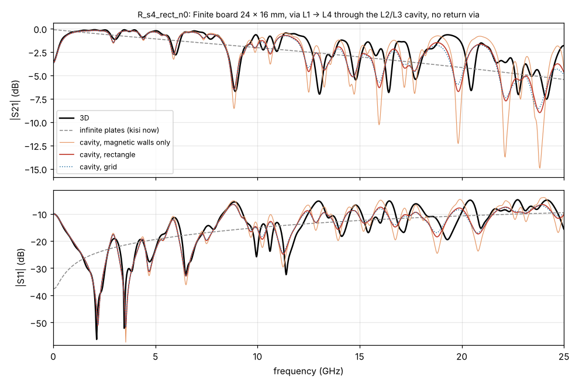
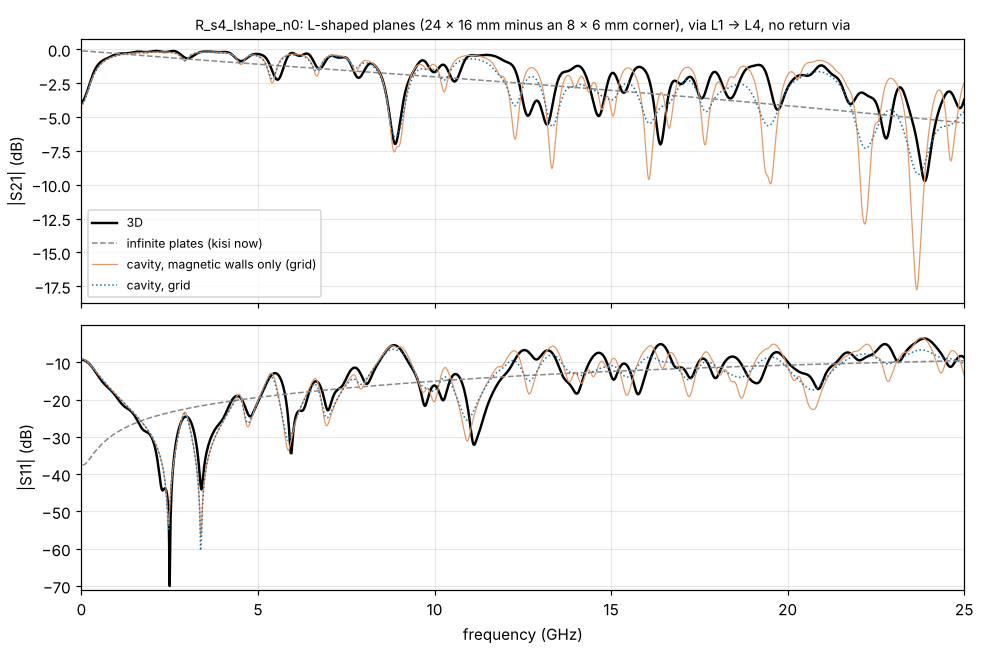
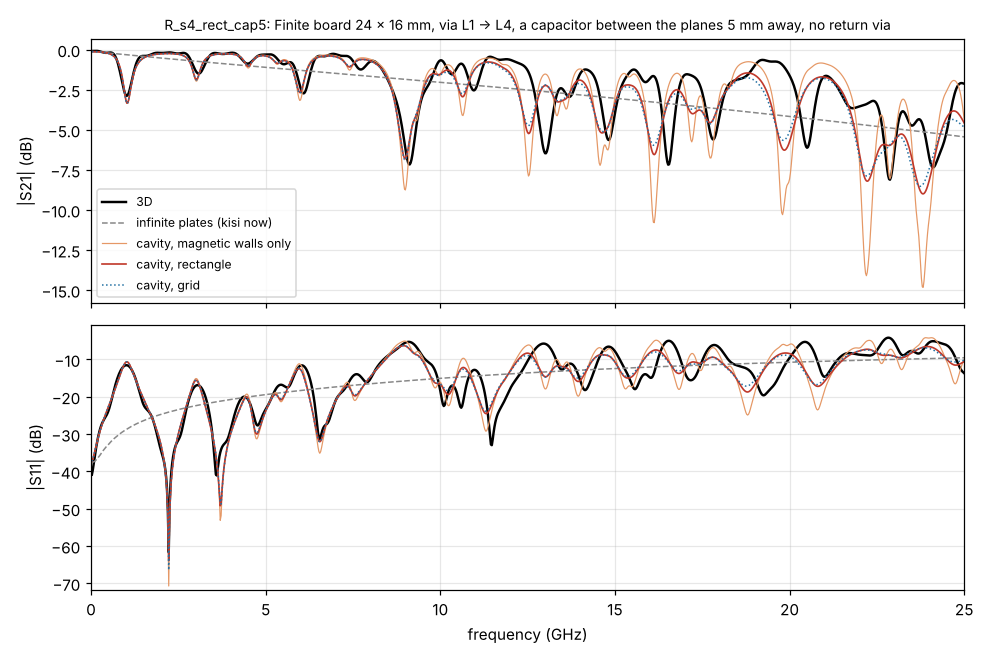
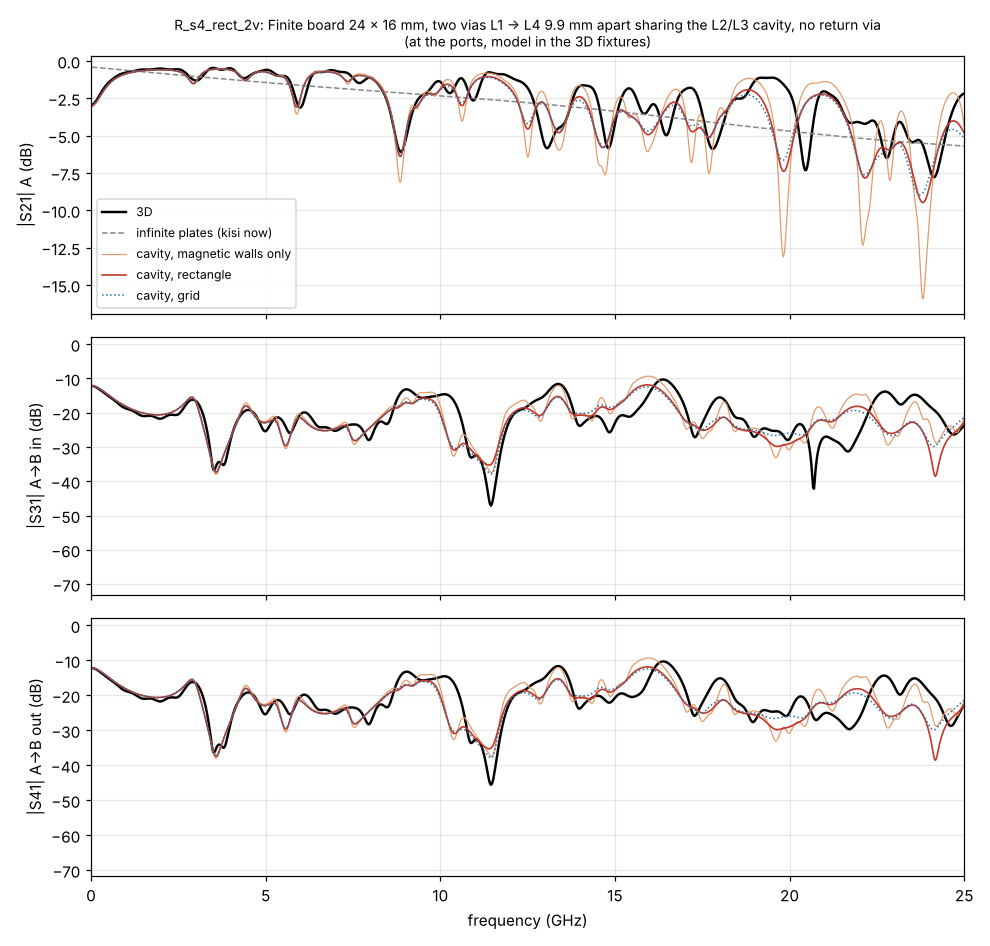
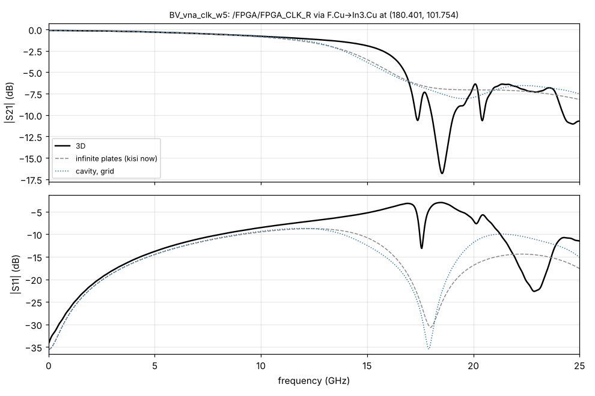
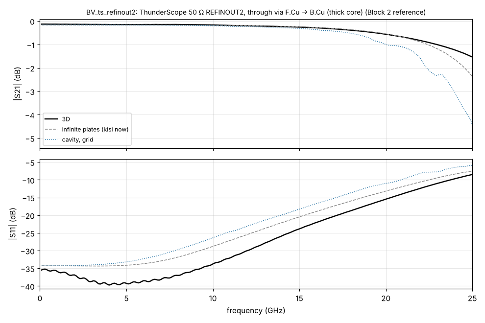

# Plane resonances of finite boards (Block 3)

kisi's via ladder (`kisi_si::via_pbm`) treats every plane pair a via crosses as an infinite pair of
plates; the return vias short it. A real plane pair is finite: its edges reflect the wave the via
launches, so the pair resonates, and every via that crosses it sees the others. This block measures
how much that matters on the example boards, adds finite cavities to the ladder as an option
(`--via-cavity`, off by default) and checks them against 3D (kisi-fdtd).

Reproduce: `board_resonances.py` (cases `resonance_cases/`, 3D results `../via_ref/R_*`,
`../via_ref/BV_vna_clk_w5`, comparison `results/board_resonances.json`, model run times
`results/board_resonances_model_timing.json`, plots `results/board_resonances/*.png`); the survey of a
board: `kisi-validate cavities <board>`; the ladder with a finite cavity on a case:
`kisi-validate cavity-model <case.json> <out>`.

## Summary

* **Which cavities matter.** On both example boards the GND/GND pairs are stitched at 1.1–2.1 mm
  over the whole board: their board-size modes (0.6–1.1 GHz) do not reach a via; what a via sees is
  its own return vias and the ring of stitching vias around it. The unstitched pairs are supply/GND
  pairs (ThunderScope: In1–In2 GND/+VUSB 117 × 86 mm, GND/+3V3 46 × 23 mm, GND/+2V5, GND/+1V8 with
  3–11 decoupling capacitors each, crossed by 5–17 channel vias; small supply islands in the thick
  In2–In3/In2–In4 pairs; LibreVNA: two +6V regions and two +5V strips, crossed by 2 vias each). But
  nearly all channel vias have return vias close enough that less than 2 % of the power at 10 GHz
  gets past them into the pair: the cavity changes the ladder at 6 via positions on ThunderScope
  and 34 pairs at 17 via positions on LibreVNA.
* **3D references.** Six finite boards (24 × 16 mm, 4 layers, open edges in air): one via without
  return via, with one and with four return vias, two vias sharing the cavity, an L-shaped plane
  pair, a decoupling capacitor in the cavity; and one real board via (LibreVNA FPGA_CLK_R, the
  least-shielded channel via of the board, in a 12.2 × 10.6 mm cut-out with its 43 GND vias).
  0.66–0.87 M cells, 77–455 s per case.
* **Model.** The ladder's plane-pair impedance comes from the cavity's Green's function instead of
  the Hankel function: a rectangle by a single modal series with Kummer acceleration, any shape on a
  grid (five-point Helmholtz operator, sparse LU, exact near field of the vias), both with the open
  edges' radiation, capacitors between the planes and the vias that short the pair. On the board:
  the grid, on the connected region of the pair around the via (or a 5 mm window with absorbing
  sides where the stitching is dense), only for pairs the return vias do not shield.
* **Accuracy.** Below 12 GHz the cavity finds every resonance of the synthetic boards within
  1.6–2.5 % in frequency and 0.2–0.5 dB in depth, where the infinite plates have none; max |ΔS21|
  4.9 → 1.8 dB (no return via), 2.4 → 1.7 dB (one), 5.2 → 1.6 dB (L shape), 5.3 → 1.9 dB
  (capacitor); the coupling between two vias 9.9 mm apart (−12.2 dB peak in 3D) comes out at
  −12.1 dB (infinite plates: none). With four return vias nothing changes (0.05 dB both). Above
  12 GHz neither model follows the 3D (rms 1.7–2.2 dB both). The real board via: both within 0.3 dB
  of the 3D to 12 GHz, the cavity changes it by at most 0.1 dB there and 0.8 dB to 25 GHz; above
  12 GHz the ladder misses the via's notches at 17–20 GHz with or without cavities.
* **Cost.** Per via and frequency: infinite plates 12–25 µs, rectangle 28–75 µs, grid 1–40 ms (600
  to 6000 cells, one LU each). On the boards (`check --all`, with a cache per via position and
  interpolation in frequency): ThunderScope 3.3 → 7.6 s, LibreVNA 0.95 → 11.6 s.
* **Effect on the example boards.** No verdict changes; LibreVNA: 6 of 19 lanes change their
  return loss by −0.04 to +0.42 dB (all other metrics by less than 0.01); ThunderScope: none of 27.
* **Recommendation.** Keep it off by default and keep `--via-cavity` as an experimental option: it
  is clearly better where a via has no close return via, but on the example boards it changes
  nothing that matters, costs 2.3–12× the run time, and its main open point – supply/GND pairs, which
  the ladder (with and without cavities) shorts through the GND return vias – is a bigger error on
  those pairs than the finite size.

* **Block 5** (`BOARD_RETURNS.md` section 7): still an option. Since the merge with main the option
  costs far more (ThunderScope `check --all` on one thread 6.9 → 108 s, LibreVNA 1.4 → 15 s; with
  `--via-returns` 16 / 13 s) and still changes no verdict. The FPGA_CLK_R board via with the coplanar
  pours (`BOARD_VIAS.md` section 5): C, L and delay within 4 % of 3D on infinite plates.
* **Block 6** (section 9): the run time was 31 744 grid factorisations, one per via and frequency for
  environments that are mostly the same matrix. Shared factorisations per region and a registering pass:
  ThunderScope 102–109 → 55–60 s (one thread), 57–62 → 31–38 s (four), LibreVNA 14–15 → 11 s; results
  byte-identical across threads and runs (they were not: hash order).

## 1. Approach

Written before the work, kept as it was carried out:

1. Survey (`kisi-validate cavities`): for every channel via of both boards, the plane pairs it
   crosses (layers, nets, distance), the connected region of each pair around it (copper of both
   planes, overlap, the part that contains the via), its size and fill ratio, the vias and plated
   holes that join both planes inside it (stitching), the capacitors between them, the first modes
   of the bounding rectangle, and the return vias near the via.
2. 3D references of finite boards that isolate one effect each (no, one, four return vias; two vias
   sharing a cavity; a non-rectangular shape; a capacitor), plus one real board via cut out of
   LibreVNA with its real stitching, on the Block 2 exporter (`kisi-validate via-case`).
3. Model: the cavity's Green's function in the ladder, rectangle (modal series as
   `kisi_pi::cavity_modal`, but in a form that has the exact singular part at the via) and grid
   (any shape), checked against each other and against the infinite plates for a large cavity.
4. Validation against the new cases and the Block 1/2 references; the effect on `check --all`.
5. Default only if it is clearly better on the boards.

## 2. Plane pairs on the example boards (`kisi-validate cavities`)

ThunderScope Rev5.3: 6 layers (F, In1 GND, In2 supplies, In3 GND/supplies, In4 GND, B), 82 lanes,
47 channel vias. LibreVNA: 6 layers, all inner layers GND planes, 44 lanes, 20 channel vias.
"Rect" is the bounding rectangle of the connected region, f10/f01 its first modes (the region is
smaller: fill = area / rect).

| board | pair | nets | d (mm) | region (rect) | fill | stitching | capacitors | f10 / f01 (GHz) | channel vias |
|---|---|---|---|---|---|---|---|---|---|
| ThunderScope | In4–B | GND/GND | 0.130 | 122 × 92 mm | 0.60 | 2786 vias, pitch 1.6 mm | – | 0.68 / 0.91 | 34 |
| ThunderScope | F–In1 | GND/GND | 0.141 | 122 × 92 mm | 0.36 | 1727, 1.5 mm | – | 0.68 / 0.91 | 9 |
| ThunderScope | In3–In4 | GND/GND | 0.128 | 77 × 91 mm | 0.44 | 1141, 1.7 mm | – | 0.86 / 1.01 | 9 |
| ThunderScope | In1–In2 | GND/+VUSB | 0.119 | 117 × 86 mm | 0.31 | none | 11 | 0.67 / 0.91 | 17 |
| ThunderScope | In1–In2 | GND/+3V3 | 0.119 | 46 × 23 mm | 0.52 | none | 11 | 1.69 / 3.37 | 14 |
| ThunderScope | In1–In2 | GND/+2V5 | 0.119 | 20 × 19 mm | 0.38 | none | 6 | 3.87 / 4.24 | 9 |
| ThunderScope | In2–In4 | +2V5/GND | 1.071 | 20 × 19 mm | 0.38 | none | 6 | 3.53 / 3.86 | 7 |
| ThunderScope | In1–In2 | GND/+1V8 | 0.119 | 25 × 12 mm | 0.38 | none | 3 | 3.13 / 6.27 | 5 |
| ThunderScope | In2–In3 | +VUSB/GND | 0.943 | 11 × 5 mm (and 12 smaller islands) | 0.5 | none | 0 | 6.4 / 12.8 | 5 |
| LibreVNA | In1–In2 | GND/GND | 0.415 | 121 × 97 mm | 0.96 | 2486, 2.1 mm | – | 0.58 / 0.72 | 20 |
| LibreVNA | F–In1 | GND/GND | 0.236 | 121 × 97 mm | 0.71 | 2373, 1.9 mm | – | 0.59 / 0.73 | 20 |
| LibreVNA | In4–B | GND/GND | 0.236 | 121 × 97 mm | 0.70 | 2395, 1.9 mm | – | 0.58 / 0.72 | 18 |
| LibreVNA | In2–In3 | GND/GND | 0.218 | 121 × 97 mm | 0.70 | 2177, 2.0 mm | – | 0.59 / 0.73 | 16 |
| LibreVNA | In3–In4 | GND/+6V | 0.415 | 32 × 38 mm | 0.29 | none | 2 | 1.85 / 2.20 | 2 |
| LibreVNA | In4–B | +6V/GND | 0.236 | 116 × 67 mm | 0.16 | none | 5 | 0.61 / 1.05 | 2 |
| LibreVNA | In2–In3 / In3–In4 | GND/+5V, +5V/GND | 0.218 / 0.415 | 5 × 31 mm / 5 × 26 mm | 0.5 | none | 0 | 2.3–2.7 / 4.7–5.5 | 2 |

(The full list, 59 regions on ThunderScope and 21 on LibreVNA, comes from the command; the rest
are small GND/GND islands between stitching vias, resonating at 3–30 GHz, crossed by 1–3 vias.)

What follows from it:

* **Stitched GND/GND pairs** (most of both boards): a row of vias at pitch p acts as a wall up to
  roughly c/(2p√εr), 36 GHz for 2 mm; the board-size modes are shorted out and the via sees a
  local cell of stitching vias. The ladder already takes the nearest return vias as shorts; the
  cavity adds the ring of further stitching vias and the open edges of islands.
* **Supply/GND pairs** have no stitching, only capacitors; their resonances start at 0.6–4 GHz and
  the capacitors (series resonance in the MHz range, inductive at GHz) damp them little. A via that
  crosses such a pair without a capacitor or a GND/supply via pair close to it sees these
  resonances. The ladder (with or without cavities) cannot model them yet: it shorts every pair a
  return via crosses, also a GND/supply pair the GND via does not join (section 7).
* **How much reaches a pair** depends on the via's return vias. The criterion used on the board is
  the leakage ratio Re Z_red / Re Z_open at 10 GHz – the real part of the pair's reduced self
  impedance (returns as shorts) over that of the same via without returns, i.e. the share of the
  power launched into the pair that gets past the return vias. Below 0.02 the pair is left as it
  is. On ThunderScope that leaves 9 pairs at 6 via positions (leakage 0.020–0.040: the channel vias
  have return-via cages); on LibreVNA 34 pairs at 17 via positions (0.02–1.08: fewer dedicated
  returns, the board's stitching does the job). The least-shielded channel via of both boards is
  LibreVNA's FPGA_CLK_R entry via (nearest return 2.9 mm, leakage 1.08): the real-board 3D case.

## 3. 3D references

All on the 4-layer 1.6 mm FR-4 stack "s4" of `via_cases.py` (L1 / GND L2 / 1.2 mm core / GND L3 /
L4), the via L1 → L4 drill Ø0.3, antipad Ø0.8 (as `A_s4_d300_ap800`), feeds of 49.6 Ω to the left
on L1 and to the right on L4. The board is 24 × 16 mm and ends 3 mm before the PML with 1.5 mm of
air above and below, so its edges are open and radiate. Mesh: 0.07 mm at the via, at most 0.35 mm
(λ/16 in the core at 25 GHz), 25 GHz, 1000 frequencies (25 MHz steps; the resonances of the L2/L3
cavity have Q of 20–60), runs until −35 dB. A field monitor stores Ez in the middle of the core at
f10, 1.5·f10 and 1.8·f10 (`fields.json`).

| case | what | cells | run time |
|---|---|---|---|
| `R_s4_rect_n0` | one via, no return via | 0.66 M | 215 s |
| `R_s4_rect_n1` | one GND via 2 mm away | 0.68 M | 228 s |
| `R_s4_rect_n4` | four GND vias at 1 mm (as the A cases) | 0.68 M | 77 s |
| `R_s4_rect_2v` | two vias 9.9 mm apart sharing the cavity, no return via (4 ports, port 1 excited) | 0.87 M | 155 s |
| `R_s4_lshape_n0` | L-shaped planes (24 × 16 mm minus an 8 × 6 mm corner), no return via | 0.66 M | 225 s |
| `R_s4_rect_cap5` | `n0` with a capacitor (100 nF, 10 mΩ, 0.6 nH) between the planes 5 mm away | 0.66 M | 211 s |
| `thru_R_s4_L1`, `thru_R_s4_L4` | 2×thru fixtures of both feeds on the same mesh | 0.15 M | 4 s |
| `BV_vna_clk_w5` | LibreVNA /FPGA/FPGA_CLK_R via 0, F.Cu → In3.Cu (stub to B.Cu), 12.2 × 10.6 mm cut-out, 43 GND vias | 0.72 M | 455 s |
| `thru_BV_vna_clk_w5_in/out` | its fixtures (60 Ω microstrip, 60 Ω stripline) | 0.26–0.29 M | 7 s |

The 2-port cases are de-embedded with the matched 2×thru (`sparam.deembed_matched`, Block 2). For
the coupled case the model's 4-port is embedded into the 3D fixtures instead (no de-embedding of a
4-port with crossing feeds). The via sits at (−3.3, −1.9) mm from the board centre, off the nodal
lines of the low modes; the second via at (5.2, 3.1) mm.

The real board via was exported with the Block 2 exporter (`kisi-validate via-case … --keep 1.1
--feed 3.0 --margin 5`). A usable case took three corrections, which also apply to other board vias:

* Its two feeds leave the via side by side. The via fence of the F.Cu feed ran through the whole
  board and so across the In3 feed's trace, and the clearance holes of those fence vias cut that
  trace (no transmission at all). Fixed in the exporter: a fence that would cross the other feed
  ends at its own feed's reference plane.
* With the usual keep box of 0.9 mm (the board's copper is taken as it is only that close to the
  via on the feed layers) the In3 GND pour around the via was cut off from its stitching via just
  outside the box and floated: sharp dips at 10.2 and 14.3 GHz (−4 and −10 dB) that neither ladder
  has. They are not from other copper (removing all other nets leaves them) and they disappear
  with a 1.1 mm keep box, where the pour keeps its via. The exporter does not warn about a floating
  pour yet.
* A third export (LibreVNA REFLO1) was dropped: its In1 port reference ran through a plane.

## 4. Model (`kisi_si::via_cavity`, option `--via-cavity`)

### 4.1 Where it enters the ladder
The ladder splits a via into plane-pair sections. In each, the barrel and the return vias that span
the pair see each other through the pair's impedance Z_ij = jωμd·G(r_i, r_j); the returns are
reduced as shorts (Z_aa − Z_ab Z_bb⁻¹ Z_ba), a pair's odd mode is Z_PP − Z_PN. With infinite plates
G = (−j/4)·H0⁽²⁾(kρ). With `--via-cavity` G is the Green's function of the finite pair with all its
other posts (stitching vias, capacitors) already inside, for the ports "via, partner, returns".
Nothing else in the ladder changes (Laplace capacitances, junction model, stubs, conductor and
dielectric loss). Several vias in one cavity couple through the same Green's function
(`via_pbm::coupled_s`, used by the validation; the channel uses one via at a time).

### 4.2 Rectangle (`RectEnv`)
For an a × b rectangle with magnetic walls the double modal series is summed in closed form along
the longer side, leaving a single series along the shorter one:
G = (1/a) Σ εm cos(αm x) cos(αm x′) gm(y, y′), gm the 1D Green's function of the strip with both
ends open (four exponentials over 2γm(1 − e^{−2γm b})), γm² = αm² − k². Its terms fall as e^{−m|Δy|}/m,
so the series converges slowly at the via (Δy = 0, the self term). Kummer: the asymptotic terms are
subtracted and their sum added in closed form (Σ cos(mθ) e^{−mτ}/m = −½ ln(1 − 2e^{−τ} cos θ +
e^{−2τ})), with a second-order tail in k²; then 3·k·a/π + 40 terms (56 at 25 GHz for 16 mm) give
0.1 %. The logarithm of the source comes out exactly, so the self term is G at the via radius as in
the ladder; it is averaged over ±r along both axes (the modes' gradient across the barrel would
otherwise bias it by up to 10 %). Shorts and capacitors are further ports, reduced like the returns.
Tests: against the double series, a 1 m cavity against the Hankel function (0.3 %), the
low-frequency limit (the plate capacitance).

### 4.3 Grid (`GridEnv`)
Any plane shape on a square raster of cell h: the five-point Helmholtz operator (branch admittance
1/(jωμd), node −k²h²/(jωμd)), one sparse complex LU per frequency (faer, symbolic factorisation
reused) shared by all ports. A grid node has Peaceman's equivalent radius h·e^{−γ}/(2√2) ≈ 0.20 h,
far larger than a via: the grid supplies only the part of G the edges reflect. The near field comes
from the exact free-space function: G_ij = Σ w w G_grid + G0(ρ_ij) − Σ w w G0_lattice, with ports off
the cell centres spread bilinearly over four nodes and G0_lattice the static lattice Green's function
(exact lattice resistances up to three cells away) plus the continuum k-dependence. Stitching vias
are the inductance of a post in its cell, μd/(2π)·ln(r_eq/r); a capacitor is R + jωL + 1/(jωC) plus
its post's inductance. The open edges radiate through their boundary faces (below). A window of a
large pair (dense stitching) ends on the cut sides in the admittance of an outgoing cylindrical
wave, k/(ωμd)(1 − j/(2kρ))cos θ. The grid agrees with the rectangle within 1 % (unit test
`grid_matches_rect`), a window with the infinite plates within 5 % (`grid_window_is_open`).

### 4.4 Losses and edge radiation
Dielectric loss through complex k² (tanδ; in the validation the 3D's fixed conductivity, tanδ ∝ 1/f
from fmax/2), conductor loss of the plates as in the ladder. An open board edge radiates: slot
conductance per edge G1 = I/(120π²) (Balanis, radiating edge of a patch), halved because a board
edge has no flange to provide the image. The grid puts it on its boundary faces (per face G1(W)/W
of its straight run W); the rectangle as an equivalent loss tangent 1.5·d·ΣG/(ωεA) (a cosine mode
has twice its mean |V|² on the walls across which it varies). Without radiation the resonances are
1 dB too deep and the model is 2–3× worse above 12 GHz (tables below, "no edge radiation").

### 4.5 On the board
For each plane pair of a via (`kisi_si::via`, `cavity_links`):
* pairs bounded by one of the via's own signal layers are left as they are (their "plane" is a pour
  around the trace, Block 2), and pairs the return vias shield (leakage < 0.02 at 10 GHz, section 2);
* the region: copper of both layers rasterised, their overlap, the via openings filled
  (clearance + 1.5 cells), the connected part that contains the via; posts = vias and plated holes
  joined to both nets within 0.6 mm (thermal reliefs); capacitors = fitted two-pad parts with one
  pad on each net, ESR and ESL plus mounting inductance from `data/components.json` ("decoupling",
  by package, estimates), C from the value (else 100 nF, estimate);
* cells of at least 0.3 mm, about 2500 over the region's bounding box, refined to λ/6 at 25 GHz
  where that is coarser (at most 12000 cells); where the stitching is dense (pitch < 3 mm, both example boards' GND pairs) a 5 mm window around the via
  at 0.3 mm with absorbing sides instead: beyond a few rows of posts nothing comes back;
* the Green's function is cached per via position, layers, nets and ports, and interpolated in
  frequency (exact every 0.25 GHz for windows, every 0.05 GHz for whole regions, which resonate).

### 4.6 Which form where
The rectangle is fast (28–75 µs per frequency) and exact for rectangles, and it reproduces the
synthetic boards as well as the grid. But real regions are not rectangles: the fill ratios of
section 2 are 0.15–0.96, with holes, slots and posts. A rectangle of the same area or bounding
box has other modes than the region (already for the L shape, whose modes the grid finds within
1.8 %), and the stitching vias – 30 to 2500 in a region – would all become ports of the series. The board path therefore always uses
the grid; the rectangle stays as a reference and a check of the grid. The cost of the grid is
bounded by the window (stitched pairs) and the region cap; per board it is dominated by the number
of different via positions, not by the frequencies (cache and interpolation).

### 4.7 Cost
| | per frequency | 1000 frequencies, one via (synthetic cases) |
|---|---|---|
| infinite plates (default) | 12–25 µs | 12–25 ms |
| rectangle | 28–75 µs | 28–75 ms |
| grid, 6144 cells (0.25 mm on 24 × 16 mm), every frequency exact | 33–44 ms | 33–44 s |
| grid on the board, 600–1000 cells, cached and interpolated | ≈1 ms per LU | – |

Boards (`check --all`, native, one thread): ThunderScope 3.3 → 7.6 s (2634 factorisations of 949
cells on average, 3.2 s), LibreVNA 0.95 → 11.6 s (5120 of 1012 cells, 8.6 s; 17 via positions with
up to 5 pairs each). The Node CLI is about 2× slower than native in the ladder; with the option
26 s on LibreVNA (`--formula`), identical to native to 1e-13.

## 5. Validation

### 5.1 Single vias on finite boards (de-embedded, max / rms |ΔS21| in dB against 3D)

| case | model | 0.5–6 GHz | 0.5–12 GHz | 12–20 GHz | 20–25 GHz | dips < 12 GHz found | mean \|Δf\| | mean \|Δdepth\| |
|---|---|---|---|---|---|---|---|---|
| no return via (`n0`) | infinite plates (default) | 1.53 / 0.52 | 4.90 / 1.13 | 4.38 / 1.92 | 3.61 / 1.73 | 0/6 | – | – |
| | rectangle, no edge radiation | 0.92 / 0.20 | 3.00 / 0.62 | 11.22 / 2.96 | 10.11 / 3.57 | 6/6 | 2.0 % | 0.99 dB |
| | rectangle | 0.74 / 0.17 | 1.92 / 0.47 | 5.65 / 2.08 | 4.36 / 2.15 | 6/6 | 2.0 % | 0.25 dB |
| | grid | 0.73 / 0.17 | 1.75 / 0.46 | 4.97 / 1.98 | 4.34 / 2.15 | 6/6 | 2.0 % | 0.18 dB |
| one return via (`n1`) | infinite plates (default) | 1.28 / 0.37 | 2.41 / 0.75 | 3.80 / 1.91 | 4.12 / 1.93 | 0/8 | – | – |
| | rectangle, no edge radiation | 0.74 / 0.16 | 2.78 / 0.57 | 9.03 / 2.59 | 11.85 / 3.75 | 8/8 | 2.5 % | 0.65 dB |
| | rectangle | 0.52 / 0.15 | 1.76 / 0.44 | 4.83 / 1.86 | 4.58 / 2.10 | 8/8 | 2.5 % | 0.23 dB |
| | grid | 0.54 / 0.15 | 1.71 / 0.43 | 4.50 / 1.80 | 4.41 / 2.15 | 8/8 | 2.5 % | 0.23 dB |
| four return vias (`n4`) | infinite plates (default) | 0.04 / 0.03 | 0.04 / 0.03 | 0.11 / 0.04 | 0.07 / 0.03 | – | – | – |
| | rectangle | 0.04 / 0.03 | 0.05 / 0.03 | 0.10 / 0.03 | 0.21 / 0.08 | – | – | – |
| | grid | 0.04 / 0.03 | 0.05 / 0.03 | 0.10 / 0.03 | 0.17 / 0.07 | – | – | – |
| L shape (`lshape_n0`) | infinite plates (default) | 1.04 / 0.51 | 5.16 / 1.13 | 3.70 / 1.53 | 4.58 / 2.02 | 0/8 | – | – |
| | grid, no edge radiation | 1.20 / 0.29 | 2.00 / 0.51 | 7.46 / 2.56 | 11.13 / 3.51 | 8/8 | 1.7 % | 0.57 dB |
| | grid | 1.13 / 0.26 | 1.61 / 0.44 | 3.91 / 1.69 | 4.01 / 1.74 | 7/8 | 1.8 % | 0.25 dB |
| capacitor (`cap5`) | infinite plates (default) | 2.56 / 0.72 | 5.29 / 1.25 | 3.84 / 1.94 | 3.34 / 1.71 | 0/8 | – | – |
| | rectangle, no edge radiation | 1.03 / 0.24 | 3.19 / 0.66 | 9.33 / 2.96 | 10.70 / 3.72 | 8/8 | 1.9 % | 0.93 dB |
| | rectangle | 0.66 / 0.21 | 2.04 / 0.51 | 5.23 / 2.13 | 4.84 / 2.26 | 7/8 | 1.6 % | 0.46 dB |
| | grid | 0.74 / 0.21 | 1.86 / 0.51 | 4.70 / 2.05 | 4.51 / 2.26 | 7/8 | 1.6 % | 0.39 dB |

"Dips" are the minima of the 3D |S21| below 12 GHz at least 0.5 dB deep (6–8 per case, −0.7 to
−7.2 dB), matched to the model's within 8 %; "found 7/8" means one dip merged with a neighbour in
the model.

* Without return via the infinite plates give a smooth loss; the finite board has a dip at every
  mode the via excites (3.0, 4.4, 6.0, 8.9, 10.3, 11.0 GHz; −7 dB at 8.9 GHz) and, between them,
  less loss than the infinite plates (the energy comes back). Both cavity forms follow it to
  12 GHz.
* Single resonances are off by −4.5 to +5.6 % (mostly within ±3 %), with no common sign; the
  first board mode near 3.0 GHz is 1.6–2.5 % low in all cases. The cause is not found (the
  fringing field at the open edges would lower the 3D frequencies, the opposite). Not corrected.
* One return via 2 mm away does not remove the resonances (8 dips in 3D, up to −4.1 dB); four at
  1 mm do (no dip deeper than 0.5 dB): the case of almost every channel via on the example boards.
* L shape: 8 of the dips are reproduced by the grid within 1.8 %; one pair of close modes near
  10 GHz is a single dip in the model.
* The capacitor case adds the series resonance of capacitor and cavity at 1.0 GHz (−2.9 dB in 3D),
  which the infinite plates cannot have; the cavity puts it at the same frequency, 0.45 dB too deep
  (with the ESL of the 3D lumped element plus the Peaceman inductance of its cell in the 3D mesh,
  `cap_radius`).
* Above 12 GHz neither model follows the 3D: the dips are there, but up to 5–6 dB off in depth
  and shifted; the infinite plates are as good in rms (1.5–1.9 dB against 1.7–2.1 dB) because
  they sit in the middle. Possible causes, not separated: the edge radiation model (a slot
  formula for a gap small against the wavelength; the 1.2 mm core is λ/5 in the dielectric at
  25 GHz), the mode density (the resonances overlap above 12 GHz, so small frequency errors become
  large dB errors), and the ladder's junction model, fitted to infinite plates.

### 5.2 Two vias sharing the cavity (`R_s4_rect_2v`; model embedded in the 3D fixtures)

| model | \|ΔS21\| max / rms 0.5–12 GHz | 12–25 GHz | coupling S31: peak below 12 GHz, 3D / model | mean 1–12 GHz, 3D / model |
|---|---|---|---|---|
| infinite plates (default) | 3.95 / 1.03 | 3.51 / 1.75 | −12.2 / none | −23.0 / none |
| rectangle, no edge radiation | 2.87 / 0.54 | 11.56 / 2.96 | −12.2 / −12.1 dB | −23.0 / −23.2 dB |
| rectangle | 1.81 / 0.39 | 5.84 / 1.93 | −12.2 / −12.1 dB | −23.0 / −23.6 dB |
| grid | 1.67 / 0.39 | 5.18 / 1.89 | −12.2 / −12.1 dB | −23.0 / −23.8 dB |

The two vias 9.9 mm apart couple at −12 dB at low frequency (the pair's capacitance couples them
both ways, S31 ≈ S41) and at −15 to −35 dB across the band; the infinite plates have no coupling at
all (it decays as 1/√ρ and is lost in the ladder's reduction to one via). The cavity reproduces the
level (mean within 0.2–0.8 dB) and the dips of the coupling below 12 GHz (rms 3.5–3.7 dB on a
curve that swings by 25 dB). The channel and crosstalk commands do not use via-to-via coupling yet.

### 5.3 A real board via (`BV_vna_clk_w5`)

LibreVNA's /FPGA/FPGA_CLK_R entry via (F.Cu → In3.Cu, stub to B.Cu) is the least-shielded channel
via of both boards (nearest return 2.9 mm). kisi gives it a cavity in two pairs, In1–In2 and In4–B
(GND/GND, leakage 0.14 each), both stitched densely, so both are 5 mm windows with 39 and 28 posts;
the pairs next to F.Cu and In3 are pours on its own signal layers and stay as they are. The 3D
cut-out ends in the PML as well, so this case checks the window model, not a board-size cavity.

| model | \|ΔS21\| max / rms 0.5–6 GHz | 0.5–12 GHz | 12–20 GHz | 20–25 GHz |
|---|---|---|---|---|
| infinite plates (default) | 0.09 / 0.04 | 0.29 / 0.09 | 8.56 / 2.59 | 2.16 / 1.61 |
| cavity (two grid windows) | 0.11 / 0.05 | 0.21 / 0.10 | 8.09 / 2.55 | 2.82 / 1.52 |

* Below 12 GHz both are within 0.3 dB of the 3D; the cavity changes |S21| by at most 0.09 dB there
  and 0.8 dB up to 25 GHz.
* Above 12 GHz the 3D stays flat longer (−2.9 dB at 16 GHz against −5.7 dB) and then has notches at
  17.4, 18.5 (−16.8 dB) and 20.4 GHz, where the ladder has a broad minimum of −8.5 dB; the 3D also
  reflects about 4 dB more over the whole band. These are ladder errors of the kind Block 2 found
  (the pours on the via's signal layers taken as planes, the stub), not effects of the plane pairs'
  size: with or without cavities the ladder is the same there.
* The case found the exporter faults of section 3; with the floating pour (0.9 mm keep box) it had
  two more sharp resonances at 10.2 and 14.3 GHz.

### 5.4 The Block 2 board vias

The two single-via cases of Block 2 (`BOARD_VIAS.md`, de-embedded there) with the ladder as the
channel builds it, infinite plates and with the cavities, to 25 GHz (`board_resonances.py block2`):

| case | pairs with a cavity | \|ΔS21\| max / rms 0.5–12 GHz, infinite / cavity | 12–20 GHz | 20–25 GHz | cavity − infinite, max |
|---|---|---|---|---|---|
| ThunderScope REFINOUT2, through via F.Cu → B.Cu | In2–In3 +VUSB/GND (0.94 mm, 2469 cells of 0.94 mm, 4 capacitors, leakage 0.021) | 0.10 / 0.06 → 0.07 / 0.05 | 0.38 / 0.23 → 0.36 / 0.16 | 0.63 / 0.52 → 2.47 / 1.12 | 1.84 dB (above 20 GHz) |
| LibreVNA RF_HBLB_PORT1, F.Cu → In2.Cu with stub | none (pairs bounded by its signal layers, the rest shielded) | 0.21 / 0.08 (unchanged) | 1.85 / 0.73 | 17.1 / 7.9 (the stub notch, Block 2) | 0 |

The 3D cut-outs of Block 2 end in the PML, so they do not contain the region's own resonances: for
REFINOUT2 the cavity is a little better to 20 GHz, and adds a ripple above 20 GHz that the 3D
cannot confirm or refute (the region's cells are 0.94 mm there, λ/6 at 25 GHz).

### 5.5 Block 1 references and regressions

* Default path: `compare_kisi.py` gives results identical to `results/kisi_models.json` (all 56
  rows), and `check`, `gaps`, `interfaces`, `config-check` of both boards are unchanged; native and
  Node CLI agree (`compare_cli.py`). The option is read only where `--via-cavity` or
  `KISI_VIA_CAVITY` is set.
* With the option the Block 1 references get worse (e.g. `D_s8_stitch_none` max |ΔS21| 0.8 →
  12.6 dB, pairs `E_s8_L1L8_p1000_*_g0` 0.14 → 2.4–2.7 dB): their 3D planes run into the PML
  (infinite), while the KiCad board kisi reads for them ends at the window, so the cavity puts in
  resonances of a 13 × 13 mm board that the reference does not have. These references test the
  default only.

## 6. Effect on the example boards (`kisi check --all`)

| board | lanes | via positions / plane pairs with a cavity | run time | lanes that change | change |
|---|---|---|---|---|---|
| ThunderScope Rev5.3 | 27 | 6 / 9 | 3.3 → 7.6 s | 0 | – |
| LibreVNA | 19 | 17 / 34 | 0.95 → 11.6 s | 6 | return loss −0.04 to +0.42 dB (SRC_REF_IN 35.19 → 35.61 dB, REFLO2 24.87 → 24.98 dB, FPGA_CLK 9.83 → 9.86 dB); loss, eye and skew < 0.01 |

No verdict changes on either board (the summaries are identical). The reasons: on ThunderScope the
channel vias have return-via cages, so only 9 plane pairs pass the leakage test and those barely
(0.020–0.040); on LibreVNA the GND pairs are stitched every 2 mm, and a window full of stitching
vias is close to the infinite plates with the nearest returns. The ThunderScope pairs that would
resonate – GND/supply planes with only capacitors – are exactly where the ladder takes the GND
return vias as shorts (section 7). With the option, `check` says so in `models` and `net` in its
warnings (experimental; capacitor parasitics estimated).

## 7. Limits and open points

* **Supply/GND pairs.** The ladder takes the return vias as shorts in every pair they span, also a
  GND/supply pair the GND via does not join; the real return there is through capacitors and the
  displacement current of the pair. This is a larger error than the finite size on ThunderScope's
  In1–In2 and In2–In3/In4 pairs. Next: return groups per pair (a GND via shorts only GND/GND pairs;
  in a GND/supply pair the cavity with its capacitors is the return).
* **Above 12 GHz** neither model follows the 3D on the synthetic boards (rms 1.7–2.2 dB); the
  1.6–2.5 % offset of the first board mode is not explained.
* **Via-to-via coupling** is in `via_pbm::coupled_s` and validated, but the channel and crosstalk
  commands use one via at a time.
* **PDN:** the same grid (with the IC's and capacitors' ports) is the natural cavity model for the
  PDN impedance of irregular planes (`kisi_pi::cavity_modal` is rectangular); not connected.
* **Decoupling parasitics** in the cavity are typical values by package (estimates; a `PI_CAP`
  field is not read here yet).
* **Exporter** (`via-case`): a keep box too small to include the stitching via of a pour around the
  via leaves that pour floating, with resonances of its own (no warning yet); a port reference
  through a plane (REFLO1) is not detected; side-by-side feeds are handled now (section 3). A
  real-board 3D case is a cut-out (planes into the PML), so it checks the window model, not the
  board-size cavity; a whole small board (or a cut-out along slots and board edges) would be the
  next reference.
* **Viewer:** the option is in the CLI only; the 3D references page (`make_viewer.py`) does not read
  `resonance_cases/` yet.

## 8. Recommendation

Keep the default (infinite plates) and keep `--via-cavity` as an experimental option:

* It is clearly better where a via crosses a plane pair without close return vias: below 12 GHz
  the max |ΔS21| drops from 2.4–5.3 dB to 1.6–1.9 dB, every resonance is found within 2.5 %, and
  the coupling of vias in one cavity is there at all. It never makes the shielded case worse
  (four returns: 0.05 dB both).
* On the example boards hardly any channel via is in that situation: no verdict changes, the
  largest change is 0.4 dB of return loss, at 2.3× (ThunderScope) to 12× (LibreVNA) the run time.
* Above 12 GHz it is no better than the infinite plates, and on the boards the larger errors are
  elsewhere: the pours on the via's signal layers (Block 2) and the return through GND/supply
  pairs.

Next, in order of value: return groups per plane pair (a GND via shorts only GND/GND pairs; in a
GND/supply pair the return is the cavity with its capacitors – where the cavity model would matter
on ThunderScope); via-to-via coupling in the crosstalk check; the grid as the PDN cavity for
irregular planes; a floating-pour warning in the exporter. The default could switch once the
return groups are in and a board with unstitched GND/supply transitions shows a verdict change
that 3D confirms.

## 9. The run time of `--via-cavity` (Block 6)

**Cause.** Profile of `check --all --via-cavity` on ThunderScope (one thread, `KISI_CAVITY_STATS=1`, before
the fix): 105 s, of it 79 s in 31 744 sparse LU factorisations of the grid cavities (1 296 cells on average) –
one per cavity environment and sampled frequency (0.05 GHz for regions, 0.25 GHz for windows), each via
position on its own; the rest the solves and the Green's functions around them. Block 3 needed 2 634
factorisations (3.2 s): since the merge with main the check evaluates more vias per lane (both lines of a
pair as a 4-port, every line on its own path), 127 cavity environments instead of a few dozen. Most of them
are the same region of the same plane pair seen from different vias: the same system matrix, factorised
again for every via.

**Fix** (`via_cavity::GridGroup`, `kisi_sparse::ComplexPattern`, `service::register_cavities`):
- environments whose system matrices are identical (grid, medium, shorted cells, loads, edges, cut faces)
  share one factorisation per frequency (`GridEnv::share`, a process-wide group); each via's Green's
  matrix comes from single-RHS solves for the ports it needs, deduplicated across the group;
- a registering pass (8 frequencies, `set_register_only`) before the check collects every via's ports in
  the groups, so that the first factorisation at a frequency serves all of them (off with `--via-returns`,
  where it cost more than it saved; `KISI_CAVITY_PASS=0/1`);
- the sparse matrix is assembled into a fixed pattern (no triplet sort per frequency), the region
  overlaps of `pair_region` are cached;
- the shorted cells were collected in hash order: the results changed at the last digit from run to run
  and with the thread count. Now sorted – byte-identical across runs, threads and with the pass on or off.

Not taken: one grid per region for all vias crossing it (the union of their fill masks: 7 600 instead of
26 000 factorisations) merges islands the per-via masks keep apart (17 → 1 495 cells) and changes results;
a multi-RHS block solve gave nothing over the single solves.

**Timings** (`check --all`, both boards; the machine has 2 cores and was shared with other jobs, load
2–4 – ranges of 2–3 runs; "before" is 9e58542, "after" this branch with Block 6, whose extra return posts
leave fewer pairs unshielded: ThunderScope 95 environments in 74 groups, 18 902 factorisations; the
runtime fix alone: 127 environments in 102 groups, 26 130):

| | before | after |
|---|---|---|
| ThunderScope, default, one thread | 6.5–7.2 s | 6.4–6.9 s |
| ThunderScope, `--via-cavity`, one thread | 102–109 s | 55–60 s |
| ThunderScope, `--via-cavity`, four threads | 57–62 s | 31–38 s |
| ThunderScope, `--via-cavity --via-returns`, one / four threads | 15.0–16.8 / 8.0–8.3 s | 13.2–14.6 / 7.0 s |
| LibreVNA, `--via-cavity`, one / four threads | 14.0–15.1 / 7.6–12.8 s | 11.0–11.1 / 6.0–7.1 s |
| LibreVNA, `--via-cavity --via-returns`, one / four threads | 10.0–10.5 / 5.7 s | 8.5–9.1 / 4.5–4.9 s |
| Node CLI (`kisi.mjs --formula`, WebAssembly, one thread; load 4.4), `--via-cavity` ThunderScope / LibreVNA | 236 / 36 s | 159 / 29 s |

The Node CLI and the viewer (WebAssembly, one thread) share the same code; the registering pass's clock call
trapped there at first (`Instant::now` has no clock in `wasm32-unknown-unknown`) – fixed, and `compare_cli.py` now
also compares `check --all --via-cavity` on LibreVNA (Node identical to native on both boards and both option
sets).

Results: one thread against four byte-identical on both boards and both option sets; the runtime fix
alone left every result unchanged (`check --all` JSON identical to the old binary up to the last-digit
noise the hash order caused, unit test `via_cavity::tests::shared_grid_groups`). Still 7× Block 3's
time on ThunderScope: the remaining cost is the per-via fill masks (74 groups) and the frequency sampling;
fewer factorisations need a region model shared by all vias (above) or coarser sampling with interpolation
of the factorised operator.
