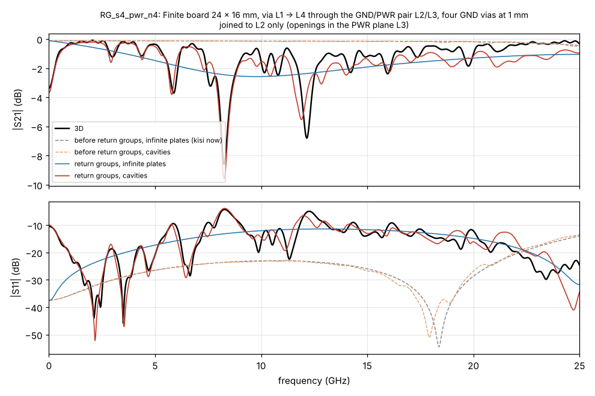
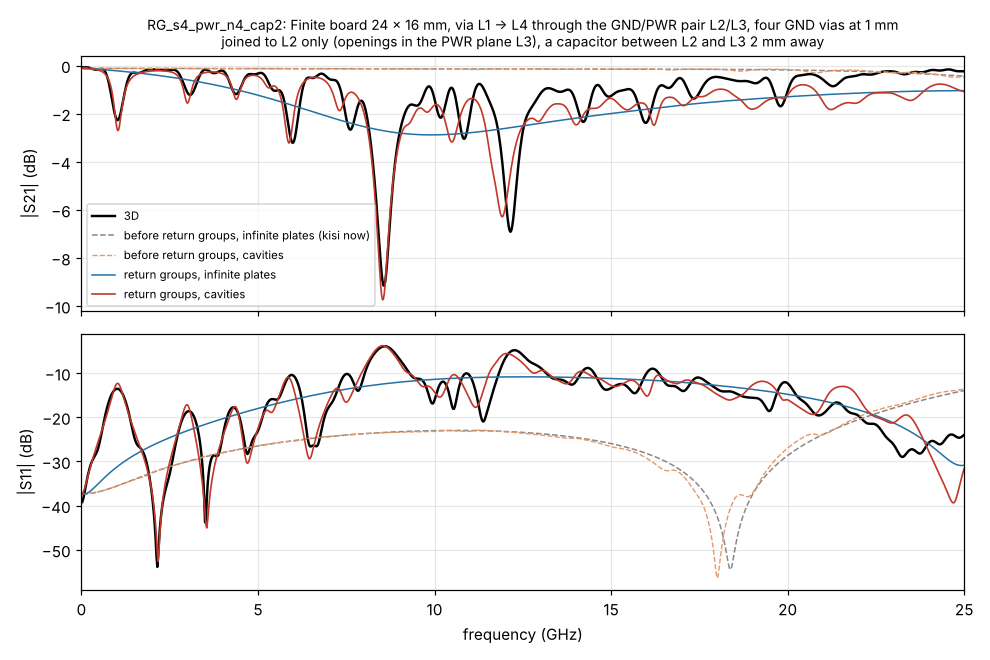
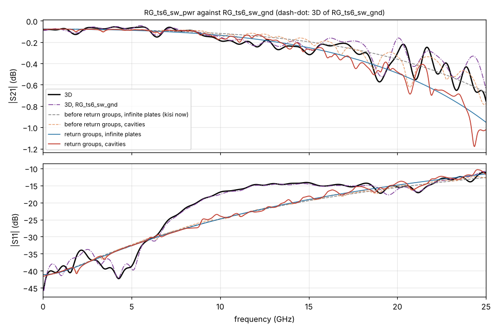
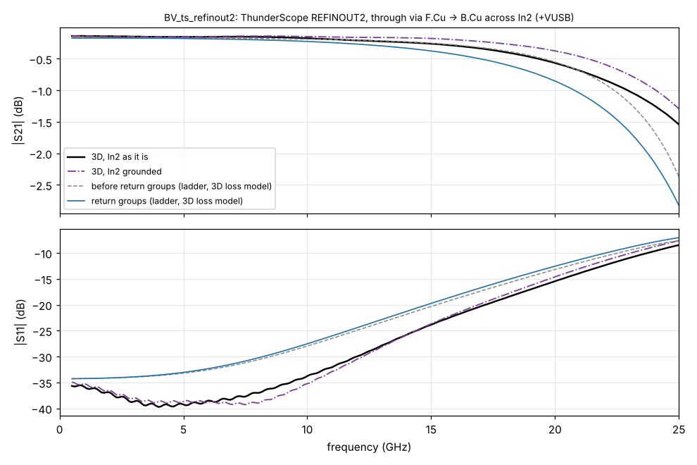
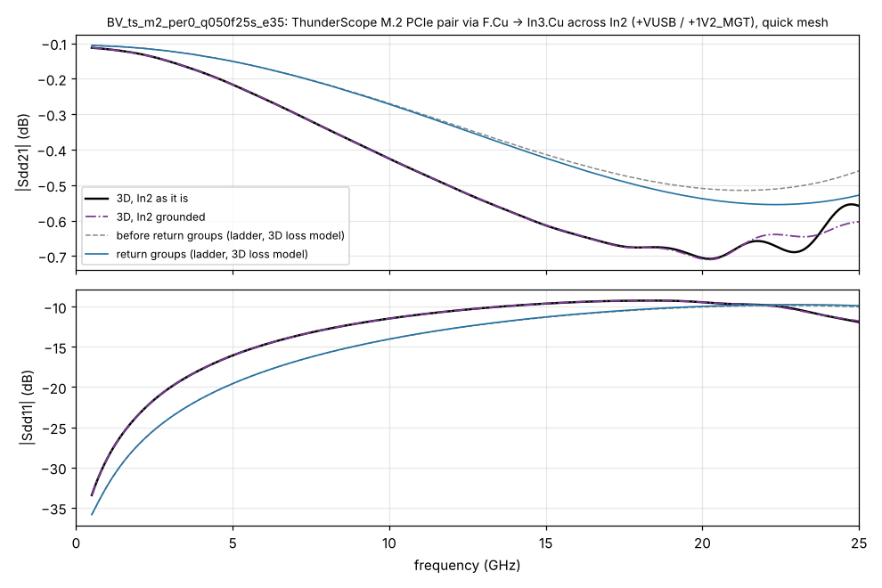

# Return groups per plane pair (Block 4)

kisi's via ladder (`kisi_si::via_pbm`) takes the plane-net vias near a via as its return vias and
treats each of them as a short of every plane pair it spans – also a GND via that passes a supply
plane through an opening. Block 3 (`BOARD_RESONANCES.md`) named this as the larger open error on
ThunderScope, whose channel vias cross GND/supply pairs (In1–In2 GND/+VUSB, GND/+3V3, …). This block
makes the ladder find out which vias actually join which planes ("return groups"), puts that into
the infinite-plate and the cavity path as an option (`--via-returns`, off by default) and checks it
against 3D (kisi-fdtd).

Reproduce: `board_returns.py` (cases `return_cases/`, 3D results `../via_ref/RG_*`,
`../via_ref/BV_ts_m2_per0_q050f25s_e35_in2gnd`, comparison `results/board_returns.json`, model run
times `results/board_returns_model_timing.json`, plots `results/board_returns/*.png`); the survey of
a board: `kisi-validate cavities <board>` (now with the return group of every pair); the ladder on a
case: `kisi-validate cavity-model <case.json> <out> --returns`.

## Summary

* **What the example boards have.** On both boards every pair of two nets (GND/supply) that a
  channel via crosses in its path is *bridged*: the GND vias next to the via join the GND planes on
  both sides of the supply plane and pass it through an opening (ThunderScope 50 via × pair cases in
  the path, 21 in stubs; LibreVNA 4 and 4). No channel via of either board has a GND/supply pair in
  its path that no return via bridges (ThunderScope: one, in a stub). So the error Block 3 expected –
  GND vias shorting a GND/supply pair they do not join – is on these boards mostly the residual
  effect of the floating supply plane between the GND planes, not a missing return path.
* **Model.** A return via shorts a pair only when it joins both planes (its net is the pair's plane
  net at the via and the fill of that net reaches it). Elsewhere it is a small ladder of its own: a
  span with its own current in every pair it does not short, and at every plane it passes through an
  opening a node with its capacitance to that plane (r–z Laplace with and without the post: 119 fF
  for the 4-layer test case, 37 fF on the ThunderScope stack). A GND via across a supply plane is so
  a *floating* return that ties the pairs on both sides together; a GND via that ends at a supply
  plane closes that pair only through its capacitance (*capacitive* return). Capacitors between the
  planes of two nets within 3 mm are posts closed by ESR + ESL (with mounting) + C from
  `data/components.json` (estimates). The returns are reduced onto the via's current moment in each
  pair, so the ladder gets one extra unknown per such pair.
* **3D references.** Four finite boards (24 × 16 mm, as Block 3): a 4-layer board where the via's L4
  trace refers to the PWR plane and the four GND vias join only the GND plane (the classic
  GND → PWR reference change), the same with a capacitor 2 mm away, and the ThunderScope stack with
  a via F → In3 whose GND vias cross In2 as a PWR plane or join it as a GND plane. Plus two
  ThunderScope board vias with In2 as it is and grounded: REFINOUT2 (both from Block 2) and the M.2
  pair (quick mesh; the grounded copy computed here). 0.52–0.81 M cells, 201–411 s per case.
* **Accuracy.** Where the GND vias do not bridge the supply plane the ladder before return groups is
  flat while the board resonates (dips to −8.6 dB): max/rms |ΔS21| below 12 GHz 8.45/1.97 dB. Return
  groups on infinite plates: 6.15/1.36 dB; with `--via-cavity` 2.48/0.68 dB, every resonance below
  12 GHz within 2.1 % in frequency and 0.44 dB in depth, and the recovery above 15 GHz (the GND vias'
  capacitance to the PWR plane) – 3.17/0.85 dB at 12–20 GHz against 6.65/1.69. The capacitor case
  likewise (9.02/2.10 → 6.45/1.42 → 2.94/0.77 dB). Where the GND vias bridge the supply plane, the
  floating plane costs 0.06/0.14 dB at 16/20 GHz in 3D (ThunderScope stack) and the ladder with
  return groups gives 0.07/0.13 dB. On REFINOUT2 (board via) it gives 0.07/0.15/0.28 dB at
  12/16/20 GHz where 3D has 0.05/0.10/0.19 dB: right sign, 1.3–1.6× too large, and since the ladder
  is already too lossy there (Block 2), its absolute error grows (12–20 GHz max 0.38 → 0.66 dB). For
  the differential M.2 pair In2 makes no difference in 3D (≤ 0.002 dB to 20 GHz) nor in the ladder
  (≤ 0.03 dB). GND/GND cases and all 56 Block 1 reference rows: identical.
* **Effect on the example boards (`check --all`).** No verdict changes. ThunderScope: 23 of 71 rows
  change, insertion loss at Nyquist by at most +0.025 dB, return loss by up to +0.66 dB, skew by up to
  0.8 ps; LibreVNA: 5 of 44 rows, return loss of SRC_REF_IN +0.83 dB, everything else < 0.001 dB.
  Run time 2.9 → 4.1 s (ThunderScope), 1.0 → 1.15 s (LibreVNA).
* **Recommendation.** Keep `--via-returns` as an experimental option, off by default: it is
  clearly more correct where a supply plane is not bridged (a reference change from GND to a supply
  plane, common on 4-layer boards), but neither example board has such a via, it changes no verdict
  there, it makes the agreement with 3D worse on the one single-ended board via with a 3D reference
  (because the ladder's own loss is too high there) and costs 1.4× on ThunderScope. Switch it on by
  default once the Block 2 ladder errors (pours on the via's signal layers, series inductance) are
  fixed, or when a board with unbridged GND/supply transitions shows a verdict change – the
  criterion Block 3 set.
* **Block 6** (section 7): the REFINOUT2 excess loss was the open return cage (plated pads now return
  posts, `BOARD_VIAS.md` section 6); without it the return groups are 0.29 dB off the 3D at 12–20 GHz (was
  0.67), their own floating-plane loss 1.6× the 3D's. Still an option.

## 1. Approach

1. Survey: for every channel via of both boards and every plane pair it crosses, which of its
   return vias join both planes, which join planes on both sides but not this pair's (a supply plane
   in between), which join only one side, and which capacitors sit between the planes nearby
   (`kisi-validate cavities`).
2. Model: return vias by the planes they join, in the infinite-plate ladder and in the cavity
   path; capacitors as lossy posts; unit tests for the limits (a floating return over pairs of one
   dielectric equals shorts, a capacitor post without impedance equals a short, the nodal solve
   equals the chain).
3. 3D references that isolate the effect: GND vias that do not bridge a supply plane (with and
   without a capacitor), GND vias that bridge one (against the same board with the plane grounded),
   the Block 3 GND/GND case; ThunderScope board vias with In2 as it is and grounded.
4. Effect on `check --all` of both boards; default only if clearly better and not much slower.

The first version (floating returns only, the vias passing a plane without joining it carrying no
current there) reproduced the 4-layer case below 12 GHz but was 5 dB off above 15 GHz, where the 3D
recovers: the GND vias that end at the PWR plane return through their capacitance to it. That led
to the return ladders of section 3.2 (100 fF per GND via, put in by hand, brought the 20–25 GHz error
from 5.3 to 0.9 dB; the Laplace estimate gives 119 fF without fitting).

## 2. Return groups on the example boards (`kisi-validate cavities`)

A *pair* is two neighbouring planes at the via (layers with a plane opening around it). "Shorted":
at least one return via joins both planes. "Bridged": no return via joins both, but some join a
plane above and one below (floating returns). "Open": neither. Via × pair cases over all channel
vias:

| board | channel vias | pairs of one net, shorted (path / stub) | two nets, bridged (path / stub) | two nets, shorted (path / stub) | two nets, open (path / stub) |
|---|---|---|---|---|---|
| ThunderScope Rev5.3 | 37 | 16 / 43 | 50 / 21 | 6 / 9 | 0 / 1 |
| LibreVNA | 20 | 60 / 32 | 4 / 4 | – | – |

* "Two nets, shorted" are pairs bounded by a pour on the via's own signal layer (e.g. In3 inside a
  +1V0_MGT pour), which count as joined by every return (section 3.1).
* ThunderScope has capacitors between the planes of 35 two-net pairs within 3 mm of the via (59 in
  all, 1–4 per pair, mostly 0402/0603 on the GND/+2V5 and GND/+3V3 islands) and capacitive returns
  (supply vias, or GND vias ending at a supply plane) in 39 via × pair cases. LibreVNA has neither.
* The typical ThunderScope channel via runs F.Cu → In3 through In1 GND, In2 (a supply), the 0.93 mm
  core and In3, with GND vias joined to In1, In3 (if In3 has a GND pour there), In4 and B: In2 is
  bridged on both sides.

## 3. Model (`kisi_si::via_pbm`, `kisi_si::via`; option `--via-returns`)

### 3.1 Which vias join which planes
`via::return_posts`: the candidates are the plane-net vias within 3 mm as before; a candidate joins
the plane of layer k when the plane net at the signal via on that layer is the candidate's net and
a fill of that net on that layer covers it or reaches its pad (thermal spokes,
`via::joined_to_fill`), and the layer is not back-drilled. The nearest 8 that join at least one
plane are taken, each with the planes it joins (`Post::joins`) and its opening radius in the others
(`Post::open_r`, from `plane_clearance` at its position, to 0.01 mm). A pour on the via's own entry
or exit layer – which the ladder takes as a plane although it is the trace's coplanar copper
(Block 2) – counts as joined by every return that spans it, as before return groups; a via joined
only to such a pour is not taken. (Without this, a +1V0_MGT pour around an In3 trace became a
floating conductor at the junction and three +1V0_MGT vias resonated as capacitive returns: a
−2.8 dB dip at 25 GHz in a ThunderScope pair via that no other model has.)

### 3.2 Return ladders
For a plane pair (planes at za > zb) a return is a short if it joins both; otherwise, if its range
spans the pair and it joins some plane, it has a span of its own in that pair. Each return is a
ladder over the planes it spans: a node at every plane it does not join, with its capacitance to
that plane (`post_plane_cap`: an axisymmetric r–z Laplace solve of the post in its opening between
the neighbouring planes, everything but that plane at the post's potential, the charge with the post
minus the charge without it; cached by geometry), and a span with its current in every pair it does
not short. A span's voltage is the pair's voltage at the return (zero at a plane it joins):

  u_top − u_bot = b·M_p + Σ_r' D_rr'·d·I_r',  and at a node  I_above − I_below = jωC·u,

with M_p = Σ_k ℓ_k I_k the via's current moment in pair p (ℓ_k the length of its span k), b and D
the pair's reduced impedances per metre (Hankel, with the shorts and capacitors of the pair
eliminated), d the pair's height. Without the capacitances a return joined above and below is a
floating return with one current and Σ_pairs V = 0; over pairs of one dielectric that the via
crosses with one current that is exactly the shorts in each pair (the middle plane carries no field
of its own) – the old ladder is the right answer there, and the difference comes from the different
εr of the pairs and the via's current changing along the barrel.

### 3.3 Coupling to the via
The via's span k in pair p gets c·ℓ_k·I_r from each return span r in p (c the pair's reduced
transfer impedance per metre; the span's share of the pair's voltage driven by the return's current
over the whole height), and each return span sees b·M_p. The returns' system is solved for the
moments: W = C·A⁻¹·B (pairs × pairs), so the via's ladder is solved with one extra unknown per pair
with returns of their own, M_p, and a span voltage ℓ_k Σ_p' W_pp' M_p'. W/f is interpolated on the
0.25 GHz grid of the plane-pair impedances (≤ 0.001 dB against the exact solve); with finite
cavities it is exact at every frequency (identical to 10⁻¹² to the full nodal solve). Without return
spans the via is evaluated as the chain it always was. With a partner via the via's row is the odd
(even) mode Z_PP ∓ Z_PN, as the groups', and the returns are driven by both barrels (b_P ∓ b_N).

### 3.4 Capacitors
Fitted two-pad parts with one pad on each of the two plane nets of a pair, within 3 mm (`CapPost`):
a post of 0.15 mm at the middle of the pads, closed by ESR + jω(ESL + mounting) + 1/(jωC) from
`data/components.json` ("decoupling", by package), C from the value (else 100 nF); all estimates.
On infinite plates they are ports of the pair's matrix; a finite cavity has its own capacitors.
They join every neighbouring pair of their two nets (as in `via_cavity`).

### 3.5 With finite cavities (`--via-cavity --via-returns`)
The cavity's ports are the via, the partner and the returns that short the pair or close it
capacitively. A pair crossed by a floating return stays an infinite radial line with its floating
returns: they short the pairs' common field, the stitching beyond them is not in a cavity of one
pair, and the supply plane's own field is excited only by the asymmetry of the via's current
between the pairs (3D: ≤ 0.05 dB below 12 GHz on the ThunderScope stack, section 5.2). A pair closed
only by capacitive returns and capacitors (an unbridged supply plane) gets its cavity.

### 3.6 Checks (unit tests in `via_pbm`)
| test | what | result |
|---|---|---|
| `coupled_core_equals_chain` | the nodal solve of the ladder (core with return spans) without returns = the chain | 10⁻⁹ |
| `floating_return_across_a_plane` | a return joined to the outer of three planes in one dielectric = shorts in both pairs; joined to all three = the ladder before return groups; joined to one = poorer than shorts | < 2·10⁻³·f/GHz in S21; 10⁻¹²; holds |
| `cap_post_and_roles` | a capacitor post without impedance = a short; the roles Short / Float / Cap / Open; a real capacitor (1 nH) is a poorer return at 10 GHz | 10⁻⁹; holds |
| `post_capacitance` | post capacitance between the coaxial stub value and 3× it; less for a larger opening or a shorter stub | holds |

## 4. 3D references

All finite boards as Block 3 (24 × 16 mm, open edges, 3 mm of air to the PML, 0.07 mm mesh at the
via, ≤ 0.35 mm, 25 GHz, 1000 frequencies, run to −35 dB), the via at (−3.3, −1.9) mm, four GND
vias on a 1 mm ring. De-embedded with the matched 2×thru (`sparam.deembed_matched`).

| case | what | cells | run time |
|---|---|---|---|
| `RG_s4_pwr_n4` | s4 stack (L1 / GND L2 / 1.2 mm core / PWR L3 / L4), via L1 → L4, the L4 trace on the PWR plane; GND vias joined to L2 only (Ø0.7 openings in L3) | 0.81 M | 348 s |
| `RG_s4_pwr_n4_cap2` | the same with a capacitor (100 nF, 10 mΩ, 0.6 nH) between L2 and L3 2 mm away | 0.81 M | 411 s |
| `R_s4_rect_n4` (Block 3) | the GND/GND reference: the same GND vias join L2 and L3 | 0.68 M | 77 s |
| `RG_ts6_sw_pwr` | ThunderScope stack with planes In1 GND, In2 PWR, In4 GND; via F → In3 with the stub to B (drill Ø0.203); GND vias joined to In1 and In4, Ø0.6 openings in In2 | 0.78 M | 227 s |
| `RG_ts6_sw_gnd` | the same with In2 GND, joined to the GND vias | 0.68 M | 201 s |
| `thru_RG_ts6p_L1/L4` | 2×thru of both ts6 feeds (the s4 cases use `thru_R_s4_L1/L4`) | 0.14 M | 3 s |
| `BV_ts_refinout2`, `…_in2gnd` (Block 2) | ThunderScope through via F.Cu → B.Cu, In2 as it is (+VUSB) and as a solid GND plane | 1.19 M | 1125 s |
| `BV_ts_m2_per0_q050f25s_e35` (Block 2, quick mesh) | ThunderScope M.2 pair via F.Cu → In3, In2 +VUSB / +1V2_MGT | 0.52 M | 213 s |
| `BV_ts_m2_per0_q050f25s_e35_in2gnd` (new) | the same with In2 joined to the GND vias by GND disks over their openings (9 of 16; the 7 that share an opening with another net's via left as they are) | 0.52 M | 323 s |

The model of the synthetic cases is `kisi-validate cavity-model` as in Block 3 (feeds as the cases,
the 3D loss model), before return groups (every GND via a short of every pair it spans) and with
them (`--returns`: each GND via joins the GND sheets with copper at it, its openings from the
sheets' holes, the capacitor as a post with the 3D lumped values and the Peaceman radius of its
cell); each on infinite plates and with a finite cavity per pair (grid 0.25 mm; the rectangle agrees
within 0.6 dB at the resonances of the PWR cases and 0.07 dB on the others). The board vias use
kisi's own ladder for the via as the channel builds it (`KISI_DEBUG_VIA`), with the 3D loss model,
before and with return groups.

## 5. Validation

### 5.1 GND vias that do not bridge the supply plane (max / rms |ΔS21| in dB against 3D)

| case | model | 0.5–6 GHz | 0.5–12 GHz | 12–20 GHz | 20–25 GHz | dips < 12 GHz found | mean \|Δf\| | mean \|Δdepth\| |
|---|---|---|---|---|---|---|---|---|
| `RG_s4_pwr_n4` | before return groups, infinite plates (default) | 3.59 / 0.94 | 8.45 / 1.97 | 6.65 / 1.69 | 0.84 / 0.28 | 0/7 | – | – |
| | before return groups, cavity | 3.59 / 0.94 | 8.46 / 1.97 | 6.67 / 1.69 | 0.85 / 0.28 | 0/7 | – | – |
| | return groups, infinite plates | 1.93 / 0.67 | 6.15 / 1.36 | 4.44 / 1.11 | 0.93 / 0.77 | 1/7 | – | – |
| | return groups, cavity | 1.29 / 0.26 | 2.48 / 0.68 | 3.17 / 0.85 | 1.14 / 0.85 | 7/7 | 2.1 % | 0.44 dB |
| `RG_s4_pwr_n4_cap2` | before return groups, infinite plates (default) | 3.08 / 0.86 | 9.02 / 2.10 | 6.77 / 1.70 | 0.88 / 0.26 | 0/8 | – | – |
| | before return groups, cavity | 3.08 / 0.86 | 9.03 / 2.10 | 6.78 / 1.71 | 0.90 / 0.27 | 0/8 | – | – |
| | return groups, infinite plates | 2.05 / 0.66 | 6.45 / 1.42 | 4.33 / 1.12 | 0.89 / 0.76 | 2/8 | – | – |
| | return groups, cavity | 0.98 / 0.22 | 2.94 / 0.77 | 2.67 / 0.79 | 1.16 / 0.85 | 8/8 | 2.0 % | 0.44 dB |
| `R_s4_rect_n4` (GND/GND) | before = with return groups, infinite plates | 0.04 / 0.03 | 0.04 / 0.03 | 0.11 / 0.04 | 0.07 / 0.03 | – | – | – |
| | before = with return groups, cavity | 0.04 / 0.03 | 0.05 / 0.03 | 0.10 / 0.03 | 0.17 / 0.07 | – | – | – |

"Dips" as in Block 3: minima of the 3D |S21| below 12 GHz at least 0.5 dB deep, matched within 8 %.

* Before return groups the four GND vias short the GND/PWR pair and the via is "perfect" (flat
  |S21|, |S11| 10–20 dB too low). In 3D the L4 trace's return current has no via to the PWR plane:
  it crosses the cavity, which resonates at the board's modes (3.0 … 12.2 GHz, down to −8.6 dB).
* With return groups on infinite plates the via sees an unshorted radial line: a smooth loss that is
  right on average below 20 GHz but has no resonances; with the cavity every dip below 12 GHz is
  found. (The case resembles Block 3's board without return via, `R_s4_rect_n0`, but the GND vias'
  posts in the cavity shift its dips: the two 3D results differ by up to 7 dB at the dips.)
* Above ~15 GHz the 3D recovers towards the shorted case: the GND vias return through their
  capacitance to L3 (119 fF each from the Laplace estimate: the opening plus the 0.2 mm stub below
  L3) – a series resonance with their post inductance near 30 GHz. Without these capacitances the
  error at 20–25 GHz was 5.3 / 4.4 dB (infinite plates) instead of 0.93 / 0.77 dB.

* The capacitor 2 mm away adds its series resonance with the cavity at 1.0 GHz (−2.3 dB in 3D) and
  shifts the modes; return groups with the cavity follow all eight dips. On infinite plates the
  capacitor only adds a small low-frequency return (a few ohms of ESL at 1 GHz against a pair
  impedance far below that), as on the board.

### 5.2 GND vias that bridge the supply plane

`RG_ts6_sw_pwr` against `RG_ts6_sw_gnd` (In2 PWR, crossed by the GND vias, or GND, joined by them),
|S21| difference PWR − GND in dB:

| | 6 GHz | 12 GHz | 16 GHz | 20 GHz | max 12–20 GHz | max 20–25 GHz |
|---|---|---|---|---|---|---|
| 3D | +0.004 | −0.007 | −0.055 | −0.138 | 0.15 | 0.32 |
| return groups, infinite plates (minus the ladder before, = GND case) | −0.005 | −0.029 | −0.067 | −0.131 | 0.13 | 0.28 |
| return groups, cavities | −0.006 | −0.013 | −0.147 | −0.144 | 0.17 | 0.62 |

| case | model | 0.5–12 GHz | 12–20 GHz | 20–25 GHz |
|---|---|---|---|---|
| `RG_ts6_sw_pwr` | before return groups, infinite plates (default) | 0.10 / 0.04 | 0.26 / 0.09 | 0.20 / 0.10 |
| | return groups, infinite plates | 0.07 / 0.03 | 0.19 / 0.07 | 0.39 / 0.25 |
| | return groups, cavities | 0.11 / 0.03 | 0.18 / 0.08 | 0.54 / 0.28 |
| `RG_ts6_sw_gnd` | before = with return groups, infinite plates | 0.09 / 0.03 | 0.20 / 0.08 | 0.29 / 0.15 |

* A floating supply plane between two GND planes the return vias join costs little: in 3D
  ≤ 0.05 dB below 12 GHz, 0.14 dB at 20 GHz. The return ladders give the same (infinite plates within
  0.02 dB up to 20 GHz). The finite board's own resonances of the PWR plane (In2 against both GND
  planes, no capacitors) hardly show in 3D: the via excites that field only through the difference of
  its current moments in the two pairs (here ~1 % of the common one).
* The cavity form overshoots at 16 GHz (−0.15 against −0.06 dB) and above 20 GHz; on the board the
  bridged pairs stay infinite plates (section 3.5).

### 5.3 ThunderScope board vias (In2 as it is and grounded in 3D)

|S21| (dB; M.2 pair: |Sdd21| at 100 Ω), the ladders with the 3D loss model:

| via | | 4 GHz | 8 GHz | 12 GHz | 16 GHz | 20 GHz | 24 GHz |
|---|---|---|---|---|---|---|---|
| REFINOUT2 (F.Cu → B.Cu across In2 +VUSB) | 3D, In2 as it is | −0.152 | −0.152 | −0.207 | −0.292 | −0.566 | −1.239 |
| | 3D, In2 grounded | −0.150 | −0.139 | −0.159 | −0.197 | −0.373 | −0.979 |
| | ladder before return groups | −0.180 | −0.217 | −0.304 | −0.503 | −0.944 | −1.840 |
| | ladder with return groups | −0.182 | −0.236 | −0.369 | −0.655 | −1.223 | −2.225 |
| M.2 pair (F.Cu → In3 across In2) | 3D, In2 as it is | −0.181 | −0.341 | −0.506 | −0.641 | −0.706 | −0.605 |
| | 3D, In2 grounded | −0.182 | −0.341 | −0.506 | −0.640 | −0.708 | −0.630 |
| | ladder before return groups | −0.253 | −0.505 | −0.779 | −0.934 | −0.866 | −0.569 |
| | ladder with return groups | −0.254 | −0.506 | −0.783 | −0.944 | −0.884 | −0.601 |

| via | ladder | against 3D as it is: 0.5–12 / 12–20 / 20–25 GHz (max / rms) | against 3D grounded |
|---|---|---|---|
| REFINOUT2 | before return groups | 0.10/0.06, 0.38/0.23, 0.63/0.52 | 0.14/0.07, 0.57/0.35, 0.87/0.76 |
| | with return groups | 0.16/0.08, 0.66/0.41, 1.02/0.87 | 0.21/0.10, 0.85/0.52, 1.27/1.11 |
| M.2 pair | before return groups | 0.27/0.15, 0.30/0.27, 0.16/0.09 | 0.27/0.15, 0.30/0.27, 0.16/0.10 |
| | with return groups | 0.28/0.15, 0.31/0.28, 0.18/0.10 | 0.28/0.15, 0.31/0.28, 0.18/0.10 |

* REFINOUT2: grounding In2 in 3D takes 0.05 / 0.10 / 0.19 / 0.26 dB of loss away at 12 / 16 / 20 /
  24 GHz (Block 2 compared only C, L and the 30 GHz notch, which do not change). The ladder before
  return groups is the grounded case by construction; with return groups it adds 0.07 / 0.15 / 0.28
  / 0.39 dB: the right effect, 1.3–1.6× too large. As the ladder is already 0.2–0.6 dB too lossy above
  12 GHz (Block 2: pours on the via's signal layers as planes, 105 pH too much inductance), its
  absolute error grows. A likely part of the excess: the too high series inductance makes the via's
  current and voltage vary more along the barrel, which is what excites the floating plane.
* The M.2 pair: in the odd mode both barrels drive the GND vias almost equally and oppositely, so a
  floating In2 does not matter (3D ≤ 0.002 dB to 20 GHz, 0.025 dB at 24 GHz), and the ladder with
  return groups changes by ≤ 0.03 dB.
* Neither ladder has REFINOUT2's 30.4 GHz notch (Block 2); the return ladders do not explain it.

### 5.4 Block 1 references and regressions

* Default path: `compare_kisi.py` identical to `results/kisi_models.json` (all 56 rows); `check --all`
  of both boards byte-identical. With `KISI_VIA_RETURNS=1` also all 56 rows identical: no reference
  via crosses a plane it does not join (the PWR cases of group Dcap have a blind via that ends above
  the PWR plane).
* `kisi-validate cavity-model` reproduces Block 3's ladders of `R_s4_rect_n4` bit for bit, and with
  `--returns` the same (the GND vias join both planes).

## 6. Effect on the example boards (`kisi check --all`)

| board | rows | run time (native, 1 thread) | rows that change | largest changes |
|---|---|---|---|---|
| ThunderScope Rev5.3 | 71 | 2.9 → 4.1 s | 23 | IL at Nyquist +0.025 dB (PCIe PET0/PET1), RL +0.66 dB (ADC D2A_P), −0.16 dB (D4A_P), skew +0.83 ps (D2A_P), −0.64 ps (D4A_P) |
| LibreVNA | 44 | 1.0 → 1.15 s | 5 | RL +0.83 dB (SRC_REF_IN: 35.19 → 36.01 dB), the rest < 0.001 dB |

No verdict changes on either board (the summaries are identical). The stub-resonance field
(`stub_ghz`, the first dip of a via's |S21| below −3 dB up to 1.2× the quarter-wave estimate) moves
for several ThunderScope lanes (e.g. D2A_P 65 → 28 GHz, USRIO_8 66 → 33 GHz): their stubs are
0.26 mm long (quarter-wave estimate 156 GHz), so the search runs to 80 GHz and picks up broad minima
of the whole via near or above 25 GHz, which exist in both ladders within a few tenths of a dB; the
field is information, not judged. With the option, `check` says so in `models` and `net` warns
(experimental; capacitor parasitics estimated).

Cost on ThunderScope's 81 ladder builds: the plane-connection test of the return candidates
(≈ 0.6 s), the capacitance solves (≈ 0.3 s), the reduction W on the 0.25 GHz grid (≈ 0.3 s).

## 7. Default or option

Kept as an option (`--via-returns`, off by default), for these reasons:

* **Where it matters it is clearly better** – a supply plane no return via bridges, i.e. a reference
  change from GND to a supply plane, as on most 4-layer boards (L2 GND, L3 PWR): the ladder before
  return groups calls such a via perfect while the board resonates; with return groups the infinite
  plates cut the rms error by 30–35 % below 20 GHz and the cavity option finds every resonance.
* **But not on the example boards**: their channel vias have the supply planes bridged by GND vias,
  where the old ladder is close to right (exactly right for equal εr and a uniform current), the
  change is ≤ 0.03 dB in insertion loss and no verdict moves.
* **On the one single-ended board via with a 3D reference** (REFINOUT2) the absolute agreement gets
  worse, because the ladder's own excess loss there has the same sign; the M.2 pair is unchanged.
* **1.4× the run time** on ThunderScope (1.15× on LibreVNA).

Switch it on by default when either the Block 2 ladder errors (pours on the via's signal layers,
series inductance) are fixed – then the floating-plane loss no longer adds to an excess – or a board
with unbridged GND/supply transitions shows a verdict change that 3D confirms (Block 3's criterion).
The cheap intermediate step – a warning in the default path when a via's path crosses an open
GND/supply pair, without changing the numbers – is section 8.

### Reassessed in Block 5 (after the coplanar pours, `BOARD_VIAS.md` section 5)

| | `--via-returns` | `--via-cavity` | both |
|---|---|---|---|
| run time `check --all`, one thread (ThunderScope / LibreVNA; default 6.9 / 1.4 s) | 10.1 / 1.4 s | 108 / 15 s | 16.3 / 12.7 s |
| rows that change (ThunderScope / LibreVNA), verdicts | 9 / 5, none | 9 / 9, none | 9 / 9, none |
| largest change | IL at Nyquist 0.07 dB (PCIe_PET2), RL 0.33 dB (SRC_REF_IN) | RL 1.5 dB (PCIe_PER2) | IL 0.07 dB, RL 0.84 dB |
| REFINOUT2 against 3D, 12–20 / 20–25 GHz max |ΔS21| (default 0.41 / 0.76 dB) | 0.67 / 1.15 dB | – | – |
| M.2 pair (quick mesh), 0.5–12 / 12–20 GHz (default 0.18 / 0.20 dB) | 0.17 / 0.19 dB | – | – |

**Decision: both stay options, off by default.** The coplanar fix brought the M.2 pair close to 3D (the
return groups now improve it slightly), but the REFINOUT2 ladder still dissipates too much above 12 GHz
(16 % of the power at 20 GHz against 9 % in 3D), and the floating-plane loss of the return groups adds
to that error instead of closing it. Neither example board has an open GND/supply pair, so the options
change no verdict; where a board has one, the new warning (section 8) points at the options. The cavity
option has become much slower than in Block 3 (ThunderScope 7.6 s there, now 108 s on one thread; with
the return groups, which leave the bridged pairs infinite, 16 s): the 241 ladder builds with their
cavities take 2.7 s, the rest is the cavity impedances evaluated at the channels' frequencies – the
check evaluates more channels per lane since main (pairs as 4-ports, every line on its own path); not
investigated further. Far from a default. Next for the
default: the REFINOUT2 excess loss above 12 GHz, and the cavity run time.

### Reassessed in Block 6 (return posts from plated pads, the cavity run time)

The REFINOUT2 excess loss had one cause: the ladder ignored the connector's plated GND pins and took at
most 8 return vias, so the return cage was open on one side and the infinite plates radiated 12 % of the
power at 20 GHz (`BOARD_VIAS.md` section 6). With plated pads among the posts and the nearest 12, the ladder
before return groups is within 0.02 dB of the 3D (In2 as it is) to 20 GHz. The return groups now take it
0.29 / 0.16 dB (max / rms, 12–20 GHz) away from it (Block 5: 0.67 / 0.38 dB) and 0.48 dB from the 3D with In2
grounded (0.86): their floating-plane loss (0.30 dB at 20 GHz) is 1.6× what the 3D shows between In2
floating and grounded (0.19 dB) – the excess no longer hides it. The M.2 pair is unchanged (0.19 / 0.18 dB
with return groups, 0.20 / 0.19 dB without). `--via-cavity` costs 55–60 s on ThunderScope instead of
102–109 s (one thread; `BOARD_RESONANCES.md` section 9), still 8× the default.

**Decision: both stay options.** The cause of the excess is fixed in the default; what keeps the return
groups from the default is now their own floating-plane loss on REFINOUT2, the one board via with a
floating supply plane and a 3D reference, and still no verdict change on the example boards.

## 8. The warning in the default path (Block 5)

Without any option, every channel via now checks the plane pairs of two nets (GND/supply) in its
path (`via::open_pairs`): a pair is *open* when none of the return vias the ladder with return
groups would take (plane-net vias within 3 mm, the nearest 8 that join one of the via's planes)
joins both planes (short) or planes above and below it (floating return) – the case where the ladder
before return groups calls the via nearly ideal while the board resonates (section 5.1). The joins
are computed lazily, nearest return first, and only for vias whose path crosses a pair of two nets
(ThunderScope `check --all`: no measurable cost). The numbers do not change.

* `net` and the viewer's lane and net detail: one warning per such via in the channel's warnings,
  with the pair, its layers, the capacitors between the two nets within 3 mm, the hint (a stitching
  via or a decoupling capacitor next to the via, or `--via-cavity --via-returns`) and "estimate";
  for a via of a pair it adds that mainly the common mode is affected. With both options on it says
  that the via is modelled with return groups and finite cavities. The viewer's via table marks the
  pair as "not bridged".
* `check`: `via_warning` on the row (one line, all such vias of the lane) and `via_warnings` at the
  top (also for rows that are not shown, e.g. green ones).
* The old warning "reference changes to another net, return current only through capacitors" (a
  change of the trace's reference to a plane of another net) is dropped where the via's path has
  plane pairs of two nets and every one of them is joined or bridged by a return via: there the
  return current has a via (3D: ≤ 0.05 dB below 12 GHz, section 5.2). It stays where the path has
  no such pair.

| board / case | vias with an open pair | warnings changed in `net` (all nets of the check) |
|---|---|---|
| ThunderScope Rev5.3 (40 lane nets) | none | none |
| LibreVNA (55 lane nets) | none | 2 old "reference changes … capacitors" warnings dropped (PORT1LO2, REFLO2: the In4 → F.Cu vias across the +5V/+6V islands, bridged by GND vias) |
| `RG_s4_pwr_n4` (`kisi_board.py`) | the via, GND/PWR In1–In2 | the new warning instead of the old one |
| `RG_s4_pwr_n4_cap2` | the same, "1 capacitor(s) within 3 mm" | the same |
| `RG_ts6_sw_pwr` (In2 bridged) | none | the old warning dropped |
| `RG_ts6_sw_gnd`, `R_s4_rect_n4` | none | none |

On `RG_s4_pwr_n4` with a 50 Ω target (se50) the row is green in the default path (insertion loss
−0.03 dB at Nyquist) and carries the warning; with `--via-cavity --via-returns` it is yellow
(−0.30 dB), as the 3D result with its dips suggests. `kisi_board.py` now writes the capacitors of
the finite-board cases (`meta.caps`) as 0402 parts between the plane nets, so the survey sees them.
Unit test: `via::tests::open_plane_pair_warning` (the board of `RG_s4_pwr_n4` with and without the
capacitor, and with L3 a GND plane).

## 9. Limits and open points

* **Floating-plane loss 1.3–1.6× too large** on REFINOUT2 (and 2× in the cavity form of the
  ThunderScope stack at 16 GHz); within 0.02 dB on the synthetic ThunderScope stack. Not separated
  from the ladder's own errors on the board via.
* **Pours on the via's signal layers** are coplanar returns since Block 5 (`BOARD_VIAS.md` section 5);
  return groups count them as joined by every return, as before. The return groups' default now waits
  for the REFINOUT2 excess loss above 12 GHz (section 7).
* **Return vias**: the nearest 8 plane-net vias within 3 mm that join one of the via's planes, with
  their openings measured at their position; annular rings on planes they pass are not modelled; a
  return's capacitance assumes the planes it does not neighbour are shielded.
* **Capacitors**: within 3 mm, on every neighbouring pair of their two nets, parasitics by package
  (estimates; a `PI_CAP` field is not read here); on the boards they change little at GHz (~5 Ω of
  ESL at 1 GHz against a sub-ohm pair impedance).
* **Cavities**: a pair crossed by floating returns stays infinite (section 3.5); the distant GND vias
  that cross a supply plane are not modelled in a cavity of one pair. `coupled_s` (via-to-via
  coupling in a cavity, validation only) leaves floating returns open.
* **Grounded-In2 copy of the M.2 case**: 7 of its 16 GND vias share an opening with another net's
  via and stay unjoined to In2.
* **Viewer**: the option is in the CLI only, like `--via-cavity`; the 3D references page does not
  read `return_cases/` yet.
