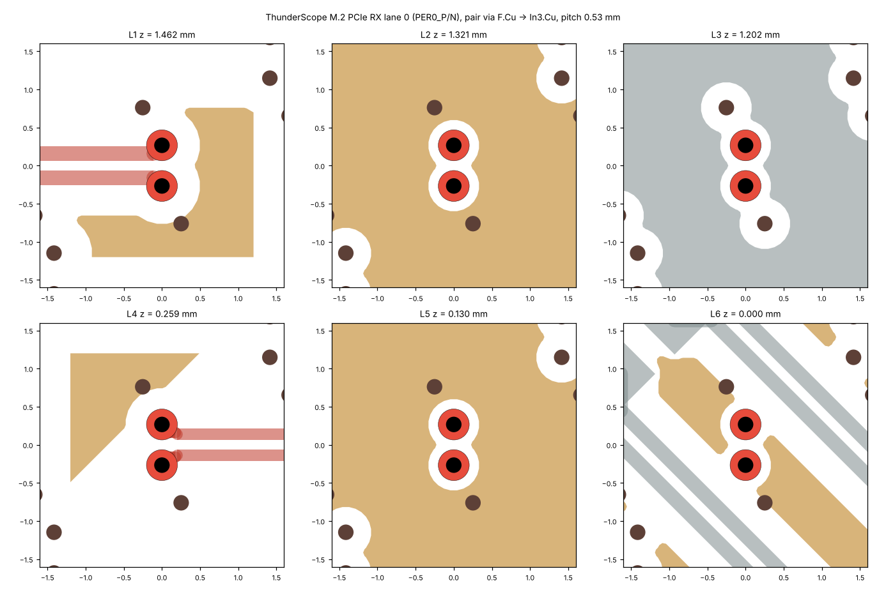
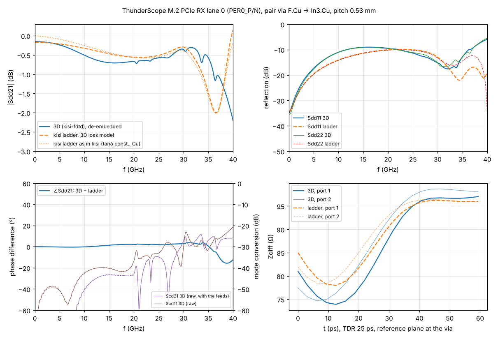
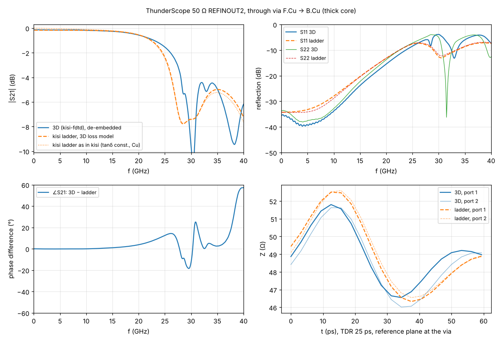
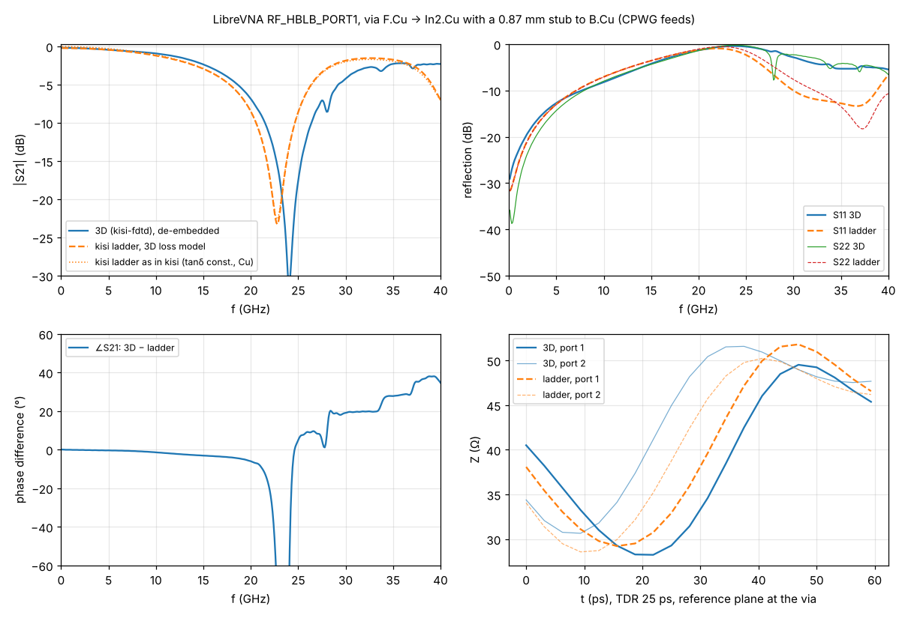

# Board vias in 3D: exporter, three critical vias, cost of a viewer integration

Block 2 of the via work (Block 1: `TESTS.md` section 7). A via is cut out of the real layout, computed with
kisi-fdtd, de-embedded and compared with kisi's ladder (`kisi_si::via_pbm`) for the same via. The last part
estimates what "click a via → 3D simulation in the viewer" would cost.

Everything here is reproduced by `board_vias.py` (commands at the end). Cases: `board_cases/`, results:
`../via_ref/BV_*` and `../via_ref/thru_BV_*`, numbers: `results/board_vias*.json`, plots: `results/board_vias/`.

## Summary

- **Exporter:** `kisi-validate via-case <board> --net NET` writes a kisi-fdtd case of one via, or of the via pair of
  a differential pair, with the real zone fills (polygons, so the real antipads and pour clearances), pads,
  tracks and vias of the neighbourhood, the stackup with kisi's layer heights, and the 2×thru fixture of each
  side. Three solver extensions made that possible (polygon copper, ports across y-directed traces, refinement
  boxes); board geometry also showed solver bugs that the references never hit, now fixed (sliver cells that set
  a 7× too small time step, conformal edges in the PML and on its faces that made runs grow without bound).
- **De-embedding:** the lines of a board cut-out are not 50 Ω in the 3D model (zero-thickness copper at kisi's
  heights, no solder mask: 52–64 Ω, 94–115 Ω differential). A 2×thru de-embedding referred to 50 Ω then leaves an
  impedance step at each via plane, worth up to +80 fF and −200 pH in the lumped totals (checked on a known
  network). The fixtures are therefore first referred to their own line impedance (`sparam.deembed_matched`);
  on the known network that recovers C within 5 fF and L within 4 pH. The Block 1 references with lines of
  49.4–50.7 Ω change by at most 5 fF and 11 pH (stub and back-drill vias up to 20 fF); three cases with 44–47 Ω
  stripline fixtures change more.
- **ThunderScope M.2 PCIe pair via (F.Cu → In3, pitch 0.53 mm):** the 16 GHz dip is **real**, but it is not a
  resonance: it is the broad reflection maximum of the low-impedance via pair, and kisi's ladder makes it about
  0.3 dB too deep. 3D: |Sdd21| −0.71 dB at 16 GHz, flat within 0.06 dB from 13 to 21 GHz, |Sdd11| at most −9.0 dB
  at 16.3 GHz (100 Ω reference); ladder (3D loss model) −1.00 dB at 16.9 GHz, |Sdd11| −7.5 dB at 17.4 GHz; kisi's
  ladder as used in the channel −0.98 dB at 17.5 GHz. In the lane's 85 Ω reference the dip is −0.36 dB (3D)
  against −0.53 dB (ladder). The ladder is 3.4 ps too slow and too capacitive (Zdiff TDR minimum 80 against
  88 Ω); its steep fall above 28 GHz (−3 dB at 33 GHz) is not in 3D.
- **ThunderScope through via F.Cu → B.Cu (REFINOUT2, thick core):** |S21| within 0.21 dB up to 16 GHz and 0.38 dB up
  to 20 GHz (the ladder rolls off earlier), capacitance within 9 fF (278 against 269 fF; the reference case
  B_ts6_L1L6 with round antipads: 260 against 210 fF), series inductance 105 pH too high. 3D shows a notch at
  30.4 GHz (−10.9 dB) that the ladder does not have; it stays when the In2 power plane is grounded.
- **Block 5 (section 5):** the comparison of this block carried extra trace in the ladder and its TDR lost half
  of every reflection at the reference plane; corrected, and the pours on the via's signal layers are now
  coplanar returns in the ladder (M.2 phase 23.6° → 2.2°, LibreVNA L 337 → 225 pH against 262 pH in 3D).
  The numbers below are those of Block 2.
- **Block 6 (section 6):** REFINOUT2's ladder lost 16 % of the power at 20 GHz (3D 9 %): a connector's plated GND
  pins, which the ladder never took as return posts, close its return-via cage. Plated pads of plane nets are
  posts now, the nearest 12: 12–20 GHz max |ΔS21| 0.41 → 0.02 dB, loss at 20 GHz 16.2 → 7.1 %; the other board vias
  and all 56 reference rows unchanged.
- **LibreVNA RF via F.Cu → In2 with a 0.87 mm stub:** stub notch 24.0 GHz in 3D, 22.8 GHz in the ladder
  (−5.0 %, as in the references); |S21| within 0.06 dB up to 6 GHz (the board's band) and 0.42 dB up to 16 GHz; the
  ladder is 4.6 ps too slow, 87 fF too capacitive and has 240 pH too much.
- **Model finding (follow-up):** GND pours on the via's own signal layers enter the ladder as full planes (the pour
  clearance as an antipad). Leaving them out of the ladder brings the phase error at 20 GHz from 25° / 8° / 34° to
  3.4° / 2.3° / 9° (M.2 / REFINOUT2 / LibreVNA), the M.2 capacitance from 217 to 147 fF (3D 158) and its TDR
  minimum to 88 Ω (3D 88), but it moves the LibreVNA stub notch above 25 GHz (3D 24.0) and leaves 26–127 pH of
  extra inductance. A pour on a signal layer needs its own treatment in the ladder (it is a coplanar return, not
  a plane pair).
- **Cost:** 1.0–1.5 M cells per via at the reference mesh (0.035 mm), 29–43 k time steps per excitation, 19–29
  minutes natively for all excitations of a case (one thread, shared machine), 80–120 MB per run. WebAssembly
  (SIMD) runs at 0.84–0.88 of native, with a setup of 10–24 s that needs optimising. Stopping at −35 dB instead of
  −50 dB halves the steps at ≤ 0.03 dB. A quick mesh (single vias 0.07 mm, pairs 0.05 mm with the −35 dB stop,
  25 GHz) costs 1/8–1/23 at 0.07–0.20 dB in |S21| up to 20 GHz: about 1–3 minutes in the browser against 10–20
  minutes for the standard mesh (estimates).
- **Recommendation:** a "3D check" panel in kisi's own viewer (exporter compiled to WebAssembly, one Web Worker
  per excitation, fixture cache, S-parameter/TDR plots against the ladder, a 2D field-plane view), no 3D WebGL
  view at first. Neither Forstén's js_2d_fields nor the maintainer's fork has a 3D view to reuse. Effort about
  **8 days** (minimal version 4 days, estimate), details in section 4.

## 1. Method

### Exporter: `kisi-validate via-case` (`crates/kisi-cli/src/viacase.rs`)

```
kisi-validate via-case <board.kicad_pcb> --net NAME --out DIR
    [--at X,Y | --via K] [--layers IN,OUT] [--config F | --no-config] [--keep 1.2] [--keep-cell 0.05]
    [--rotate DEG] [--feed 4.0] [--margin 2.5] [--fmax 40e9] [--dfine 0.035] [--name ID] [--list] [--scan]
```

It loads the board with kisi's own parser and configuration (`Project::load_with`), so stackup overrides from
`<board>.kisi.json`, plane nets and the reference planes of the extraction are those kisi uses.

1. **Via and partner:** the via of the net (`--via`, `--at`; `--list` shows them, `--scan` lists every signal
   via of a board with the layers its tracks join). For a differential pair the partner via is found as in
   `kisi_si::via` (nearest via of the partner net within 2 mm). The origin is the via, or the middle of the pair.
2. **Feeds:** the tracks of the net (and of the partner) that leave the via on its two connected layers are
   followed outwards. Their exit direction decides the rotation of the cut-out: 0° or 45°, whichever brings both
   exits closer to the axes (45° routing then runs along the mesh). Inside the **keep box** (±1.2 mm) the traces
   are taken as routed (round-ended segments as polygons, axis-parallel pieces as rectangles with the thirds rule);
   at the box edge each continues straight along the nearest axis to a 50 Ω lumped port 4 mm from the origin.
3. **Copper:** on every layer without a feed, the zone fills of all other nets (KiCad's filled polygons, clipped to
   the window), pads (plated holes as barrels) and other tracks inside the window (keep box + 2.5 mm margin, 1.5 mm
   beyond the ports). On the two feed layers only the keep box is taken from the board.
4. **Coplanar copper:** if a pour runs closer than 3 h (at most 0.6 mm) beside a feed at the keep-box edge, it
   continues along the extension as a sheet with that gap and a via fence (r 0.15 mm, pitch 1 mm) to every plane of
   its net at the port (planes of other nets get a 0.35 mm clearance). The board's own vias in that corridor are
   left out. The fixture has the same sheet and fence, so it is the same line.
5. **Vias:** the signal via (and the partner): barrel of the drill radius, annular rings by KiCad's rules (every
   layer, or only the connected ones and with `keep_end_layers` the ends for `remove_unused_layers`), the
   back-drilled part removed. Every other via in the window: plane-net vias as return vias, other nets' vias with
   their rings (floating).
6. **Stackup:** kisi's copper heights (dielectric plus half the copper on each side, as the ladder), zero-thickness
   copper, air 1 mm above and below, dielectric loss as in the references.
7. **Fixtures:** the 2×thru of each side is the straight feed (single trace or pair with its pitch), 2 × 4 mm,
   with solid sheets on the layers that have copper at the port in the case, their nets, and the coplanar sheet and
   fence if any. Pairs: a 4-port thru, de-embedded in the differential mode.
8. **Ladder match:** the case's `meta.kisi_returns` lists the return vias as kisi's via model selects them (plane-net
   vias within 3 mm, nearest 8); `board_vias.py ladder` takes the ladder geometry that kisi's channel prints with
   `KISI_DEBUG_VIA=1` for that via (for a pair the differential channel's odd-mode ladder).

### What the exporter approximates
- Copper has zero thickness; the heights are kisi's (dielectric plus half the copper), as in the ladder. Together
  with the missing solder mask this makes the lines of the cut-out 5–26 % higher in impedance than kisi's 2D
  solution of the same trace: REFINOUT2 64 / 62 Ω against 51 / 48 Ω, M.2 115 / 94 Ω differential against 91 / 85 Ω,
  LibreVNA 53 / 52 Ω against 49 / 50 Ω (in / out side; 3D from the 2×thru, `line_z_3d_ohm` in
  `results/board_vias.json`). The de-embedding takes care of the lines themselves (next section); the trace pieces
  at the via (over the antipad, into the pad) keep the same height convention in both models.
- Outside the window nothing is modelled; copper that reaches the window edge continues through the PML, so planes
  are infinite there and fills cut by the window do not end.
- On the feed layers only the keep box comes from the board. Outside it the feed is a straight trace (or pair)
  along the nearest axis, with a coplanar pour only if one runs within 3 h at the box edge. A route that bends
  outside the box, a neck-down or a different pair pitch further out are not in the case. A bend at the box edge
  (for routing that is neither 0°/90° nor 45° to the other feed) stays in the de-embedded result.
- Traces of other nets on the feed layers are cut at the keep box (floating ends).
- Other vias and tracks of the own net and the partner net are left out (a second via of the lane close by is not
  in the case).
- The barrel is a solid cylinder of the drill radius (no plating thickness, no hole wall); solder mask is ignored.
- Dielectric loss is a conductivity fixed at fmax/2: tanδ is exact at 20 GHz and grows towards low frequencies
  (at 0.1 GHz the de-embedded |S21| is 0.2 dB low). The comparison uses the ladder with the same loss model
  (`ladder_3dloss.s2p`); copper is lossless in both.
- Zone fills are taken as filled in the file (no refill); thermal reliefs and islands are in the polygons.

### Solver extensions and fixes (`crates/kisi-fdtd`)
- **Polygon copper:** a sheet may carry `polys` (rings, even-odd; KiCad's fractured outlines work as they are).
  Point tests use a band index, the conformal treatment uses the polygon edges like the round boundaries (a cell
  index finds the edges near a face). Polygons add no mesh lines; `mesh.refine` boxes ask for fine cells.
- **Ports across y-directed traces:** `x1` on a port (the strip runs along x at y = y0). The thirds rule follows
  traces along y.
- **Sliver cells (bug, found on the M.2 case):** soft lines join a group when they lie within 0.9 cells of its
  *first* line, but the group then sits at its mean, so two groups could end 0.005 mm apart (0.14 · dfine). That
  cell set the time step of the whole run (7× too small). Lines closer than 0.7 · dfine now merge. The 74 reference
  meshes are unchanged (their smallest cell is 0.84 · dfine); unit test `no_sliver_cells`.
- **Conformal metal in the PML and on its faces (bug, found on the M.2 case and on a coarse mesh of REFINOUT2):**
  a track of another net running out of the window made partial edges in the PML, where the CPML terms use the
  full-cell spacings, and fills crossing the window edge made partial edges *on* the domain faces, next to faces
  that reach into the PML and are not treated conformally. Both break the condition of the stability argument
  (every face that touches a partial edge uses the free lengths); the M.2 run and the quick-mesh variant
  `board_cases/quick/BV_ts_refinout2_q050f25s.json` grew without bound (found with monitor planes: the field grew
  at the window edge). Partial edges now lie strictly inside the domain; in the PML and on its faces the metal is
  staircased (the PML geometry is the extruded domain face anyway). No reference case has a round boundary within
  1.2 mm of the domain edge, so they are unchanged (a reference via case and a thru case rerun bit-identical);
  smoke test `trace_into_pml_stable`. The three board cases computed before and after the fix differ by at most
  0.07 dB up to 25 GHz; their 2×thru fixtures rerun bit-identical.
- **Time-step guard:** a Gershgorin bound of the discrete operator (ε⁻¹·C_H·μ⁻¹·C_E over the free and partial edges)
  compares the rows next to conformal faces with the regular ones and shrinks the time step if they exceed them.
  It never triggered (all 74 references, the board cases) and costs a fraction of a second; it stays as a guard for
  geometry the references do not cover. New case options: `courant` (fraction of the Courant limit) and
  `conformal_polys` (false: polygon edges staircased, a fallback).
- Conformal faces are now also built when a case has polygon copper but no round boundary (before, partial edges
  of polygons would have been left without their faces).
- Unit test `polygon_plane_and_y_ports`: the microstrip of `short_microstrip` turned by 90° with a polygon plane
  gives the same S-parameters and the same mesh.

### De-embedding and comparison
- **Fixtures referred to their own line (`sparam.deembed_matched`).** The line impedance Zc(f) of each 2×thru is
  its image impedance √(B/C), fitted with Zc² = Z∞² · jω / (jω + g) (lossless copper, a dielectric conductivity
  fixed in frequency; the fit skips the half-wave frequencies of the thru, where B and C vanish). The outer
  ports of the case and of the thru are referred to Zc(f) (an exact change of reference at the lumped ports);
  each thru is then nearly matched, and the IEEE P370-style NZC split (`sparam.fixture_2xthru`) only has to place
  the small port parasitics. The via comes out referred to the line impedance at its planes and is converted to
  50 Ω (pair: 100 Ω differential) at the end, i.e. the via between ideal 50 Ω lines, as the ladder's S-matrix.
- **Why:** with the thru referred to 50 Ω, NZC puts a line of Zc ≠ 50 Ω into the fixture model as "port + line +
  impedance step back to 50 Ω"; that step does not exist in the case and stays in the de-embedded via. On the
  board vias it showed as a frequency-flat low-frequency reflection of opposite sign at the two ports (M.2:
  Sdd11 = −0.104, Sdd22 = +0.067 at 0.1 GHz, where the via alone gives −0.018 on both sides).
- **Check on a known network** (`board_vias.py deembed-check`, `results/board_vias_deembed_check.json`): a π-section
  via between 30 pH ports and 4 mm lossy lines, the same metrics as below.

  | lines (in / out), reference | z0-referred NZC: C / L | matched: C / L | true C / L | max \|ΔS\| to 25 GHz, NZC / matched |
  |---|---|---|---|---|
  | 64 / 62 Ω, 50 Ω (as REFINOUT2) | 352 fF / 649 pH | 268 fF / 852 pH | 270 fF / 849 pH | 0.24 / 0.027 |
  | 53 / 51.5 Ω, 50 Ω (as LibreVNA) | 520 / 499 | 476 / 545 | 480 / 543 | 0.088 / 0.038 |
  | 50 / 50 Ω, 50 Ω | 280 / 816 | 267 / 853 | 270 / 849 | 0.057 / 0.032 |
  | 114 / 94 Ω, 100 Ω (as the M.2 pair) | 221 / 812 | 216 / 912 | 217 / 910 | 0.11 / 0.020 |

  Without the port parasitic the matched result is exact; with it, |S21| is within 0.2 dB up to 20 GHz (worst
  near 19.5 GHz), the size of the port-parasitic error the z0-referred NZC has on 50 Ω lines.
- Pairs: the mixed-mode Sdd of the case and of each 4-port thru (the thrus are symmetric, mode conversion
  negligible: raw Scd21 of the case ≤ −42.9 dB up to 20 GHz).
- The reference plane is the via centre (pair: the middle) on both sides, as in the reference cases and the
  ladder (which removes the feed to the via centre). The 3D result keeps the routing inside the keep box minus a
  straight line to the origin (here 0.1–0.2 mm of extra trace per side).
- Metrics: max Δ|S21| up to 20 / 25 GHz, phase, |S11|, TDR (25 ps edge, 0–40 ps after the reference plane),
  delay from the phase slope at 5–15 GHz, lumped totals at 3–8 GHz (shunt C = Im ΣY / ω, series
  L = Im(Z11 + Z22 − Z12 − Z21) / ω; the same formulas on both sides, so L is an effective value that includes the
  shunt C), least |S21| at 8–25 GHz (dip, notch) and at 25–40 GHz. Late TDR times (beyond about 30 ps) hold the
  low-frequency behaviour of the conductivity loss model, in 3D and in the ladder alike.

## 2. Results

| | M.2 pair PER0 (Sdd, 100 Ω) | REFINOUT2 through via | LibreVNA RF_HBLB_PORT1 |
|---|---|---|---|
| layers, drill / pad | F.Cu → In3.Cu (stub to B.Cu 0.26 mm), 0.203 / 0.406, pitch 0.533 | F.Cu → B.Cu, 0.203 / 0.406 | F.Cu → In2.Cu (stub to B.Cu 0.87 mm), 0.25 / 0.5 |
| copper around | GND pours on F.Cu, In3, B.Cu; In2 split power plane | GND pours on F.Cu, B.Cu; In2 power | GND on every layer |
| feeds | pairs w 0.191 / 0.148 mm, 45° routing (case turned 45°) | w 0.213, one-sided coplanar pour (gap 0.40) on F.Cu | CPWG w 0.35 gap 0.18 (F.Cu), w 0.22 gap 0.23–0.26 (In2) |
| line impedance 3D / kisi (Ω) | 115 / 91 and 94 / 85 (diff.) | 64 / 51 and 62 / 48 | 53 / 49 and 52 / 50 |
| cells, excitations, steps | 1.03 M, 4, 36–42 k | 1.19 M, 2, 29–35 k | 1.53 M, 2, 32–43 k |
| run time (native, 1 thread, shared machine) | 1737 s | 1125 s | 1119 s |
| \|S21\| 3D / ladder at 8 GHz (dB) | −0.39 / −0.58 | −0.15 / −0.22 | −0.70 / −0.70 |
| at 16 GHz | −0.71 / −0.99 | −0.29 / −0.50 | −2.90 / −3.31 |
| at 20 GHz | −0.67 / −0.93 | −0.57 / −0.94 | −6.87 / −8.71 |
| max Δ\|S21\| to 16 / 20 GHz (dB) | 0.29 / 0.30 | 0.21 / 0.38 | 0.42 / 1.85 (notch shift) |
| phase at 20 GHz | 25° | 8° | 34° |
| dip / notch, 3D / ladder | broad minimum 16 / 17 GHz, −0.71 / −1.00 dB | 3D notch 30.4 GHz (−10.9 dB), none in the ladder | stub notch 24.0 / 22.8 GHz (−5.0 %) |
| \|S11\| 3D / ladder at 4 / 12 GHz (dB) | −19.4 / −16.1, −9.9 / −8.5 | −39.8 / −29.9, −30.0 / −21.2 | −14.3 / −16.1, −6.6 / −6.2 |
| TDR min (Ω), 3D / ladder | 87.6 / 80.2 (−8.4 %) | 48.1 / 47.8 (−0.6 %) | 33.5 / 32.8 (−2.1 %) |
| delay 5–15 GHz (ps), 3D / ladder | 10.1 / 13.5 | 14.1 / 15.2 | 13.5 / 18.1 |
| shunt C (fF), 3D / ladder | 158 / 217 (differential) | 278 / 269 | 391 / 478 |
| series L (pH), 3D / ladder | 673 / 855 (differential) | 686 / 791 | 262 / 503 |
| ladder without the pours on the signal layers: C, L, delay, phase at 20 GHz | 147 fF, 772 pH, 10.7 ps, 3.4° | 267 fF, 712 pH, 14.4 ps, 2.3° | 447 fF, 389 pH, 14.8 ps, 9.3°; notch > 25 GHz |

"Ladder" is kisi's ladder for the same via with the 3D loss model (`ladder_3dloss.s2p`: dielectric conductivity
fixed at 20 GHz, lossless copper). kisi's ladder as the channel uses it (`ladder.s2p`: constant tanδ, copper loss)
differs from it by up to 0.24 dB below 5 GHz and 0.17 dB at 5–20 GHz, only through the loss models; its dip and
notch frequencies are the same within 0.6 GHz. The last row evaluates the matched ladder geometry with
`kisi-validate via-geom` after removing the planes at the via's entry and exit layers (M.2: F.Cu, In3; REFINOUT2:
F.Cu, B.Cu; LibreVNA: F.Cu, In2), `board_vias.py variants`, `results/board_vias_variants.json`.

### ThunderScope M.2 PCIe lane 0: is the 16 GHz dip real?


The case around the pair (±1.6 mm, one panel per copper layer; red: the pair with its pads, brown: GND vias,
ochre: GND copper, grey: other nets). The GND pours on F.Cu (L1) and In3 (L4) wrap around the pads; the ladder
takes them as planes. Whole windows of all three cases: `results/board_vias/*_case.png`.



- **Yes, as a broad minimum, not as a resonance.** The pair via is a low-impedance section (Zdiff TDR minimum 88 Ω
  against the 100 Ω reference): its reflection rises to −9.0 dB at 16.3 GHz, and |Sdd21| has its least value
  there, −0.71 dB at 16 GHz (within 0.06 dB from 13 to 21 GHz; a small step to −0.72 dB at 20.5 GHz disappears when
  the run stops at −35 dB, a late-time artefact). The ladder puts the minimum at the same place (16.9 GHz) but 0.29 dB
  deeper (−1.00 dB, |Sdd11| −7.5 dB at 17.4 GHz): too much capacitance (217 against 158 fF) and a TDR minimum of
  80 instead of 88 Ω. Above it both recover to about −0.6 dB at 25 GHz.
- In the lane's own 85 Ω reference the dip is −0.36 dB at 16 GHz (3D) and −0.53 dB at 17 GHz (ladder), |Sdd11| at
  most −12.7 / −10.5 dB: a mismatch of the via, not a channel-breaking dip.
- The ladder's steep fall above 28 GHz (−3 dB at 33 GHz, −5.7 dB at 40 GHz) does not exist in 3D (at worst −1.2 dB
  up to 37 GHz). Below 25 GHz, where kisi's channel ends, it does not matter.
- The ladder is 3.4 ps slower. Without the GND pours on F.Cu and In3 as planes it gets C 147 fF, a TDR minimum of
  88 Ω, the delay within 0.7 ps and the phase error at 20 GHz down to 3.4°, with the minimum at 21 GHz (−0.56 dB);
  L stays 100 pH high (772 against 673 pH). Without the junction model as well: C 123 fF, L 666 pH.
- The P and N vias see different pours (the ladder of the N via has equivalent antipads 0.76 / 0.72 mm on
  F.Cu / In3 against 0.63 / 1.13 mm for P); mode conversion in 3D stays small (raw Scd21 ≤ −43 dB, Scd11 ≤ −37 dB
  up to 20 GHz).

### ThunderScope REFINOUT2: through via across the 0.93 mm core


- **Capacitance:** 278 fF in 3D against 269 fF in the ladder. The reference case B_ts6_L1L6 (same stack, round
  antipads, planes on every inner layer, 4 GND vias) has 260 against 210 fF; on the board the pours on F.Cu and
  B.Cu, which the ladder takes as planes, add the capacitance the ladder otherwise misses (without them: 267 fF).
- **Inductance:** the ladder has 105 pH too much (791 against 686 pH); its |S21| rolls off from 12 GHz (−0.94 dB at
  20 GHz against −0.57 dB). Without the F.Cu and B.Cu pours as planes: 712 pH, phase error 2.3°.
- **Reflection:** in 3D the via is better matched than in the ladder up to 16 GHz (|S11| −40 to −22 dB against −30
  to −18 dB); above 20 GHz the 3D reflection rises steeply towards the notch.
- **Notch at 30.4 GHz in 3D** (−10.9 dB, |S11| −4 dB around 30 GHz), none in the ladder. It is not the floating
  In2 power plane: with In2 as a solid GND plane joined to every GND via (diagnostic run
  `../via_ref/diag/BV_ts_refinout2_in2gnd`) the notch stays (29.5 GHz, −9.3 dB) and C, L do not change (280 fF,
  684 pH). The return vias sit at 0.95–1.05 mm on three sides and at 2.2 mm beyond, so a resonance of this cage in
  the core is likely; the ladder interpolates the plane-pair impedance on the assumption that the cage does not
  resonate below about 50 GHz (`DF_GRID` in `via_pbm.rs`). Not checked further; above kisi's 25 GHz.

### LibreVNA RF_HBLB_PORT1: via with a stub


- **Stub notch:** 24.0 GHz (3D, −31.4 dB) against 22.8 GHz (ladder, −24.2 dB), −5.0 %, the same sign and size as
  the ThunderScope stub reference B_ts6_L1L3_stub (−5.7 %).
- |S21| agrees within 0.06 dB up to 6 GHz (the board's band), 0.10 dB up to 10 GHz and 0.42 dB up to 16 GHz; TDR
  minimum within 2.1 %.
- The ladder is 4.6 ps too slow; C 478 against 391 fF, L 503 against 262 pH. Without the F.Cu and In2 pours as
  planes the phase error drops to 9° and C, L to 447 fF, 389 pH, but the notch moves above 25 GHz; without the
  junction model as well C, L and the delay match (389 fF, 333 pH, 13.5 ps), the notch still not.
- The In2 side has a via fence along the CPWG feed in case and fixture; its line impedance scatters more around the
  half-wave frequencies of the thru, so port 2 (In2) is the less certain side (its TDR beyond 25 ps rises to 69 Ω
  in 3D against 60 Ω in the ladder).

### Model findings (follow-up work, no change to the ladder in this branch)
1. **Pours on the signal layers:** `plane_clearance` takes any plane-net fill on any layer as a plane with the pour
   clearance as antipad (the equivalent radius counts rays without an edge within 1.5 mm as an edge at 1.5 mm). On
   the via's own signal layers such a pour is a coplanar return around the pad and the trace, not one side of a
   plane pair. Removing these planes from the ladder fixes the delay on all three vias (phase error at 20 GHz
   25° → 3.4°, 8° → 2.3°, 34° → 9°) and the M.2 capacitance and reflection, but loses the LibreVNA stub notch
   (3D 24.0 GHz, ladder > 25 GHz). A follow-up should model the pour as a coplanar ground (a small capacitance
   between pad / trace and pour, the return current on the pour edge) instead of dropping it.
2. **Series inductance:** too high on all three board vias: +183 pH (M.2, differential), +105 pH (REFINOUT2),
   +241 pH (LibreVNA); 100 / 26 / 127 pH remain without the signal-layer pours (and −7 / −13 / 71 pH without the
   junction model as well). The references: within 10–70 pH, B_ts6_L1L6 with the ladder 70 pH *below*.
3. **Capacitance:** too high where pours sit on the signal layers of a tight pair (M.2: +59 fF, +37 %) and on the
   CPWG via (LibreVNA: +87 fF); right on the thick-core through via (REFINOUT2: −9 fF), where the reference case
   without pours shows −50 fF.
4. **Delay:** the ladder is 1.1–4.6 ps too slow (25–34° at 20 GHz on M.2 and LibreVNA).
5. **Notches:** stub notch −5 % (as in the references); a 30 GHz cage-like resonance on REFINOUT2 is missing; the
   M.2 pair ladder falls steeply above 28 GHz where 3D does not.
6. **Power planes:** the ladder shorts every plane pair with the return vias, also pairs with a power plane. On
   REFINOUT2 this did not matter (In2 grounded in 3D: same L and C).

### Effect of the de-embedding (first evaluation, Block 1)
- The first evaluation of these runs used the z0-referred NZC. It reported the REFINOUT2 ladder 87 fF short and all
  three ladders 260–280 pH too inductive; most of that was the impedance step of the 3D lines (REFINOUT2: 3D C 356
  instead of 278 fF, L 533 instead of 686 pH; M.2: TDR minimum 82 instead of 88 Ω, L 573 instead of 673 pH;
  LibreVNA: C 425 instead of 391 fF). |S21| moved by at most 0.22 dB up to 20 GHz, the notch and dip frequencies
  did not move. `results/board_vias.json` keeps both (`nzc_z0_*`).
- Block 1 (`TESTS.md` section 7) de-embeds the reference cases with the z0-referred NZC. On the 26 of its 29 single
  vias whose fixtures are 49.4–50.7 Ω, the matched de-embedding changes C by −1 … −5 fF, L by 0 … +11 pH and the TDR
  extremes by at most 0.7 Ω, except the B_s8 L1L3 back-drill and stub vias (C −8 … −20 fF, TDR 1.0–2.1 Ω; large
  reflections at 3–8 GHz). Three cases use 44–47 Ω stripline fixtures and change more: X_s8x2_L1L3_bd_d200 (44 Ω:
  C 22 → 62 fF, L 32 → 89 pH), B_ts6_L1L3_stub (46.7 Ω: C 178 → 192 fF), X_s8x4_L1L3_bd_d200 (47 Ω: −3 fF,
  −7 pH). Block 1's conclusions (e.g. B_ts6_L1L6 lacking about 50 fF) stand; the cases above would be worth
  re-scoring with `deembed_matched` when the ladder is next fitted.

## 3. Resource estimate

### Measured on the board cases
One excitation, one thread, the case's own mesh; setup = geometry, conformal faces and coefficients (one time
step), step rate from 1 and 4001 steps, peak memory of the process (`board_vias.py speed --threads 2`,
`results/board_vias_speed.json`). Workspace: 2 vCPU (Xeon, 2.1 GHz nominal) shared with another agent; native and
WebAssembly (node 22, V8, SIMD build) back to back.

| case | cells | native setup | native, 1 thread | native, 2 threads | WASM setup | WASM step rate | memory native / WASM |
|---|---|---|---|---|---|---|---|
| M.2 pair | 1.03 M | 6.1 s | 80 Mcells/s | 86 Mcells/s | 13.3 s | 67 Mcells/s | 82 / 79 MB |
| REFINOUT2 | 1.19 M | 4.7 s | 80 Mcells/s | (68)* | 10.0 s | 69 Mcells/s | 88 / 85 MB |
| LibreVNA | 1.53 M | 11.0 s | (75)* | (56)* | 23.8 s | (66)* | 113 / 110 MB |

\* another job compiled on the second vCPU during these measurements.

- **WebAssembly runs at 0.84–0.88 of native** with SIMD (`-C target-feature=+simd128`); without SIMD it was 21 against
  50 Mcells/s (M.2, earlier measurement under load). The SIMD build is the one to ship (all current browsers run
  SIMD128). The module is 370 kB.
- **Memory 77–84 bytes per cell**, as for the references (77 B/cell): about 80–120 MB per worker for these cases.
- **Two threads gave only +8 %** (M.2, idle machine): the field update is bound by memory bandwidth on this VM.
- **The setup is large**: 4.7–11 s natively and 10–24 s in WebAssembly, against 0.7 s for a reference case of similar
  size (the 0.77 M-cell pair E_s8_L1L8_p1000_round_g2). The conformal faces sample the geometry 576 times per face
  and every sample tests the polygons; worth optimising before an integration (analytic free fractions for
  straight polygon edges, fewer samples where only one boundary crosses a face).
- **Steps:** 29–43 k per excitation to −50 dB of the peak energy at the 0.035 mm mesh (time step 50–54 fs,
  1.5–2.3 ns); the references need 4–40 k. The board vias ring longer (weakly damped plane cavities, resonances
  above 25 GHz). Stopping at −35 dB halves that (15–24 k) and changes |S21| by at most 0.004 / 0.012 / 0.03 dB up
  to 20 GHz (M.2 / REFINOUT2 / LibreVNA; the deep LibreVNA notch moves by 0.1 GHz). The small step of the M.2
  |Sdd21| at 20.5 GHz disappears with it: a late-time artefact.
- **Whole cases, native, one thread, −50 dB** (as computed here, the workspace shared): M.2 pair 1737 s
  (4 excitations), REFINOUT2 1125 s, LibreVNA 1119 s (2 each), i.e. 69–105 Mcells/s averaged over the run; the
  2×thru fixtures 15–39 s each (3.4–4.2 k steps).

### Quick mesh
Coarser variants of each case (`board_vias.py quick`: the exporter with `--dfine`, `--keep-cell`, `--fmax`, shorter
feeds and margin, and the stop level), de-embedded the same way and compared with the standard result up to 20 GHz.
Time = all excitations and both fixtures, native, one thread, on the shared workspace (the load varied, so the
ratios are approximate; the step counts are exact).

| case | mesh, fmax, stop | cells | steps | time | vs standard | max Δ\|S21\| | Δphase | max \|ΔS11\| | ΔC | |
|---|---|---|---|---|---|---|---|---|---|---|
| M.2 pair | 0.035 mm, 40 GHz, −35 dB | 1.03 M | 18.4–21.0 k | 902 s | 2.0× | 0.00 dB | 0.0° | 0.001 | 0 fF | |
| M.2 pair | 0.05 mm, 25 GHz, −50 dB | 0.52 M | 33.0–39.8 k | 807 s | 2.2× | 0.11 dB | 6.7° | 0.026 | +15 fF | |
| M.2 pair | **0.05 mm, 25 GHz, −35 dB** | 0.52 M | 8.0–13.0 k | 239 s | 7.6× | 0.11 dB | 6.7° | 0.026 | +15 fF | |
| M.2 pair | 0.07 mm, 25 GHz, −50 dB | 0.34 M | 24.4–29.2 k | 381 s | 4.7× | 0.23 dB | 11.8° | 0.157 | +24 fF | too coarse for the 0.13 mm gap |
| M.2 pair | 0.07 mm, 25 GHz, −35 dB | 0.34 M | 5.6–9.6 k | 124 s | 15× | 0.23 dB | 11.6° | 0.151 | +24 fF | |
| REFINOUT2 | 0.035 mm, 40 GHz, −35 dB | 1.19 M | 15.0–19.4 k | 479 s | 2.5× | 0.01 dB | 0.1° | 0.003 | 0 fF | |
| REFINOUT2 | 0.05 mm, 40 GHz, −50 dB | 0.83 M | 22.6–27.2 k | 440 s | 2.7× | 0.01 dB | 1.3° | 0.030 | +12 fF | |
| REFINOUT2 | 0.05 mm, 25 GHz, −50 dB | 0.61 M | 5.0–8.0 k | 108 s | 11× | 0.10 dB | 1.3° | 0.032 | +12 fF | |
| REFINOUT2 | 0.05 mm, 25 GHz, −35 dB | 0.61 M | 3.8 k | 77 s | 15× | 0.13 dB | 1.4° | 0.033 | +10 fF | |
| REFINOUT2 | **0.07 mm, 25 GHz, −50 dB** | 0.35 M | 3.4–6.8 k | 51 s | 23× | 0.07 dB | 3.2° | 0.021 | +14 fF | |
| REFINOUT2 | 0.07 mm, 25 GHz, −35 dB | 0.35 M | 2.6 k | 34 s | 35× | 0.17 dB | 2.9° | 0.020 | +12 fF | |
| LibreVNA | 0.035 mm, 40 GHz, −35 dB | 1.53 M | 14.2–24.0 k | 813 s | 1.4× | 0.03 dB | 0.2° | 0.002 | 0 fF | notch 24.1 GHz |
| LibreVNA | 0.05 mm, 25 GHz, −50 dB | 0.71 M | 4.6–10.0 k | 134 s | 8.6× | 0.17 dB | 4.1° | 0.167 | −9 fF | notch 23.8 GHz |
| LibreVNA | 0.05 mm, 25 GHz, −35 dB | 0.71 M | 3.6 k | 87 s | 13× | 0.15 dB | 5.3° | 0.161 | −10 fF | notch 24.1 GHz |
| LibreVNA | **0.07 mm, 25 GHz, −50 dB** | 0.39 M | 5.4–10.6 k | 84 s | 14× | 0.20 dB | 2.1° | 0.158 | −5 fF | notch 23.6 GHz |
| LibreVNA | 0.07 mm, 25 GHz, −35 dB | 0.39 M | 2.6 k | 43 s | 27× | 0.30 dB | 2.2° | 0.157 | −6 fF | notch 23.9 GHz |

(Standard: 0.035 mm, 40 GHz, −50 dB, notch 24.0 GHz. The large \|ΔS11\| of LibreVNA sits at the stub notch, where
\|S11\| is close to 1 and a small shift of the notch is a large linear difference.)

- **Single vias: 0.07 mm, 25 GHz** keeps |S21| within 0.07–0.20 dB up to 20 GHz, the phase within 3.2° and the stub
  notch within 0.4 GHz, at 1/14–1/23 of the cost. Their runs are short already; stopping at −35 dB saves little
  and costs accuracy at 20–25 GHz.
- **Pairs: 0.05 mm, 25 GHz, −35 dB.** 0.07 mm cells do not resolve the 0.13 mm gap of the M.2 pair (Sdd11 off by
  0.15, C +24 fF); at 0.05 mm the pair keeps ringing (plane cavities), so the −35 dB stop is what makes it quick.
- The quick meshes shift the lumped C by 5–15 fF and keep the TDR minimum within 0.4–0.9 Ω (single) and 0.4 Ω (pair);
  that is below the ladder errors of section 2, so the quick result is enough to judge the ladder.

### What a user would wait (estimate)
From the measured setup and step rates and the step counts above: WebAssembly with SIMD on this workspace, one
worker per excitation at 60 % of the single-worker rate each (an assumption: bandwidth-bound, see above), fixtures
afterwards in parallel (cached after the first via of a line type). Other machines were not measured; the gain
from parallel workers depends on their memory bandwidth.

| case | quick (1 worker / one per excitation) | standard, −35 dB stop (1 worker / one per excitation) | fixtures, first time (quick / standard) |
|---|---|---|---|
| M.2 pair (4 excitations) | 0.05 mm, −35 dB: 5.2 / 2.9 min | 21 / 9 min | +0.6 / +1.4 min |
| REFINOUT2 (2) | 0.07 mm: 1.0 / 1.0 min | 10 / 9.5 min | +0.3 / +1.5 min |
| LibreVNA (2) | 0.07 mm: 1.8 / 1.9 min | 16 / 16 min | +0.2 / +0.9 min |

With the −50 dB stop the standard mesh takes about twice as long (M.2: 41 / 18 min). Memory is no limit
(80–120 MB per worker). A quick check of a via is a 1–3 minute wait, a standard one 10–20 minutes; the setup
(10–24 s of it) is the first thing to optimise, the stop criterion the second (section 4).

## 4. Integration: click a via or a segment → 3D in the viewer

### What it needs
1. **Exporter as a library.** Move `viacase.rs` from `kisi-cli` into `kisi-core` (`kisi_core::viacase`, the same
   code for CLI and viewer) and export it through `kisi-wasm`; the viewer already holds the loaded project in
   WebAssembly. A **segment mode** uses the same machinery with a clicked point on a track instead of a via: keep
   box around the point, the track's two directions as feeds, the 2×thru of that line (neck-downs, plane gaps,
   pads, connector launches).
2. **Solver in workers.** `kisi_fdtd.wasm` (370 kB with SIMD, separate from the viewer's module, loaded on demand).
   `simulate` already reports progress natively; `fd_run` ignores it and runs to the end. It needs a JS import
   called every few hundred steps (step, energy level) for the progress bar, the ETA and an early stop. Cancel =
   terminate the worker. One worker per excitation (2 for a single via, 4 for a pair) and the fixtures as further
   jobs, through a small pool like the field solver's (`web/src/field-pool.js`, classic-script workers from blob
   URLs, which also work when kisi.html is opened from disk). Threads inside one run (the native `threads`
   option) would need `SharedArrayBuffer`, i.e. a cross-origin-isolated page (COOP/COEP headers), which neither
   the single-file kisi.html nor GitHub Pages provides; separate runs per worker need no shared memory. How much
   the parallel workers gain depends on the memory bandwidth: on the 2-vCPU workspace two native threads gave
   only +8 % (M.2), a desktop with more channels should do better (not measured).
3. **Stop criterion.** The runs stop when the field energy has fallen 50 dB below its peak. Weakly damped plane
   cavities and resonances above the band keep energy in the window long after the port signals have settled;
   stopping at −35 dB changed |S21| by at most 0.03 dB up to 20 GHz on the standard meshes and cut the steps
   1.8–2× there and 3–4× on the quick pair mesh (section 3).
   A criterion on the port waves (the DFT of b/a no longer changing) would be the robust version.
4. **Post-processing in Rust.** The matched 2×thru de-embedding (line impedance fit, NZC split), mixed mode, TDR and
   the metrics of `sparam.py` and `board_vias.py` (about 350 lines) belong in `kisi-core`, so CLI and viewer compute
   the same numbers; kisi's ladder for the same via is already in WebAssembly.
5. **Fixture cache.** A 2×thru depends only on the stackup, layer, width (and pitch, coplanar gap) of the feed, so
   most vias of a board share a few fixtures; cache them per board (memory, optionally IndexedDB) and run them only
   once.
6. **Panel.** From the via list of the net detail and from a click on a via in the board view: the case preview
   (layer by layer, as `results/board_vias/*_case.png`), cells and an estimated time from the mesh (milliseconds to
   compute), quick / standard; progress per excitation (energy against the stop level, ETA) with cancel; results:
   |S21| / |S11| (Sdd for pairs) against the ladder, TDR, dip / notch frequency, downloads (Touchstone, case JSON
   for `kisi-fdtd`). Estimated values marked as such, as everywhere in kisi; the quick mesh marked as such.
7. **Field view (optional).** The monitor planes kisi-fdtd already records (top view in the thickest dielectric,
   section through port 1, 10 / 20 / 30 GHz) as 2D heat maps with the phase animated, as on the reference page
   (`make_viewer.py`).
8. **Solver robustness and setup time.** Board geometry exercised paths the references did not (three bugs,
   section 1). The time-step guard now checks the operator bound; a run whose energy grows after the pulse should
   stop with an error (or repeat with `"conformal_polys": false`) instead of returning NaN. The setup (10–24 s in
   WebAssembly, section 3) should come down before an integration.

### Hosts for a 3D view
- **Forstén's js_2d_fields** (vendored unmodified in `third_party/js_2d_fields`, upstream revision `3d5009c`): a
  2D cross-section solver (quasi-static and full-wave) with Plotly plots of the cross-section. No 3D view, and the
  vendored copy must not be changed.
- **The maintainer's fork `riehlies/js_2d_fields`** (based on upstream `318300a`): the full-wave solver as default
  and 2D field views of the cross-section — |E|, |H|, current density J, power flow S and loss density, E/H/S
  arrows, flux-weighted field lines, equipotentials, marching-squares contours, perceptual colour maps — scaled by
  one excitation, with a solve worker and a hosted teaching page. Also no 3D view: everything is the transverse
  plane of a line. It ships the full Plotly 3.3 bundle (4.8 MB), whose WebGL traces (surface, mesh3d) it does not
  use.
- Neither is a host for a 3D via view. What carries over from the fork is the way fields are shown (log scales,
  colour maps, arrows), which fits the 2D field-plane view of point 7.

### Recommendation and effort
Build the 3D check into kisi's own viewer with 2D views only (layer preview, plots, field planes) and keep a WebGL
3D view out of the first version (three.js would add about 150 kB compressed; only if users ask for it). Offer the
quick mesh by default (single vias 0.07 mm, pairs 0.05 mm with the −35 dB stop, 25 GHz: about 1–3 minutes in
WebAssembly on the measured cases) and the standard mesh with the −35 dB stop as an explicit "accurate" run
(10–20 minutes); estimates, section 3.

| step | days (estimate) |
|---|---|
| exporter as a library in kisi-core + WebAssembly binding | 1 |
| segment mode (a clicked track point instead of a via) | 1 |
| matched de-embedding, mixed mode, TDR, metrics in Rust (shared with the CLI) | 1 |
| solver: progress callback, stop criterion on the port waves, stop on growth, faster setup | 1 |
| worker pool for excitations and fixtures, fixture cache | 1 |
| panel: preview, estimate, progress / cancel, plots against the ladder, downloads | 1.5 |
| field-plane view | 1 |
| tests (`check_viewer.py`, viewer against `board_vias.py` on one case), docs | 0.5–1 |
| **total** | **8–8.5**; minimal version (vias only, quick and standard mesh, no field view, no segments): **3.5–4** |

## 5. Block 5: the ladder fixes (pours on the signal layers, inductance, TDR, wide traces, thick core)

Order decided by the maintainer on 2026-10-24: the warning (`BOARD_RETURNS.md` section 8), then these
fixes, each against the 3D references, then the 3D check in the viewer (section 4, design note 5.6).
Reproduce: `board_vias.py fixes` (before/after on all four board vias with a 3D reference →
`results/board_vias_fixes.json`), `board_vias.py variants`, `compare_kisi.py`, `rust_models.py`.

### 5.1 Two corrections of the comparison itself
- **The board vias were compared with extra trace in the ladder.** kisi's channel leaves the unreferenced
  trace over the antipad (`Feed::dropped`) to the ladder, which puts it back. The ladder geometry that
  `board_vias.py ladder` takes from the channel still carried it, while the de-embedded 3D result is
  referred to lines that run to the via centre: LibreVNA RF via 0.15 / 0.34 mm, M.2 pair 0.03 mm of extra
  line. The comparisons now use `dropped = 0` (`board_vias.py`, `board_returns.py`) and the ladder dumps
  (`KISI_DUMP_VIA`, Block 3) `PbmVia::abcd_centre`. Most of what section 2 reported for the LibreVNA via
  was this: with the pours still as planes it is 1.4 ps (not 4.6 ps) slow, C +7 fF (not +87 fF), L +75 pH
  (not +241 pH).
- **The TDR of the validation scripts lost half of every reflection at the reference plane.**
  `sparam.step_response` summed the step from the middle of its Gaussian edge; a reflection centred at
  t = 0 lost its first half, whose integral stayed as an offset (a 60 fF shunt capacitor read as a 56 Ω
  plateau, 200 pH as 43 Ω). It now sums from three rise times before the edge, as kisi's own TDR
  (`rf::tdr`) always did. Every TDR number was re-scored:

  | TDR error (25 ps), median / p90 | before | after |
  |---|---|---|
  | ladder on the single-via references (`rust_models.py`, 29 vias) | 1.3 / 9.3 % | 1.1 / 4.3 % |
  | kisi channel, single vias alone (`compare_kisi.py`) | 1.4 / 7.4 % | 2.3 / 5.5 % |
  | kisi channel, pair vias alone (Zdiff) | 5.9 / 17.9 % | 11.7 / 14.4 % |
  | B s8 L1→L3 long stubs (d200 / d300), ladder: min / max | 12.0 / 16.2, 9.0 / 10.8 % | 1.0 / 4.8, 0.7 / 1.1 % |

  The pairs read worse because the first half of their reflection was hidden: the L1→L8 pair vias are
  8–11 % high in Zdiff minimum in the channel pipeline (the ladder alone is not scored in Zdiff). That is
  an open point for the pair ladder (odd-mode capacitance), not a change of the model.

### 5.2 Pours on the via's own signal layers (`ViaGeom::coplanar`, the default now)
A pour on the via's entry or exit layer (GND around the pad and the trace) entered the ladder as a full
plane: a plate of the span to the next plane, shorted by the return vias – a radial line whose
inductance reaches out to the return vias – and with the nodes and odd-mode scaling of a plane pair.
Now it stays in the Laplace solve (the pad's capacitance to the pour), is a plate of the spans on the
stub side of the junction (an inner exit: the stub's current returns on it as on any plane – without
that the LibreVNA stub notch moved above 25 GHz) and is no plate of the spans between the two signal
layers (the trace's return turns into the via on its reference plane and the pour's edges). The
validation switch `KISI_VIA_POURS=planes` gives the ladder before.

Before → after (3D loss model, at the via centre; max / rms |ΔS21| in dB per band; `fixes`):

| via | 0.5–6 GHz | 6–12 GHz | 12–20 GHz | 20–25 GHz | phase 20 GHz | C fF (3D) | L pH (3D) | delay ps (3D) | TDR min / max Ω (3D) |
|---|---|---|---|---|---|---|---|---|---|
| M.2 pair (Sdd, 100 Ω) | 0.17/0.12 → 0.05/0.02 | 0.23/0.20 → 0.23/0.15 | 0.29/0.27 → 0.24/0.20 | 0.25/0.14 → 0.16/0.09 | 23.6° → 2.2° | 214 → 144 (158) | 838 → 753 (673) | 13.3 → 10.6 (10.1) | 67/87 → 78/95 (74/95) |
| REFINOUT2 | 0.04/0.03 → 0.03/0.03 | 0.10/0.07 → 0.06/0.05 | 0.38/0.23 → 0.41/0.23 | 0.62/0.52 → 0.76/0.62 | 8.3° → 2.4° | 269 → 267 (278) | 791 → 712 (686) | 15.2 → 14.5 (14.1) | 47.9/53.6 → 46.8/52.5 (46.6/51.8) |
| LibreVNA RF_HBLB_PORT1 | 0.06/0.03 → 0.04/0.02 | 0.20/0.10 → 0.44/0.25 | 1.87/0.74 → 1.63/0.80 | 17.0/7.9 → 18.3/8.2 | 10.9° → 6.0° | 398 → 397 (391) | 337 → 225 (262) | 14.9 → 12.7 (13.5) | 30.3/43.5 → 29.2/47.2 (28.2/42.5) |
| LibreVNA FPGA_CLK_R (Block 3) | 0.07/0.03 → 0.02/0.01 | 0.37/0.12 → 0.32/0.12 | 8.5/2.6 → 9.9/2.9 | 2.2/1.6 → 3.6/1.4 | 44° → 39° | 416 → 414 (430) | 577 → 396 (393) | 20.2 → 16.8 (16.8) | 38.6/45.9 → 36.3/40.6 (35.0/40.6) |

- The M.2 pair improves everywhere: the 16 GHz dip now 21 GHz / −0.56 dB against 20.5 GHz / −0.72 dB
  in 3D (before 16.9 GHz / −1.00 dB). Most of the old excess capacitance was the odd-mode scaling of
  the nodes between the pour and the next plane.
- REFINOUT2: phase, L, delay, reflection better; the excess loss above 12 GHz stays (S21 at 20 GHz
  −0.98 dB against −0.57 dB; the ladder dissipates 16 % of the power there, 3D 9 %), so the band maxima
  above 12 GHz grow by 0.03–0.14 dB.
- LibreVNA RF via (CPWG with a via fence on both layers): within its band (≤ 6 GHz) better, L and delay
  closer, but more reflective at 6–16 GHz (|S11| at 12 GHz −5.5 against −5.6 dB in 3D, before −5.2 dB):
  0.24 dB worse there. The stub notch stays at 22.8 GHz (3D 24.0).
- LibreVNA FPGA_CLK_R: C, L and delay now match 3D within 4 %, 0.3 ps; below 12 GHz better; at 12–25 GHz
  the 3D notches at 17–20 GHz, which neither ladder has, dominate the maxima.
- Variants (`results/board_vias_variants.json`): dropping the pours altogether loses the LibreVNA notch
  (> 25 GHz) and gives the same as the new treatment elsewhere; without the junction model the delay and
  phase get worse on all three (M.2 8.5°, LibreVNA 15°): it stays.
- The Block 1 references have no pours on their signal layers: all 56 `compare_kisi.py` rows identical.
- On the example boards (`check --all`): no verdict changes; ThunderScope 9 rows change (the M.2 PCIe
  lanes PER0–3 / PET0–3 and REFINOUT2: insertion loss at Nyquist up to +0.43 dB better (PET0
  −5.05 → −4.62 dB), return loss ±0.4 dB), LibreVNA 10 rows (return loss +0.1 … −4.5 dB, insertion
  loss ≤ 0.004 dB, FPGA_CLK's stub field 20.6 → 29.2 GHz). Run time unchanged.

### 5.3 Series inductance
After 5.1 and 5.2 the series inductance is +81 pH (M.2, +12 %), +26 pH (REFINOUT2, +4 %), −37 pH (LibreVNA
RF, −14 %) and +3 pH (FPGA_CLK, +1 %) off: no common sign. The 105–241 pH of section 2 came from the
pours as planes and the extra trace. A wide-trace scaling of the junction inductance (less current
crowding where the trace is wider than the pad) was tried on the X cases and made them worse. No
change.

### 5.4 TDR maxima of long stubs, wide traces at the via
- The long-stub TDR maxima (B s8 L1→L3 stubs 11–16 %, B ts6 L1→L3 stub 15 %) were the TDR artefact of
  5.1: now 1–5 % (B ts6 stub: max 1.3 %, min 8.1 %).
- The X cases with the 0.93 mm microstrip: their 3D results use 44 / 47 Ω stripline fixtures with the
  z0-referred de-embedding, whose impedance steps show as TDR plateaus of 43 / 57 Ω in the 3D result
  itself. With the matched de-embedding (`board_vias.py block1`) the wide-trace case X_s8x2 has C 61.5
  (ladder 66.3) fF and L 88.8 (35.4) pH, X_s8x4 C 63.4 (119) fF: real ladder errors of a few tens of
  fF/pH at exits without a plane on one side, but no single change fixes both. No change; re-scoring
  the Block 1 references with the matched de-embedding stays the next step.

### 5.5 The ThunderScope thick-core through via
B_ts6_L1L6 (round antipads, planes on every inner layer) still lacks 50 fF (210 against 260 fF, matched
de-embedding 259.7 fF); its TDR error is 0.5 / 1.3 %, |S21| within 0.03 dB to 20 GHz, phase 10°. The board
via of the same stack (REFINOUT2, with pours on F.Cu / B.Cu) is within 11 fF. Not changed.

### 5.6 Design note: a 3D check in the viewer (not started)
Section 4 stands, with what Block 5 adds: the comparison has to be made at the via centre
(`abcd_centre`), with the corrected TDR and the matched de-embedding in Rust. Minimal prototype, in this
order: (1) `viacase.rs` into `kisi_core::viacase` and a `kisi_cli_via_case` export in kisi-wasm (0.5 d);
(2) kisi-fdtd as a second WebAssembly module with a progress import, run in a classic worker from a
blob URL, one worker per excitation (1 d); (3) the matched de-embedding and the metrics of
`board_vias.py` in Rust (1 d); (4) a "3D check" button on a row of the via table: case preview, quick
mesh, progress/cancel, |S21|/|S11|/TDR against `abcd_centre` (1 d); (5) a `check_viewer.py` test with a
tiny case (0.5 d) – 4 days, as estimated. Not built in this block: the ladder fixes and the default
decision took the time, and a prototype that runs 1–3 minutes per via needs the solver's setup time
(10–24 s in WebAssembly) reduced first.

## 6. Block 6: why the ladder lost too much above 12 GHz

REFINOUT2 dissipated 16 % of the power at 20 GHz in the ladder against 9 % in 3D (|S21| −0.98 against
−0.57 dB), and the return groups added to it. Reproduce: `board_vias.py fixes` (column `block6`,
`loss_pct_20`), the power balances below with `kisi-validate via-geom` on variants of
`via_ref/BV_ts_refinout2/ladder3d_geom.json`.

### 6.1 Which element dissipates it
Power balance 1 − |S11|² − |S21|² (%), the ladder with the 3D loss model:

| | 4 GHz | 8 GHz | 12 GHz | 16 GHz | 20 GHz | 24 GHz |
|---|---|---|---|---|---|---|
| 3D (de-embedded) | 3.4 | 3.4 | 4.6 | 5.9 | 9.4 | 14.0 |
| ladder (Block 5) | 3.9 | 4.4 | 5.7 | 9.0 | 16.3 | 28.4 |
| the same, lossless dielectric: radiation into the plane pairs only | 0.1 | 0.5 | 1.5 | 4.6 | 11.6 | 24.2 |
| ladder with the board's GND posts within 3 mm (Block 6) | 3.8 | 3.9 | 4.2 | 4.9 | 7.1 | 17.3 |
| the same, lossless | 0.0 | 0.0 | 0.1 | 0.3 | 1.5 | 10.2 |

Not the dielectric (the lossless ladder keeps most of the excess), not the conductor (lossless in both),
not the port terminations: the radial wave that leaks through the ladder's cage of return vias into
the infinite plane pairs. The ladder took the nearest 8 *vias* of plane nets within 3 mm. On
REFINOUT2 the return vias sit at 0.95–1.05 mm on three sides; the fourth side is closed by the GND pins
of the coaxial connector next to it (Molex 73100-0105, plated holes Ø1.8 mm, the nearest at 2.99 mm)
– pads, which the ladder never looked at – and a ninth via at 2.95 mm beyond the cap of 8. With them
the leakage at 20 GHz drops from 11.6 to 1.5 %. More posts (the whole 3D case's 25 GHz posts, incl. the
exporter's coplanar fence) leave the lossless ladder slightly non-passive (−0.5 % at 20 GHz): the cage
is then nearly closed and the interpolation of its impedance on the 0.25 GHz grid starts to show.

Checked and ruled out: tanδ applied at the wrong frequency (the 3D loss model scales it exactly as the
3D conductivity), the return-node elements (only with `--via-returns`), the cavities (not in the
default), and the de-embedding as the main cause – but the 3D balance has its own uncertainty: from the
raw case minus the dissipation of the two fixtures (half of each 2×thru) the via dissipates 5.1 % at
20 GHz and 12.4 % at 24 GHz instead of the de-embedded 9.4 / 14.0 % (the 62–64 Ω fixture lines
reflect), so the 3D number is good to about ±4 points.

The Block 1 references are not affected (4 GND vias at 1 mm, no pads): ladder minus 3D median +0.8 /
+0.4 points at 12 / 20 GHz over the 29 single vias (D stitch cases +3…+6 points at 20 GHz, B s8 L1→L3
stubs −4).

### 6.2 The fix (default): plated pads among the return posts, the nearest 12
`via::plane_posts`: the vias of plane nets and the plated holes of plane-net pads (`Pad::plated`,
connector pins, mounting holes) as posts over the pad's layers; `return_posts` takes the nearest 12
within 3 mm (`via::RETURN_POSTS`, was 8). Validation switches: `KISI_RET_PADS=0`, `KISI_RET_CAP=8`.

| via | max / rms \|ΔS21\| 0.5–12 / 12–20 / 20–25 GHz (dB), Block 5 → Block 6 | loss at 20 GHz (3D) | returns |
|---|---|---|---|
| REFINOUT2 | 0.06/0.04, 0.41/0.23, 0.76/0.62 → **0.03/0.02, 0.02/0.01, 0.83/0.32** | 16.2 → 7.1 % (9.4) | 8 → 10 |
| M.2 pair | 0.23/0.15, 0.24/0.20, 0.16/0.09 → the same | 2.2 → 2.2 % (3.1) | 8 → 10 |
| LibreVNA RF_HBLB_PORT1 | 0.44/0.25, 1.63/0.80, 18.3/8.2 → 0.44/0.25, 1.64/0.81, 18.3/8.2 | 11.2 → 11.2 % (5.5) | 8 → 12 |
| LibreVNA FPGA_CLK_R | unchanged (6 posts within 3 mm) | 78 → 78 % (58) | 6 |

REFINOUT2's phase error at 20 GHz grows from 2.4 to 3.8°. `compare_kisi.py`: all 56 rows unchanged
(golden rules). Example boards (`check --all`): no verdict changes; 5 + 5 rows move by ≤ 0.03 dB in
insertion loss and ≤ 0.04 dB in return loss (ThunderScope PCIe_PET0–3 and REFINOUT2; LibreVNA
SRC_REF_IN, RF_HBLB_PORT1/2, LO1_REFC – the stub field of SRC_REF_IN 34.5 → 28.8 GHz); run time
unchanged.

### 6.3 What is left
- Against the 3D run with In2 grounded the ladder (which shorts every pair) is still 0.18 dB too lossy at
  20 GHz (−0.55 against −0.37 dB): the 3D case has more posts beyond 3 mm. That the ladder now matches the
  3D with In2 as it is (0.02 dB to 20 GHz) is partly this compensating the floating In2.
- The return groups' floating-plane loss stays 1.6× the 3D value (0.30 against 0.19 dB at 20 GHz): with
  them REFINOUT2 is 0.29 dB off at 12–20 GHz (Block 5: 0.67). `BOARD_RETURNS.md` section 7.
- The M.2 pair's lossless odd-mode ladder is slightly non-passive above 20 GHz (−0.6 % at 20 GHz, −14 % at
  40 GHz): a defect of the pair reduction, small in kisi's band.
- The LibreVNA RF via dissipates twice the 3D power at 20 GHz, next to its stub notch (22.8 against
  24.0 GHz in 3D).

## 7. Reproduce

```
cargo build --release -p kisi-cli -p kisi-fdtd
python3 validation/fdtd/board_vias.py export      # board_cases/*.json and plots of the cases
python3 validation/fdtd/board_vias.py run         # kisi-fdtd, one case at a time (~1.1 h on 1 core)
python3 validation/fdtd/board_vias.py ladder      # kisi's ladder for the same vias
python3 validation/fdtd/board_vias.py compare     # de-embedding, metrics, plots
python3 validation/fdtd/board_vias.py variants    # the ladder without the signal-layer pours / junction model
python3 validation/fdtd/board_vias.py diag        # REFINOUT2 with In2 grounded (board_cases/diag)
python3 validation/fdtd/board_vias.py fixes         # Block 5: pours as planes against coplanar, all board vias
python3 validation/fdtd/board_vias.py deembed-check   # the de-embedding on a known network
python3 validation/fdtd/board_vias.py block1          # Block 1 references de-embedded both ways
python3 validation/fdtd/board_vias.py quick [--variants q070f25s,...]   # coarser meshes, other stop levels
python3 validation/fdtd/board_vias.py speed --threads 2 --wasm <kisi_fdtd.wasm built with +simd128>
```
The example boards come from `tools/fetch_examples.sh examples` (not in the repository); `--boards` points
elsewhere. Results of the coarser meshes are in `../via_ref/quick/` and `results/board_vias_quick.json`.
